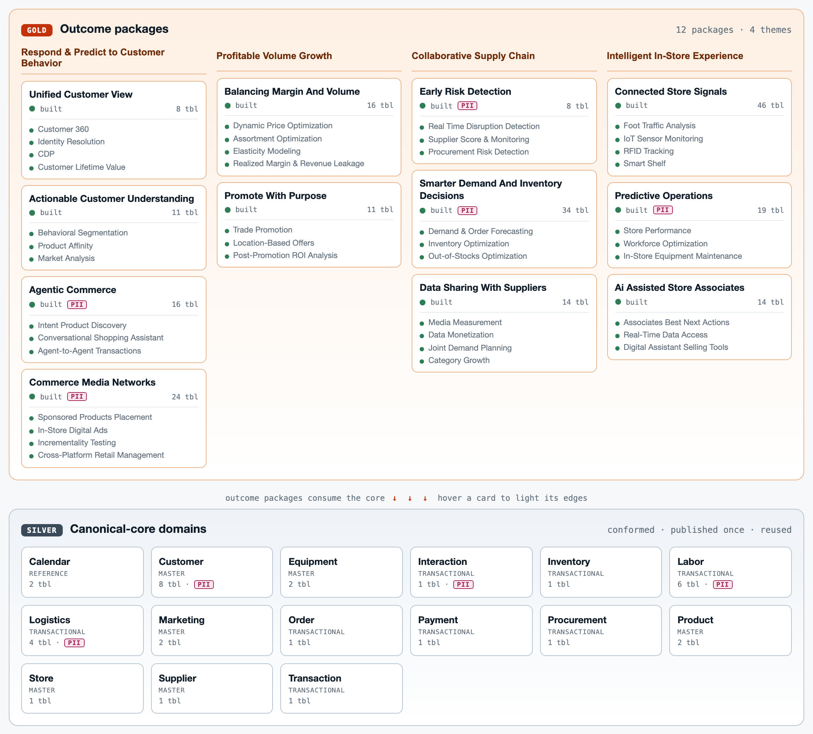
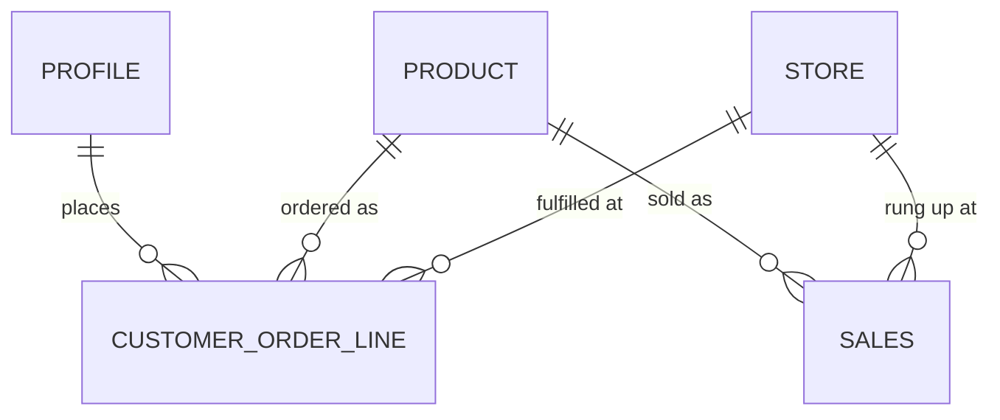

# Open Retail Data Model (ORDM)

<!-- STATUS-BADGE:START (generated by tools/gen_status.py; do not edit by hand) -->

<!-- STATUS-BADGE:END -->

The **Open Retail Data Model (ORDM)** is an open, Apache-2.0-licensed foundation of reusable retail data assets — canonical entities, semantic models, business glossary, and synthetic data — built together with retail partners, Databricks, and the broader retail community.

It gives retailers, partners, and solution builders a **shared, ready-to-use starting point** so analytics and AI solutions compose instead of being rebuilt from scratch for every project. Adopt it as-is, extend it, or adapt it to your own data landscape.

ORDM is the retail instance of the **Industry Data Model — Open Program (DIDM-OP)**.

## See the whole model, live

**[▶ Open the interactive Explorer](https://open-retail-data-model.github.io/model-explorer/)** — browse the whole model in your browser: outcome packages on top, the conformed core below, drill into columns, keys, and PII, and follow each outcome's lineage back to core. It is built straight from the DDL, so it never drifts ([source in `explorer/`](explorer/)).

## Quick start (30 seconds)

1. **Look** — [open the Explorer](https://open-retail-data-model.github.io/model-explorer/) and click any card to see its tables, keys, and PII.
2. **Read** — browse [`canonical-core/`](canonical-core/) for the shared entities and [`outcome-packages/`](outcome-packages/) for the outcome-aligned metrics.
3. **Run it** — populate the model in your own Databricks workspace with [`runtime/synthetic-data/`](runtime/synthetic-data/), no source data required (full steps under [Getting started](#getting-started)).

## Status at a glance

The **canonical core has landed**: the initial public release, 0.5, published every conformed domain (the badge above and the table below show the live count) and every **outcome package** on top of it. Live tracker: [`STATUS.md`](STATUS.md).

> **Legend:** ✅ Published · 🟢 Review complete · 🔵 Nearing complete · 🟡 In progress · ⚪ Planned — the ladder is defined in [`docs/definition-of-done.md`](docs/definition-of-done.md).

### Canonical core — 15 conformed domains

Compact by design (click a domain for its tables, glossary, and detail). Everyone who has shaped the model is credited together under [Contributors](#contributors); per-area ownership and review sign-off are tracked in [`REVIEWERS.md`](REVIEWERS.md).

<!-- STATUS-CORE:START (generated by tools/gen_status.py; do not edit by hand) -->

| Domain | Grain | Tables | Status |
|---|:---:|:---:|:---:|
| [Customer](canonical-core/customer/) | master | 8 | ✅ |
| [Product](canonical-core/product/) | master | 2 | ✅ |
| [Store](canonical-core/store/) | master | 1 | ✅ |
| [Order](canonical-core/order/) | transactional | 1 | ✅ |
| [Transaction](canonical-core/transaction/) | transactional | 1 | ✅ |
| [Payment](canonical-core/payment/) | transactional | 1 | ✅ |
| [Inventory](canonical-core/inventory/) | transactional | 1 | ✅ |
| [Supplier](canonical-core/supplier/) | master | 1 | ✅ |
| [Procurement](canonical-core/procurement/) | transactional | 1 | ✅ |
| [Marketing](canonical-core/marketing/) | master | 2 | ✅ |
| [Logistics](canonical-core/logistics/) | transactional | 4 | ✅ |
| [Equipment](canonical-core/equipment/) | master | 2 | ✅ |
| [Labor](canonical-core/labor/) | transactional | 6 | ✅ |
| [Calendar](canonical-core/calendar/) | reference | 2 | ✅ |
| [Interaction](canonical-core/interaction/) | transactional | 1 | ✅ |

<!-- STATUS-CORE:END -->

*(A one-line description of every domain is in the [What's inside](#whats-inside) table below and in each domain's README.)*

### Outcome packages — 12 outcomes across 4 retail themes

Each package bundles UC Metric Views, semantic metadata, and analytical views on the canonical core, aligned to one business outcome. (Grouping follows the [retail outcome map](docs/outcome-map.md); the working-group tracker breaks each package into finer capabilities.)

<!-- STATUS-OUTCOMES:START (generated by tools/gen_status.py; do not edit by hand) -->

_Two axes: **Status** = artifacts built and reviewed (from `STATUS.md`); **Use cases** = `done / all declared` business outcomes for the package (from its `use-cases.yaml`), naming the delivered ones, with an in-progress count where relevant; the remainder are planned or blocked. A package can be built without every use case done, and vice versa._

**Respond & Predict to Customer Behavior**

| Status | Package | Use cases |
|:---:|---|---|
| ✅ | [Unified Customer View](outcome-packages/unified-customer-view/) | 4/4 done: Customer 360, Identity Resolution, CDP, Customer Lifetime Value |
| ✅ | [Actionable Customer Understanding](outcome-packages/actionable-customer-understanding/) | 3/3 done: Behavioral Segmentation, Product Affinity, Market Analysis |
| ✅ | [Agentic Commerce](outcome-packages/agentic-commerce/) | 3/3 done: Intent Product Discovery, Conversational Shopping Assistant, Agent-to-Agent Transactions |
| ✅ | [Commerce Media Networks](outcome-packages/commerce-media-networks/) | 4/4 done: Sponsored Products Placement, In-Store Digital Ads, Incrementality Testing, Cross-Platform Retail Management |

**Profitable Volume Growth**

| Status | Package | Use cases |
|:---:|---|---|
| ✅ | [Balancing Margin and Volume](outcome-packages/balancing-margin-and-volume/) | 4/4 done: Dynamic Price Optimization, Assortment Optimization, Elasticity Modeling, Realized Margin & Revenue Leakage |
| ✅ | [Promote with Purpose](outcome-packages/promote-with-purpose/) | 3/3 done: Trade Promotion, Location-Based Offers, Post-Promotion ROI Analysis |

**Collaborative Supply Chain**

| Status | Package | Use cases |
|:---:|---|---|
| ✅ | [Early Risk Detection](outcome-packages/early-risk-detection/) — control tower + metric views | 3/3 done: Real Time Disruption Detection, Supplier Score & Monitoring, Procurement Risk Detection |
| ✅ | [Smarter Demand and Inventory Decisions](outcome-packages/smarter-demand-and-inventory-decisions/) | 3/3 done: Demand & Order Forecasting, Inventory Optimization, Out-of-Stocks Optimization |
| ✅ | [Data Sharing with Suppliers](outcome-packages/data-sharing-with-suppliers/) | 4/4 done: Media Measurement, Data Monetization, Joint Demand Planning, Category Growth |

**Intelligent In-Store Experience**

| Status | Package | Use cases |
|:---:|---|---|
| ✅ | [Connected Store Signals](outcome-packages/connected-store-signals/) | 4/4 done: Foot Traffic Analysis, IoT Sensor Monitoring, RFID Tracking, Smart Shelf |
| ✅ | [Predictive Operations](outcome-packages/predictive-operations/) — equipment + store risk + workforce | 3/3 done: Store Performance, Workforce Optimization, In-Store Equipment Maintenance |
| ✅ | [AI-Assisted Store Associates](outcome-packages/ai-assisted-store-associates/) | 3/3 done: Associates Best Next Actions, Real-Time Data Access, Digital Assistant Selling Tools |

<!-- STATUS-OUTCOMES:END -->

## What's inside

For a full tour of what each model contains, the generated formats, and how to consume it, see **[Anatomy of a model](docs/anatomy-of-a-model.md)**.

| Folder | What it is |
|---|---|
| [`canonical-core/`](canonical-core/) | The 15 conformed business domains above: the shared silver primitives every outcome builds on. |
| [`outcome-packages/`](outcome-packages/) | One package per retail business outcome (12 in the first wave), each bundling gold metric views, semantic metadata, and analytical views on top of the core. |
| [`contracts/`](contracts/) | Generated ODCS data contracts, one per domain and package. |
| [`runtime/`](runtime/) | What runs on Databricks: synthetic-data generators, the data-quality runner, and the deploy example and notebook. |
| [`explorer/`](explorer/) | Source for the interactive [Model Explorer](https://open-retail-data-model.github.io/model-explorer/) (built from the model, deployed to GitHub Pages). |
| [`docs/`](docs/) | The standard, the Definition of Done, architecture, ER diagrams, design specs, and the rest of the documentation. |
| [`governance/`](governance/) | Decisions (ADRs) and reviews. |
| [`standards/`](standards/) | The machine-readable rules registry that CI and the conformance matrix read. |
| [`tools/`](tools/), [`tests/`](tests/) | Generators for the derived artifacts, the release tool, and the test suite. |

## Architecture at a glance

<picture>
  <source media="(prefers-color-scheme: dark)" srcset="docs/diagrams/ordm-overview.dark.svg">
  
</picture>

You bring your own source data and ingestion; ORDM provides the conformed model and the outcome-aligned semantics on top. See [`docs/architecture.md`](docs/architecture.md).

Why conformed: the same shared entities (Profile, Product, Store) feed many facts, so every outcome joins them the same way instead of redefining them. A slice of the real relationships, with Product and Store reused across both the order and the sales facts (the full, always-current model is in the [Explorer](https://open-retail-data-model.github.io/model-explorer/) and the per-domain [ER diagrams](docs/er-diagrams.md)):

## Getting started

1. **Explore the model** — browse [`canonical-core/`](canonical-core/) for the core entities and [`outcome-packages/`](outcome-packages/) for outcome-aligned metrics. To see a package end to end, start with the 🟢 [Early Risk Detection](outcome-packages/early-risk-detection/) control tower.
2. **Try it with synthetic data** — use [`runtime/synthetic-data/`](runtime/synthetic-data/) to populate the model in your own Databricks workspace, no source data required.
3. **Deploy** — `databricks bundle deploy` then `databricks bundle run deploy_ordm` stands the whole model up in Unity Catalog (schemas → tables → relationships → gold views, then synthetic data, then data-quality). See [`runtime/examples/`](runtime/examples/) for the walkthrough.
4. **Adapt to your data** — map your existing sources to the canonical core, then build on the outcome packages.

## Adapting ORDM to your data

Most retailers don't start from a clean slate. The **Vibe Modeling Agent** is a companion open-source tool that helps adapt ORDM to your existing data landscape — your naming, your source systems, your custom entities — keeping what fits and customizing what doesn't. See [`docs/vibe-modeling-integration.md`](docs/vibe-modeling-integration.md).

## Documentation

- [Anatomy of a model](docs/anatomy-of-a-model.md) — what a model contains, the generated formats (and why), and how to consume it
- [Architecture](docs/architecture.md) — the layered model in detail
- [Data model standards and principles](docs/data-model-standards.md) — the rules ORDM follows (the single source of truth)
- [Definition of Done](docs/definition-of-done.md) — the 🟢/🔵/🟡/⚪ status ladder and what each tier requires
- [Retail outcome map](docs/outcome-map.md) — the 12 outcomes and the pillars above
- [ER diagrams](docs/er-diagrams.md) — how the diagrams are generated from the DDL, kept in sync, and rendered light/dark
- [Model explorer](https://open-retail-data-model.github.io/model-explorer/) (interactive, browser-based): navigate the canonical core and outcome packages, drill into columns/keys/PII, and follow use-case to core lineage. Built from the DDL; [source in `explorer/`](explorer/)
- [Testing and CI](docs/testing.md) — what the gates do and how to run them locally
- [AI skills](docs/ai-skills.md): the ORDM modeling skill for Claude Code, GitHub Copilot, OpenAI Codex and other tools that support Agent Skills, and how to plug it in
- [Adapting ORDM with the Vibe Modeling Agent](docs/vibe-modeling-integration.md)
- [Status](STATUS.md) · [Reviewers](REVIEWERS.md) · [Governance](GOVERNANCE.md) · [Contributing](CONTRIBUTING.md) · [Changelog](CHANGELOG.md) · [Contributors](#contributors) · [FAQ](docs/faq.md)

## Contributing

ORDM is built collaboratively and we welcome input from the retail community. Pick up an **unclaimed** domain or package (claim a row in [`STATUS.md`](STATUS.md)), open an **issue** to report a problem or suggest an improvement, or open a **pull request** to propose changes. See [`CONTRIBUTING.md`](CONTRIBUTING.md) for the workflow. Contributions are released under the project's Apache License 2.0 (inbound = outbound) — there is no separate CLA or DCO sign-off; we just ask that you only contribute work you have the right to share under Apache 2.0.

## Contributors

Thanks to everyone who has shaped ORDM. Credit is **repo-wide, not per domain**. The grid below is **generated** from the commit history, PR authors and `Co-authored-by` trailers of the working repository ORDM is published from. Tiles are ordered by files changed (generated artifacts excluded). Per-area ownership and review sign-off are tracked in [`REVIEWERS.md`](REVIEWERS.md).

<!-- CONTRIBUTORS:START (generated by tools/gen_contributors.py; do not edit by hand) -->

<!-- Ordered by files changed (generated files excluded), maintainer last;
     generated from the GitHub contributor graph, PR authors, commit history, and
     contributors list of the working repository. -->
<table>
  <tr>
    <td align="center"><a href="https://github.com/a0x8o"> <b>@a0x8o</b></a></td>
    <td align="center"><a href="https://github.com/saurabhshukla-db"> <b>@saurabhshukla-db</b></a></td>
    <td align="center"><a href="https://github.com/chloecheau-k"> <b>@chloecheau-k</b></a></td>
    <td align="center"><a href="https://github.com/sreekanthmunigati"> <b>@sreekanthmunigati</b></a></td>
    <td align="center"><a href="https://github.com/ojasvi-goyal-03"> <b>@ojasvi-goyal-03</b></a></td>
    <td align="center"><a href="https://github.com/bryanmoo92"> <b>@bryanmoo92</b></a></td>
  </tr>
  <tr>
    <td align="center"><a href="https://github.com/vibewisely"> <b>@vibewisely</b></a></td>
    <td align="center"><a href="https://github.com/jam-dbx"> <b>@jam-dbx</b></a></td>
    <td align="center"><a href="https://github.com/shubhamp051991"> <b>@shubhamp051991</b></a></td>
    <td align="center"><a href="https://github.com/PatrickLeahey"> <b>@PatrickLeahey</b></a></td>
    <td align="center"><a href="https://github.com/mjsturwold"> <b>@mjsturwold</b></a></td>
    <td align="center"><a href="https://github.com/adityajain03-png"> <b>@adityajain03-png</b></a></td>
  </tr>
  <tr>
    <td align="center"><a href="https://github.com/Tagar"> <b>@Tagar</b></a></td>
  </tr>
</table>

<!-- CONTRIBUTORS:END -->

## License

ORDM is released under the **Apache License 2.0** — chosen so partners and customers can freely adopt, extend, and build on the model. See [LICENSE.md](LICENSE.md).

## Acknowledgments

ORDM is built **partners first** — our retail solution partners and domain experts lead the way, with Databricks and the broader retail community building alongside them. Independently authored; not a redistribution of any third-party proprietary data model. See [NOTICE.md](NOTICE.md).
