# Canonical Core — Calendar

> Status: 🟢 Review complete (0.5)

The conformed **Calendar** domain — the shared fiscal calendar and FX-rate reference dimensions. Part of the ORDM [canonical core](../README.md).

## Contents

This is a **data domain** (→ a Unity Catalog schema). One file per table keeps parallel work conflict-free.

| Path | Purpose |
|---|---|
| `tables/fiscal_calendar.sql` | NRF 4-5-4 retail calendar — one row per date, with fiscal year / period / week |
| `tables/fx_rate.sql` | FX-rate reference for converting transaction currencies to the reporting/base currency |
| `relationships.sql` | Enum / bounded-range CHECK constraints (no FKs — these are parent dimensions) |
| `checks.sql` | Data-quality assertions for this domain (run by `runtime/data-quality/run_checks.py`) |
| `glossary.md` | Business terms for this domain |

Sample rows are produced by the synthetic-data generator on deploy (the samples MUST is satisfied by the generator), so this domain ships no committed `samples/` directory.

## Design notes

`fiscal_calendar` is the conformed date dimension every fact joins to on `date_key` for retail-week logic (NRF 4-5-4). `fx_rate` is the single conversion reference behind the single-reporting-currency invariant (#9a): `to_base(amount) = amount * rate`, with `rate` carried at `DECIMAL(18,8)`. Business dates are `DATE` (local calendar), timestamps are UTC (#9b). Both tables carry the standard surrogate `_sk` plus a durable STRING `_id` business key (`date_id` = the ISO date; `fx_rate_id` = `date|from|to`), with `date_key` the natural `DATE` every fact joins on. `fiscal_calendar`'s keys are deliberately **date-stemmed** (`date_sk` / `date_id` / `date_key`): dimensional-modeling convention names a date dimension's key for its *grain* (a date), not the physical table — e.g. TPC-DS `d_date_sk` + `d_date`, Kimball's `date_key` — so a table-matching `fiscal_calendar_sk` would be the non-idiomatic outlier. The PK constraint stays `pk_fiscal_calendar` (named for the table); `date_id` is 1:1 with `date_key` and satisfies the uniform `_sk`+`_id` contract. Being `reference` tables, both also carry the §8 audit block (`created_timestamp`, `source_updated_timestamp`, `record_source`, `load_timestamp`). `relationships.sql` declares **no foreign keys** — these are parent reference dimensions that facts join *to* on `date_key` (a logical, non-PK join key); it carries only the domain's enum / bounded-range CHECK constraints (engine-enforced NRF-4-5-4 ranges, day-name domain, positive FX rate, ISO-4217 currency length). Follows the ORDM [data model principles](../../docs/data-model-standards.md).

## Entity relationships

<!-- ORDM:ERD:START -->
<picture>
  <source media="(prefers-color-scheme: dark)" srcset="diagrams/calendar.dark.svg">
  
</picture>

Generated from the DDL · <a href="diagrams/calendar.light.svg">full SVG</a> · Mermaid <a href="diagrams/calendar.light.mmd">light</a>/<a href="diagrams/calendar.dark.mmd">dark</a> · <a href="diagrams/calendar.dbml">DBML</a>
<!-- ORDM:ERD:END -->

