# Canonical Core — Customer

> Status: 🟢 Review complete (0.5)

The conformed **Customer** domain. Part of the ORDM [canonical core](../README.md).

## Tables

| Table | Type | Description |
|---|---|---|
| [`profile`](tables/profile.sql) | Master (SCD2) | Conformed individual-customer master — identity, locale, retail identifiers, lifecycle. Shared by every outcome package. |
| [`address`](tables/address.sql) | Master (SCD2) | Postal addresses (billing, shipping, home, work). |
| [`contact`](tables/contact.sql) | Master (current state) | Reachable contact points — email / phone. Type+value model. |
| [`consent`](tables/consent.sql) | Master (SCD2) | Single source of truth for opt-ins, processing permissions, and do-not-contact suppression. Scoped by consent type and jurisdiction. |
| [`account`](tables/account.sql) | Master (SCD2) | Optional B2B organization account a customer transacts on behalf of. |
| [`household`](tables/household.sql) | Master (SCD2) | Conformed household — a grouping of related individuals. |
| [`identity_link`](tables/identity_link.sql) | Association (SCD2) | Resolved-identity primitive: a pseudonymized identifier resolved to a profile, with match method and confidence. |
| [`channel_preference`](tables/channel_preference.sql) | Master (SCD2) | Soft communication preferences (frequency, format, topic subscription, preferred channel) — distinct from consent. |

## Related files

| Path | Purpose |
|---|---|
| `relationships.sql` | Cross-table foreign keys for this domain |
| `checks.sql` | Data-quality assertions for this domain (run by `runtime/data-quality/run_checks.py`) |
| `masks.sql` | Unity Catalog column masks enforcing the `dbx_pii_*` tags (PII masked except for the `pii_readers` group) |
| `glossary.md` | Business terms for this domain |

## Design notes

Follows the ORDM [data model principles](../../docs/data-model-standards.md): vendor-neutral comments, strict typing, no derived metrics on master tables, thin cross-entity FKs, SCD where applicable.

## Entity relationships

<!-- ORDM:ERD:START -->
<picture>
  <source media="(prefers-color-scheme: dark)" srcset="diagrams/customer.dark.svg">
  
</picture>

Generated from the DDL · <a href="diagrams/customer.light.svg">full SVG</a> · Mermaid <a href="diagrams/customer.light.mmd">light</a>/<a href="diagrams/customer.dark.mmd">dark</a> · <a href="diagrams/customer.dbml">DBML</a>
<!-- ORDM:ERD:END -->

