# Canonical Core — Equipment

> Status: 🟢 Review complete (0.5)

## Overview

The equipment domain provides the in-store asset and telemetry spine for the ORDM canonical core. It models physical equipment installed in retail stores — refrigeration units, HVAC systems, POS terminals, self-checkout kiosks, ovens, and other assets that require maintenance, monitoring, and impact product availability when they fail.

## Tables

| Table | Type | Description |
|---|---|---|
| [`equipment`](tables/equipment.sql) | Master (SCD2) | In-store equipment asset with type, criticality, status, and location. |
| [`equipment_reading`](tables/equipment_reading.sql) | Transactional | Append-only sensor telemetry: temperature, power, vibration, error codes. |

## Relationships

- `equipment` → `store` (canonical-core/store) via installation location
- `equipment_reading` → `equipment` (this domain)

## Design notes

Follows the ORDM [data model standards](../../docs/data-model-standards.md). The `equipment` table is an SCD2 dimension capturing the full lifecycle of store assets — from installation through decommission. Equipment readings are append-only, streaming-ready with `event_timestamp`, `ingest_timestamp`, and `latency_seconds` for freshness monitoring, following the same pattern as `shipment_tracking` in the logistics domain.

The `criticality` column drives prioritization in the outcome package: a failing critical refrigeration unit (risk of spoilage) is escalated ahead of a degraded lighting fixture. The `equipment_status` column reflects the current operational state and is updated via SCD2 versioning when the status changes.

## Entity relationships

<!-- ORDM:ERD:START -->
<picture>
  <source media="(prefers-color-scheme: dark)" srcset="diagrams/equipment.dark.svg">
  
</picture>

Generated from the DDL · <a href="diagrams/equipment.light.svg">full SVG</a> · Mermaid <a href="diagrams/equipment.light.mmd">light</a>/<a href="diagrams/equipment.dark.mmd">dark</a> · <a href="diagrams/equipment.dbml">DBML</a>
<!-- ORDM:ERD:END -->

