# Canonical Core — Interaction

> Status: 🟢 Review complete (0.5)

## Overview

The interaction domain provides the conformed **omnichannel customer-interaction spine** for the ORDM canonical core: one append-only fact recording every observed direct customer touch, **online and offline**, across the whole shopper journey. It is the time-series *event* class of the two-class CDP shape (an interaction stream kept separate from the stateful customer profile), and the single conformed source of truth for the raw *occurrence* of a customer touch that multiple outcomes consume — behavioral segmentation (ACU), activation/segmentation (UCV), paid attribution (commerce-media-networks), and agentic commerce.

Before this domain, ORDM modeled interactions only in fragments: paid ad exposures (`media_event`), owned CRM sends (`campaign_touch`), and paid-attributed conversions (`conversion_event`) — but no conformed, person-level, un-scoped interaction fact. That gap is the one behavioral entity every major CDP models as a first-class class; this domain fills it.

## Tables

| Table | Type | Description |
|---|---|---|
| [`touchpoint`](tables/touchpoint.sql) | Transactional | Append-only omnichannel interaction fact: one row per customer touch (digital page/product/search/cart/checkout/app + offline store-visit/call-center/kiosk/offline-marketing/phone), anonymous-first on a hashed device key, stitched to `profile` via `identity_link`. Streaming-ready. |

## Relationships

- `touchpoint` → `customer.profile` (as-of) and `customer.identity_link` — the anonymous→known stitch
- `touchpoint` → `product.product` (as-of) / `store.store` — interaction context
- `touchpoint.event_date` → `calendar.fiscal_calendar.date_key` (natural date key)

Nothing in the canonical core references `touchpoint` (facts FK into dims, never the reverse), so LAYER-INTEGRITY is preserved and the core still stands alone.

## Design notes

Follows the ORDM [data model standards](../../docs/data-model-standards.md). `touchpoint` is an append-only fact (no SCD2), streaming-ready with `event_timestamp` / `ingest_timestamp` / `latency_seconds` (the same block as `equipment_reading`). Online and offline touches share one fact, discriminated by `interaction_type` + `channel_code` (the medium) with a paired `source_application` degenerate attribute (the specific app/property/data-stream — the CDP channel+source pairing) and nullable role columns — the established ORDM pattern for heterogeneous events (`media_event` unions impression/click/video; `campaign_touch` unions web/call_center/in_store). Anonymous-first: digital rows carry `device_id_hash` (pseudonymized, tagged `dbx_pii_identifier`) and resolve to a profile via `identity_link` when known; offline rows are identity-first. Consent posture is carried per touch as a point-in-time `granted/denied/unknown` snapshot (governance evidence), deliberately **not** the `customer.consent` SCD2 lifecycle domain.

**Scope boundary.** `touchpoint` holds only *person-level* (pseudonymous) direct touches. Anonymous *aggregate* physical footfall (store-zone traffic counts, dwell) is a different grain and stays in the connected-store package (`store_zone_interval`), not here.

**Single source of truth.** `touchpoint` owns the raw occurrence of a customer touch; commerce-media-networks `conversion_event` is a paid-attribution *measurement* projection of the conversion-relevant subset (clean-room-keyed, experiment-scoped), not a second recorder of the occurrence. See [ADR 0029](../../governance/decisions/0029-conformed-interaction-touchpoint-fact.md).

## Entity relationships

<!-- ORDM:ERD:START -->
<picture>
  <source media="(prefers-color-scheme: dark)" srcset="diagrams/interaction.dark.svg">
  
</picture>

Generated from the DDL · <a href="diagrams/interaction.light.svg">full SVG</a> · Mermaid <a href="diagrams/interaction.light.mmd">light</a>/<a href="diagrams/interaction.dark.mmd">dark</a> · <a href="diagrams/interaction.dbml">DBML</a>
<!-- ORDM:ERD:END -->
