# Canonical Core — Inventory

> Status: ✅ Published (0.5)

The conformed **Inventory** domain. Part of the ORDM [canonical core](../README.md).

## Tables

| Table | Type | Description |
|---|---|---|
| [`inventory_position`](tables/inventory_position.sql) | Transactional (daily snapshot) | Daily snapshot of inventory at store × product grain: on-hand, in-transit, on-order, and stockout events. Scoped to `date_key`. |

## Related files

| Path | Purpose |
|---|---|
| `relationships.sql` | Cross-table foreign keys for this domain |
| `checks.sql` | Data quality checks for this domain |
| `glossary.md` | Business terms for this domain |

## Design notes

Follows the ORDM [data model principles](../../docs/data-model-standards.md): vendor-neutral comments, strict typing, no derived metrics on master tables, thin cross-entity FKs, SCD where applicable.

## Entity relationships

<!-- ORDM:ERD:START -->
<picture>
  <source media="(prefers-color-scheme: dark)" srcset="diagrams/inventory.dark.svg">
  
</picture>

Generated from the DDL · <a href="diagrams/inventory.light.svg">full SVG</a> · Mermaid <a href="diagrams/inventory.light.mmd">light</a>/<a href="diagrams/inventory.dark.mmd">dark</a> · <a href="diagrams/inventory.dbml">DBML</a>
<!-- ORDM:ERD:END -->

