# Canonical Core — Labor

> Status: 🟢 Review complete (0.5)

## Overview

The labor domain is the conformed workforce spine for ORDM: pseudonymous associates, skills, availability, multi-store eligibility, planned shifts, and worked actuals. It unlocks **Predictive Operations → Workforce Optimization** and is reused by the planned **AI-Assisted Store Associates** package ([ADR 0043](../../governance/decisions/0043-labor-domain-workforce-optimization.md)).

No personal names, contact details, or dates of birth are stored — only durable IDs and attributes required for labor analytics and scheduling.

## Tables

| Table | Type | Description |
|---|---|---|
| [`employee`](tables/employee.sql) | Master (SCD2) | Pseudonymous associate with role, status, cost, and hour/rest constraints. |
| [`employee_skill`](tables/employee_skill.sql) | Transactional bridge | Skill / qualification eligibility. |
| [`employee_availability`](tables/employee_availability.sql) | Transactional | Availability and time-off windows. |
| [`employee_store_eligibility`](tables/employee_store_eligibility.sql) | Transactional bridge | Optional multi-store eligibility. |
| [`labor_schedule`](tables/labor_schedule.sql) | Transactional | Planned shifts. |
| [`labor_actuals`](tables/labor_actuals.sql) | Transactional | Worked / timecard intervals. |

## Relationships

- `employee` → `store` (home store)
- `employee_skill` / `employee_availability` / `employee_store_eligibility` / `labor_schedule` / `labor_actuals` → `employee`
- `employee_store_eligibility` / `labor_schedule` / `labor_actuals` → `store`
- `labor_actuals` → `labor_schedule` (optional)

## Design notes

Follows the ORDM [data model standards](../../docs/data-model-standards.md). Hourly cost is unit-grain `DECIMAL(18,4)` in a single reporting currency. Shift and availability timestamps are UTC; store-local civil time is an adopter concern. Labor-law limits are configuration fields on `employee` / outcome `labor_standard` — ORDM does not claim jurisdictional compliance.

## Entity relationships

<!-- ORDM:ERD:START -->
<picture>
  <source media="(prefers-color-scheme: dark)" srcset="diagrams/labor.dark.svg">
  
</picture>

Generated from the DDL · <a href="diagrams/labor.light.svg">full SVG</a> · Mermaid <a href="diagrams/labor.light.mmd">light</a>/<a href="diagrams/labor.dark.mmd">dark</a> · <a href="diagrams/labor.dbml">DBML</a>
<!-- ORDM:ERD:END -->
