# Canonical Core — Logistics

> Status: 🟢 Review complete (0.5)

## Overview

The logistics domain provides the transport and shipment spine for the ORDM canonical core. It models the physical movement of goods from origin to destination, supporting supply-chain visibility, disruption detection, and inventory planning.

## Tables

| Table | Type | Description |
|---|---|---|
| [`lane`](tables/lane.sql) | Master (SCD2) | Directed origin-to-destination route (supplier site, DC, port, store). |
| [`shipment`](tables/shipment.sql) | Transactional | Shipment / ASN header linking a PO to a lane, carrier, and destination. |
| [`shipment_line`](tables/shipment_line.sql) | Transactional | Item-level detail within a shipment (shipped, received, damaged quantities). |
| [`shipment_tracking`](tables/shipment_tracking.sql) | Transactional | Append-only carrier tracking messages: scans, GPS pings, customs events, delivery confirmations. |

## Relationships

- `shipment` → `supplier` (canonical-core/supplier)
- `shipment` → `lane` (this domain)
- `shipment` → `store` (canonical-core/store) via destination
- `shipment_line` → `shipment` (this domain)
- `shipment_line` → `product` (canonical-core/product)
- `shipment_tracking` → `shipment` (this domain)

## Design notes

Follows the ORDM [data model standards](../../docs/data-model-standards.md). The shipment header carries both `estimated_arrival_date` (ETA at load time) and `original_eta_date` (baseline at dispatch) to support ETA-slip measurement. Real-time ETA revisions are tracked via `shipment_tracking.carrier_eta_date` rather than mutating the shipment header; `gold_shipment_current_state` derives current ETA from the tracking feed. The `lane` dimension captures planned transit times for benchmarking.

The `shipment_tracking` table is the canonical source of raw carrier tracking messages — high-volume, append-only, streaming-ready with `event_timestamp`, `ingest_timestamp`, and `latency_seconds`. It captures every checkpoint a carrier emits (pickup, hub scans, in-transit GPS pings, customs events, delivery confirmations) with full location detail. Outcome packages (e.g. early-risk-detection's `gold_shipment_current_state`) derive current shipment state directly from this raw feed.

## Entity relationships

<!-- ORDM:ERD:START -->
<picture>
  <source media="(prefers-color-scheme: dark)" srcset="diagrams/logistics.dark.svg">
  
</picture>

Generated from the DDL · <a href="diagrams/logistics.light.svg">full SVG</a> · Mermaid <a href="diagrams/logistics.light.mmd">light</a>/<a href="diagrams/logistics.dark.mmd">dark</a> · <a href="diagrams/logistics.dbml">DBML</a>
<!-- ORDM:ERD:END -->

