# Canonical Core — Marketing

> Status: ✅ Published (0.5)

The conformed **Marketing** domain. Part of the ORDM [canonical core](../README.md). It holds the conformed **promotion** dimension (a dimension of the POS `sales` fact — Kimball's Date · Product · Store · Promotion), consumed by the Promote with Purpose (trade promotion) outcome.

> **Scope (ADR 0021, amended by ADR 0022):** the retail-media *ad-delivery* dimensions (campaign, ad group, creative, placement, advertiser, `delivery_channel` [the former `device`]) are single-outcome and live in the gold [`commerce-media-networks`](../../outcome-packages/commerce-media-networks/) package. `marketing` holds the conformed **promotion** dimension (a dimension of the POS `sales` fact) **and the conformed `audience` / segment-definition dimension** (ADR 0022 — promoted from CMN gold once behavioral segmentation became a second consumer; shared by retail media and customer-intelligence segmentation, one source of truth for a segment). Trade promotion and retail media stay separate processes and reference these dimensions rather than redefining them.

## Contents

This is a **data domain** (→ a Unity Catalog schema). One file per table keeps parallel work conflict-free.

| Path                   | Purpose                                                         |
| ---------------------- | --------------------------------------------------------------- |
| `tables/promotion.sql` | SCD2 trade-promotion dimension, incl. the reserved `NO_PROMO` member |
| `tables/audience.sql` | SCD2 audience / segment-definition dimension (ADR 0022) |
| `relationships.sql`  | Constraints / foreign keys for this domain                      |
| `checks.sql`         | Data-quality checks                                             |
| `glossary.md`        | Business terms for this domain                                  |

## Design notes

Follows the ORDM [data model principles](../../docs/data-model-standards.md): vendor-neutral comments, strict typing, no derived metrics on master tables, thin cross-entity FKs, SCD where applicable. Promotion **performance** metrics (ROI, lift, baseline) live in the Promote with Purpose outcome package, which consumes this dimension.

Ships `tables/promotion.sql` (SCD2 trade-promotion dimension, incl. the reserved `NO_PROMO` member), `tables/audience.sql` (SCD2 audience / segment-definition dimension, shared by retail media and behavioral segmentation; ADR 0022), plus `relationships.sql`, `checks.sql` and `glossary.md`.

## Entity relationships

<!-- ORDM:ERD:START -->
<picture>
  <source media="(prefers-color-scheme: dark)" srcset="diagrams/marketing.dark.svg">
  
</picture>

Generated from the DDL · <a href="diagrams/marketing.light.svg">full SVG</a> · Mermaid <a href="diagrams/marketing.light.mmd">light</a>/<a href="diagrams/marketing.dark.mmd">dark</a> · <a href="diagrams/marketing.dbml">DBML</a>
<!-- ORDM:ERD:END -->
