# Canonical Core — Order

> Status: 🟢 Review complete (0.5)

The conformed **Order** domain. Part of the ORDM [canonical core](../README.md).

## Contents

This is a **data domain** (→ a Unity Catalog schema). One file per table keeps parallel work conflict-free.

| Path | Purpose |
|---|---|
| `tables/customer_order_line.sql` | Customer-attributed purchase fact at customer × order × product (line) grain |
| `relationships.sql` | FKs to profile/product/store + logical relationship to fiscal_calendar (date_key join) |
| `glossary.md` | Business terms for this domain |

## Design notes

`customer_order_line` is the customer-attributed purchase fact (unlike the anonymous POS `sales` fact), keyed at customer × order × product (line) grain. Amounts are in the reporting/base currency (#9a); margin derives from `product.unit_cost`. FKs point to `profile`, `product`, and `store`; a logical relationship joins `order_date` to `fiscal_calendar` for retail-week logic. Follows the ORDM [data model principles](../../docs/data-model-standards.md): vendor-neutral comments, strict typing, no derived metrics on master tables, thin cross-entity FKs, SCD where applicable.

## Entity relationships

<!-- ORDM:ERD:START -->
<picture>
  <source media="(prefers-color-scheme: dark)" srcset="diagrams/order.dark.svg">
  
</picture>

Generated from the DDL · <a href="diagrams/order.light.svg">full SVG</a> · Mermaid <a href="diagrams/order.light.mmd">light</a>/<a href="diagrams/order.dark.mmd">dark</a> · <a href="diagrams/order.dbml">DBML</a>
<!-- ORDM:ERD:END -->

