# Canonical Core — Payment

> Status: 🟢 Review complete (0.5)

The conformed **Payment** domain. Part of the ORDM [canonical core](../README.md).

## Contents

This is a **data domain** (→ a Unity Catalog schema). One file per table keeps parallel work conflict-free.

| Path | Purpose |
|---|---|
| `tables/payment.sql` | Transaction-grain payment-event fact (sale / refund / adjustment / chargeback) |
| `relationships.sql` | Informational FK to customer + enforced CHECK constraints (payment_type, payment_method, payment_status, amount ≥ 0) |
| `checks.sql` | Data-quality assertions for this domain (run by `runtime/data-quality/run_checks.py`) |
| `glossary.md` | Business terms for this domain |

## Consumers

| Target | Grain | Basis | Purpose |
|---|---|---|---|
| `gold_payment_actuals` | Product x store x payment-event day | Event-date (cash) | Payment lifecycle deduplicated to latest per payment_id for revenue realization |
| `gold_realized_margin` | Product x store x day | Sale-cohort (order date for orders; transaction date for POS) | Net revenue and margin after refunds, chargebacks, adjustments |
| `mv_payment_actuals` | Metric view | Event-date | Event-date leakage rates (refund/chargeback/adjustment as cash basis) |
| `mv_realized_margin` | Metric view | Sale-cohort | Margin and leakage rates by product, store, fiscal period |

## Design notes

`payment` is an append-only event fact (no SCD2): one row per payment event, keyed to the order (`order_id`) and the customer (`profile`). It carries its own `event_timestamp` (event-time, UTC) distinct from `load_timestamp` (processing-time). Amounts are normalized to the reporting/base currency (principle #9a); direction is carried by `payment_type` (sale/refund/adjustment/chargeback), not the sign. Enforced CHECK constraints validate `payment_method` (card/cash/wallet/bank_transfer/gift_card/voucher, nullable), `payment_status` (authorized/captured/settled/declined/refunded/voided, nullable), and amount ≥ 0. Follows the ORDM [data model principles](../../docs/data-model-standards.md).

## Scope boundaries

The payment contract models the financial settlement lifecycle of customer orders and does NOT include:

- **Payment processing fees:** No fee_amount, interchange_fee, or method_fee columns. These require external acquirer/platform data sources.
- **Reason codes:** No refund_reason, chargeback_reason, or adjustment_reason columns. Root-cause analytics (fraud vs. quality vs. customer request) are out of scope for now.
- **Dispute tracking:** No dispute_id, dispute_status, or dispute_resolution columns. The contract treats each payment event (refund, chargeback, adjustment) as a separate append-only row.

These boundaries mean that leakage KPIs (refund_rate, chargeback_rate, adjustment_rate) measure net payment activity, not fee impact or root-cause attribution. For fine-grained financial reconciliation (fees, disputes), integrate external acquirer data as a separate pipeline.

## Entity relationships

<!-- ORDM:ERD:START -->
<picture>
  <source media="(prefers-color-scheme: dark)" srcset="diagrams/payment.dark.svg">
  
</picture>

Generated from the DDL · <a href="diagrams/payment.light.svg">full SVG</a> · Mermaid <a href="diagrams/payment.light.mmd">light</a>/<a href="diagrams/payment.dark.mmd">dark</a> · <a href="diagrams/payment.dbml">DBML</a>
<!-- ORDM:ERD:END -->

