# Canonical Core — Procurement

> Status: ✅ Published (0.5)

The conformed **Procurement** domain (purchase orders). Part of the ORDM [canonical core](../README.md).

## Contents

This is a **data domain** (→ a Unity Catalog schema). One file per table keeps parallel work conflict-free.

| Path | Purpose |
|---|---|
| `tables/purchase_order_line.sql` | Purchase-order-line fact (ordered/received/defective/returned quantities and pricing) |
| `relationships.sql` | FKs to supplier/product/store + enforced CHECK constraints (quantities ≥ 0, received_qty ≤ ordered_qty, order_status domain) |
| `checks.sql` | Data-quality assertions for this domain (run by `runtime/data-quality/run_checks.py`) |
| `glossary.md` | Business terms for this domain |

## Design notes

`purchase_order_line` is the line-grain procurement fact at PO × line grain: unit-grain money (`unit_price`, `contract_price`) is `DECIMAL(18,4)` (principle #9d), amounts are in the reporting/base currency (#9a). Enforced CHECK constraints: `chk_pol_quantities` keeps `ordered_qty`, `received_qty` and `defective_qty` ≥ 0 and `received_qty` ≤ `ordered_qty` (no over-delivery); `chk_pol_order_status` keeps `order_status` in {open, received, closed, cancelled}. `returned_qty` ≥ 0 is a post-hoc data-quality check (`checks.sql`), not an engine CHECK. FKs point *into* the `supplier`, `product`, and `store` masters. Follows the ORDM [data model principles](../../docs/data-model-standards.md).

## Entity relationships

<!-- ORDM:ERD:START -->
<picture>
  <source media="(prefers-color-scheme: dark)" srcset="diagrams/procurement.dark.svg">
  
</picture>

Generated from the DDL · <a href="diagrams/procurement.light.svg">full SVG</a> · Mermaid <a href="diagrams/procurement.light.mmd">light</a>/<a href="diagrams/procurement.dark.mmd">dark</a> · <a href="diagrams/procurement.dbml">DBML</a>
<!-- ORDM:ERD:END -->

