# Canonical Core — Product

> Status: 🟢 Review complete (0.5)

The conformed **Product** domain. Part of the ORDM [canonical core](../README.md).

## Contents

This is a **data domain** (→ a Unity Catalog schema). One file per table keeps parallel work conflict-free.

| Path | Purpose |
|---|---|
| `tables/product.sql` | SCD2 product master (sellable SKU/GTIN, versioned) |
| `tables/product_price.sql` | Temporal price history (one date-grained version per product × price type) |
| `relationships.sql` | Cross-table FK (product_price → product) + enum/state CHECK constraints |
| `glossary.md` | Business terms for this domain |

## Design notes

`product` is an SCD2 master with enforced CHECK constraints on `product_status` (active/inactive/discontinued) and `unit_of_measure` (each/kg/g/l/ml/pack). `product_price` is the temporal system of record for prices; the product table carries current list/cost snapshots for cheap joins. Together they enforce CHECK on `price_type` (list/cost/promotional/contract) and amount ≥ 0. No derived metrics (sales, margin) live here — those are computed in outcome-package views. Follows the ORDM [data model principles](../../docs/data-model-standards.md): vendor-neutral comments, strict typing, no derived metrics on master tables, thin cross-entity FKs, SCD where applicable.

## Entity relationships

<!-- ORDM:ERD:START -->
<picture>
  <source media="(prefers-color-scheme: dark)" srcset="diagrams/product.dark.svg">
  
</picture>

Generated from the DDL · <a href="diagrams/product.light.svg">full SVG</a> · Mermaid <a href="diagrams/product.light.mmd">light</a>/<a href="diagrams/product.dark.mmd">dark</a> · <a href="diagrams/product.dbml">DBML</a>
<!-- ORDM:ERD:END -->

