# Canonical Core — Store

> Status: ✅ Published (0.5)

The conformed **Store** domain. Part of the ORDM [canonical core](../README.md).

## Contents

This is a **data domain** (→ a Unity Catalog schema). One file per table keeps parallel work conflict-free.

| Path | Purpose |
|---|---|
| `tables/store.sql` | SCD2 store/location master (selling locations, versioned) |
| `relationships.sql` | Enum/state CHECK constraints (store_format, store_status) |
| `glossary.md` | Business terms for this domain |

## Design notes

`store` is an SCD2 master with enforced CHECK constraints on `store_format` (hypermarket/supermarket/convenience/drugstore/online) and `store_status` (active/inactive/closed). GS1 GLN retained as the location business key. Follows the ORDM [data model principles](../../docs/data-model-standards.md): vendor-neutral comments, strict typing, no derived metrics on master tables, thin cross-entity FKs, SCD where applicable.

## Entity relationships

<!-- ORDM:ERD:START -->
<picture>
  <source media="(prefers-color-scheme: dark)" srcset="diagrams/store.dark.svg">
  
</picture>

Generated from the DDL · <a href="diagrams/store.light.svg">full SVG</a> · Mermaid <a href="diagrams/store.light.mmd">light</a>/<a href="diagrams/store.dark.mmd">dark</a> · <a href="diagrams/store.dbml">DBML</a>
<!-- ORDM:ERD:END -->

