# Canonical Core — Supplier

> Status: 🟢 Review complete (0.5)

The conformed **Supplier** domain. Part of the ORDM [canonical core](../README.md).

## Contents

This is a **data domain** (→ a Unity Catalog schema). One file per table keeps parallel work conflict-free.

| Path | Purpose |
|---|---|
| `tables/supplier.sql` | SCD2 supplier/vendor master (trading-partner entity products are sourced from, versioned) |
| `relationships.sql` | Enforced CHECK constraints (supplier_type ∈ {manufacturer, distributor, wholesaler, importer, broker}, supplier_status ∈ {active, inactive, suspended}) |
| `checks.sql` | Data-quality assertions for this domain (run by `runtime/data-quality/run_checks.py`) |
| `glossary.md` | Business terms for this domain |

## Design notes

`supplier` is an SCD2 master (date-grained `effective_from_date` / `effective_to_date` / `is_current`) with the standard audit block and enforced CHECK constraints on `supplier_type` (manufacturer/distributor/wholesaler/importer/broker) and `supplier_status` (active/inactive/suspended). It is a thin root entity like `customer` — procurement and supply-chain facts (e.g. `procurement.purchase_order_line`) FK *into* it. GS1 GLN retained as the location/party business key. No performance metrics live here (those are computed in outcome-package scorecard views). Follows the ORDM [data model principles](../../docs/data-model-standards.md): vendor-neutral comments, strict typing, no derived metrics on master tables, thin cross-entity FKs, SCD where applicable.

## Entity relationships

<!-- ORDM:ERD:START -->
<picture>
  <source media="(prefers-color-scheme: dark)" srcset="diagrams/supplier.dark.svg">
  
</picture>

Generated from the DDL · <a href="diagrams/supplier.light.svg">full SVG</a> · Mermaid <a href="diagrams/supplier.light.mmd">light</a>/<a href="diagrams/supplier.dark.mmd">dark</a> · <a href="diagrams/supplier.dbml">DBML</a>
<!-- ORDM:ERD:END -->

