# Canonical Core — Transaction

> Status: ✅ Published (0.5)

The conformed **Transaction** domain. Part of the ORDM [canonical core](../README.md).

## Contents

This is a **data domain** (→ a Unity Catalog schema). One file per table keeps parallel work conflict-free.

| Path | Purpose |
|---|---|
| `tables/sales.sql` | Conformed POS sales fact (product × store × day grain) |
| `relationships.sql` | FKs to product/store/promotion + CHECK constraint for non-negative measures |
| `glossary.md` | Business terms for this domain |

## Design notes

`sales` is an append-only POS fact at product × store × day grain with an enforced CHECK constraint (`chk_sales_nonnegative`) ensuring units, gross_revenue, and net_revenue are all ≥ 0. Every sale references a `promotion` surrogate (reserved `NO_PROMO` member for non-promoted sales). FKs point to `product`, `store`, and `promotion`; a logical (non-FK) relationship joins `date_key` to `fiscal_calendar` for retail-week rollups. Follows the ORDM [data model principles](../../docs/data-model-standards.md): vendor-neutral comments, strict typing, no derived metrics on master tables, thin cross-entity FKs, SCD where applicable.

## Entity relationships

<!-- ORDM:ERD:START -->
<picture>
  <source media="(prefers-color-scheme: dark)" srcset="diagrams/transaction.dark.svg">
  
</picture>

Generated from the DDL · <a href="diagrams/transaction.light.svg">full SVG</a> · Mermaid <a href="diagrams/transaction.light.mmd">light</a>/<a href="diagrams/transaction.dark.mmd">dark</a> · <a href="diagrams/transaction.dbml">DBML</a>
<!-- ORDM:ERD:END -->

