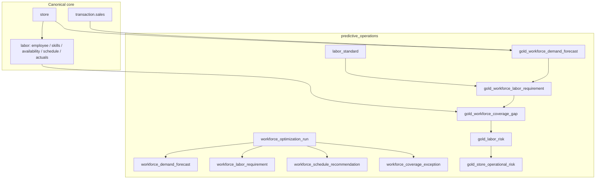

# Predictive Operations — Workforce Optimization

> Status: done (ADR 0043) · Package schema: `predictive_operations`

## Problem

Store operations need to turn historical and near-real-time demand signals into
**forecasted staffing demand**, **required labor hours**, and **feasible schedule
recommendations** that respect availability, skills, hour caps, and minimum rest
— without silently dropping uncovered demand.

## Use cases

- Forecast staffing demand by store × date × interval × zone × role.
- Translate demand drivers into labor hours via versioned `labor_standard` rules.
- Recommend shifts under hard constraints; emit coverage exceptions when infeasible.
- Feed the Store Operational Risk Score `labor_risk` sub-score.

## Architecture

## Data grain

Default: `store_id × business_date × interval_start × department_or_zone × role_code`

- Default `interval_minutes = 30` (from current `labor_standard`, else 30).
- Default forecast horizon = **7 days**.
- Timestamps are **UTC**; store-local civil time is an adopter concern.

## Required vs optional sources

| Source | Role | Required? |
|---|---|---|
| `labor.employee` (+ skills, availability, eligibility) | Workforce supply | Required |
| `labor.labor_schedule` / `labor_actuals` | Existing shifts / actuals | Required for coverage |
| `transaction.sales` | Day-grain demand proxy fallback | Required for heuristic gold fallback |
| `labor_standard` | Workload → hours rules | Required |
| `order.customer_order_line` | True 30-min demand (event_timestamp buckets) | Preferred when order package is deployed |
| CSS site-level foot traffic | True 30-min demand for foot_traffic drivers | Preferred via notebook/pipeline overlay (not hard-joined in gold — keeps Predictive Operations deployable without CSS) |

## Forecast method (honesty)

Gold prefers **order-line `event_timestamp` buckets** at `interval_minutes` (default 30)
when order history exists (`model_version = heuristic_v2_orders`); otherwise a
**sales day-profile** fallback (`heuristic_v2_sales_profile`). Hierarchical
seasonal fallback fills sparse slots. CSS site-level footfall overlays the same
grain in the notebook / `prefer_demand_signals` helper — never sum across CSS
aggregation levels. Uncertainty proxy = ±20%. ORDM trains and serves **no models**.
Pipelines may write `forecast_method='model'` rows into the fact table later.

Backtest accuracy: [`gold_workforce_forecast_accuracy`](../../../outcome-packages/predictive-operations/gold/gold_workforce_forecast_accuracy.sql)
and `compute_forecast_mape_bias` populate `workforce_optimization_run.forecast_mape` /
`forecast_bias` when actuals exist (NULL otherwise).

## Labor standards

Versioned SCD2 config. Never hardcode store-specific staffing math in code.
Drivers: `transaction_count`, `foot_traffic`, `pickup_orders`, `receiving_units`,
`store_open_coverage`, `minimum_coverage`.

## Scheduling

Default reference: **OR-Tools CP-SAT** via `optimize_schedule(..., method='ortools')`
in `tests/support/workforce_optimization.py` (falls back to the deterministic
**greedy heuristic** when ortools is not installed; `method='greedy_heuristic'`
forces greedy). Same recommendation / exception / `RunMetrics` contracts either way.
Constraints enforced: availability, skills, store eligibility, max daily/weekly
hours, minimum rest, existing shifts. Uncovered demand →
`workforce_coverage_exception`.

**Legal:** constraints are configuration. ORDM does **not** claim jurisdictional
labor-law compliance — adopters must review rules for their jurisdiction.

## How to run

1. Deploy schemas/tables via the repo DAB (`databricks bundle deploy` /
   `databricks bundle run deploy_ordm`).
2. Generate synthetic data (includes `labor` then `predictive_operations`).
3. Query gold views; optionally run the notebook template to MERGE fact outputs.
4. Validate: `pytest -q` locally; `python runtime/data-quality/run_checks.py` on a warehouse.

## Known limitations

- Intra-day profile is synthetic when only day-grain sales exist (order/CSS preferred).
- Gold does not hard-join CSS (deploy independence); CSS overlay is adopter/notebook.
- OR-Tools needs `ortools` installed; otherwise greedy fallback.
- MAPE/bias are NULL until historical forecast facts have matching actuals.
- `cx_risk` remains deferred.
