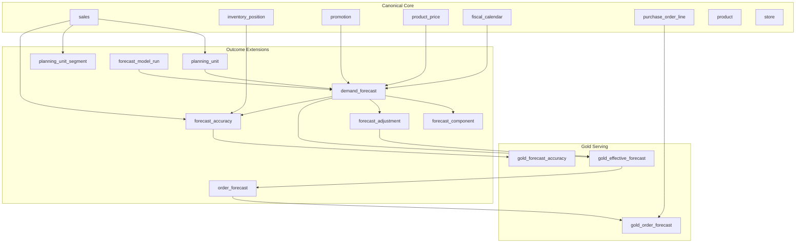

# Design — Demand and Order Forecasting

> **Outcome package:** Smarter Demand and Inventory Decisions  
> **Use case:** Demand & Order Forecasting  
> **Status:** Implemented (0.1-beta)  
> **Last updated:** 2026-07-21

## Business outcome

A demand planning team produces, measures, and governs **statistical and planner-enriched forecasts** at a consistent planning grain — from store-SKU replenishment through DC and key-account shipment planning. The package answers:

- What do we expect to sell or ship at each planning location over the next N periods?
- How accurate and biased are our forecasts, and where should planners intervene?
- What is the **order forecast** (replenishment / purchase / transfer) implied by demand, lead time, and inventory policy?

This is the **upstream planning spine** for inventory optimization and out-of-stocks optimization in the same outcome package.

---

## Industry patterns

Common integrated business planning (IBP) and demand planning patterns generalized into ORDM:

| Industry pattern | ORDM adaptation |
|---|---|
| **Planning unit grain** — key account × product hierarchy × geography | **Planning unit** — configurable grain above SKU×store; maps to `product`, `store`, and optional account/channel attributes |
| **Adjusted sales quantity** as demand signal (shipments, lagged reporting) | **`sales.units`** at POS grain + optional **`shipment_line`** for DC/wholesale; explicit **actuals lag** per channel |
| **Hierarchical horizons** — short (27w), mid (52w), long (104w) with different model recipes | **`forecast_horizon_type`** enum: `short_term`, `mid_term`, `long_term`, `backtest` |
| **Demand decomposition** — base + promo + price + weather + holiday | **`forecast_component`** child table; drivers sourced from core `promotion`, `sales`, and outcome covariate extensions |
| **ABC/XYZ segmentation** — volume tier × demand variability | **`planning_unit_segment`** extension; computed from `sales` velocity and CV, not stored on `product` master |
| **FVA + planner overrides** — statistical vs enriched forecast | **`forecast_adjustment`** extension + `gold_effective_forecast` view |
| **Lag-based accuracy** as primary KPI | **`forecast_accuracy`** at planning-unit × period grain with configurable lag |
| **Model registry / champion recipe** per hierarchy | **`forecast_model_run`** + **`forecast_model_registry`** extensions |

Many source systems collapse demand and order forecasts at the data layer; ORDM makes that distinction explicit (see §Order forecast below).

---

## Builds on (canonical core)

Reuse without redefinition:

| Canonical entity | Role in forecasting |
|---|---|
| `product` | SKU/GTIN master; style/color/size hierarchy for aggregation |
| `store` | Planning location (store, DC, or ship-to when `store_type` permits) |
| `sales` | POS actuals at product × store × day |
| `inventory_position` | On-hand context; distinguishes zero demand from stockout-constrained sales |
| `promotion` | Promo calendar and attribution (`promo_sk`, including `NO_PROMO`) |
| `product_price` | Price history for elasticity and price-driver decomposition |
| `fiscal_calendar` | NRF 4-5-4 fiscal week/month alignment |
| `purchase_order_line` | Historical order actuals for order-forecast calibration |
| `shipment` / `shipment_line` | Inbound/outbound flow for wholesale and DC-centric planners |
| `supplier` | Vendor context for purchase-order forecast |
| `lane` | Transit time for order-to-receipt offset |

**Cross-package dependency (read-only):** `early-risk-detection.gold_inventory_risk` supplies trailing velocity and stockout risk context for forecast censoring — core never FKs into gold.

---

## Gaps in canonical core (recommended additions)

These belong in **canonical core** only if multiple outcome packages need them at silver. Otherwise they ship as **outcome extensions** in this package.

| Gap | Recommendation | Layer |
|---|---|---|
| No **planning unit** abstraction above SKU×store | Add `planning_unit` reference table in core **or** outcome extension with explicit `product_id`/`store_id` roll-up rules | Outcome extension (v1); promote to core if joint demand planning adopts it |
| No **weather / holiday / macro covariates** | Outcome extension tables `demand_driver_weather`, `demand_driver_holiday` keyed by region × date | Outcome extension |
| No **forecast facts** of any kind | Outcome extension tables below | Outcome extension |
| `sales` is daily; IBP is often weekly | Gold views aggregate to `fiscal_calendar` week; no core change required |
| No **customer / key account** dimension for CPG | Reuse `account` (B2B) where retailer is the account; optional `planning_unit.account_sk` | Core `account` + outcome extension |

---

## Planning grain

ORDM supports **two deployment profiles** within one model:

### Profile A — Retail replenishment (default)

**Grain:** `product_id` × `store_id` × `date_key` (day or fiscal week via `fiscal_calendar`)

Best for: grocery, convenience, big-box store replenishment, OOS optimization.

### Profile B — CPG / wholesale IBP

**Grain:** `planning_unit_id` × `fiscal_week_key` where planning unit rolls up:

- Product hierarchy node (category → brand → sub-brand → pack size)
- Geography (region, zone, DC)
- Customer / key account (optional `account_id`)

Best for: manufacturer shipment forecasting, joint demand planning with retailers.

Both profiles share the same extension tables; `planning_unit` carries a `grain_type` CHECK (`store_sku`, `account_product_region`, …).

---

## Proposed extension tables

### `planning_unit`

Defines the atomic forecasting entity. One row per planning unit; members resolved via `planning_unit_member`.

| Column | Type | Notes |
|---|---|---|
| `planning_unit_sk` | BIGINT IDENTITY | PK |
| `planning_unit_id` | STRING | Business key |
| `grain_type` | STRING | CHECK: `store_sku`, `account_product_region`, `dc_product`, … |
| `product_sk` / `product_id` | BIGINT / STRING | Nullable when grain is above SKU |
| `store_sk` / `store_id` | BIGINT / STRING | Nullable when grain is above store |
| `account_sk` / `account_id` | BIGINT / STRING | Optional B2B key account |
| `planning_hierarchy_level` | STRING | e.g. `H1`, `H2` (hierarchy levels H1–H4) |
| `is_active` | BOOLEAN | |
| Audit block | | `created_timestamp`, `source_updated_timestamp`, `record_source`, `load_timestamp` (reference-table block, §8) |

Tag: `dbx_data_type = reference`

### `planning_unit_segment`

ABC/XYZ and cluster assignment per planning unit per fiscal period. **Not** on `product` master (principle #9).

| Column | Type | Notes |
|---|---|---|
| `segment_sk` | BIGINT IDENTITY | PK |
| `planning_unit_sk` | BIGINT | FK |
| `fiscal_period_key` | INT | `fiscal_calendar.fiscal_week_id`, e.g. `202628` (FY2026 week 28) |
| `abc_class` | STRING | CHECK: `A`, `B`, `C` |
| `xyz_class` | STRING | CHECK: `X`, `Y`, `Z` |
| `volume_tier` | STRING | e.g. `very_high`, `intermittent`, `obsolete` |
| `cluster_id` | STRING | Model recipe selector (e.g. volume-tier × ABC × XYZ clusters) |
| `cumulative_volume_pct` | DOUBLE | For ABC audit |
| `coefficient_of_variation` | DOUBLE | For XYZ audit |

### `forecast_model_run`

One row per model training / scoring execution.

| Column | Type | Notes |
|---|---|---|
| `model_run_sk` | BIGINT IDENTITY | PK |
| `model_run_id` | STRING | Business key |
| `model_name` | STRING | e.g. `lightgbm`, `prophet`, `arima` |
| `model_version` | STRING | Semantic version or git hash |
| `hierarchy_level` | STRING | H1–H4 or `store_sku` |
| `training_start_date` | DATE | |
| `training_end_date` | DATE | |
| `scored_at_timestamp` | TIMESTAMP | |
| `is_champion` | BOOLEAN | Champion for this hierarchy × segment |
| `accuracy_score` | DOUBLE | Holdout accuracy |
| `bias_pct` | DOUBLE | Holdout bias |

### `demand_forecast`

Forward-looking and backtest demand forecast lines.

| Column | Type | Notes |
|---|---|---|
| `demand_forecast_sk` | BIGINT IDENTITY | PK |
| `demand_forecast_id` | STRING | Business key |
| `model_run_sk` | BIGINT | FK |
| `planning_unit_sk` | BIGINT | FK |
| `forecast_date_key` | DATE | Period being forecast (week start or day) |
| `forecast_horizon_type` | STRING | CHECK: `short_term`, `mid_term`, `long_term`, `backtest` |
| `forecast_lag_weeks` | INT | Weeks between forecast origin and actuals availability |
| `forecast_origin_date_key` | DATE | When forecast was produced |
| `forecast_quantity` | DECIMAL(12,3) | Units (cases, eaches — UOM on `product`) |
| `forecast_lower_bound` | DECIMAL(12,3) | Optional prediction interval |
| `forecast_upper_bound` | DECIMAL(12,3) | Optional prediction interval |
| `unit_of_measure` | STRING | ISO or trade UOM code |

Cluster: `(forecast_date_key, planning_unit_sk)`

### `forecast_component`

Demand driver decomposition (base, promo, price, weather, holiday).

| Column | Type | Notes |
|---|---|---|
| `forecast_component_sk` | BIGINT IDENTITY | PK |
| `demand_forecast_sk` | BIGINT | FK |
| `component_type` | STRING | CHECK: `base`, `promo`, `price`, `weather`, `holiday`, `trend`, `residual` |
| `component_quantity` | DECIMAL(12,3) | Signed contribution in UOM |

### `forecast_adjustment`

Planner overrides and enrichment (FVA). Operational write-state may live in Lakebase per ADR 0005; this is the analytical mirror.

| Column | Type | Notes |
|---|---|---|
| `forecast_adjustment_sk` | BIGINT IDENTITY | PK |
| `planning_unit_sk` | BIGINT | FK |
| `forecast_date_key` | DATE | |
| `adjustment_quantity` | DECIMAL(12,3) | Delta or absolute per `adjustment_method` |
| `adjustment_method` | STRING | CHECK: `absolute`, `delta`, `pct` |
| `adjustment_reason_code` | STRING | e.g. `promo_not_in_model`, `new_listing`, `supply_constraint` |
| `adjusted_by` | STRING | Planner ID (PII-tagged if needed) |
| `adjusted_at_timestamp` | TIMESTAMP | |
| `approval_status` | STRING | CHECK: `pending`, `approved`, `rejected` |

### `order_forecast`

Translates demand into replenishment / purchase / transfer orders.

| Column | Type | Notes |
|---|---|---|
| `order_forecast_sk` | BIGINT IDENTITY | PK |
| `planning_unit_sk` | BIGINT | FK |
| `order_date_key` | DATE | Planned order placement date |
| `need_by_date_key` | DATE | Required on-shelf / in-DC date |
| `order_forecast_quantity` | DECIMAL(12,3) | |
| `order_type` | STRING | CHECK: `replenishment`, `purchase`, `transfer`, `allocation` |
| `source_location_id` | STRING | DC or supplier site (degenerate; polymorphic like `lane`) |
| `destination_store_sk` | BIGINT | FK to `store` |
| `demand_forecast_sk` | BIGINT | FK — lineage to demand forecast |
| `inventory_policy_sk` | BIGINT | FK — see inventory optimization design |

### `forecast_accuracy`

Lag-based accuracy snapshot at planning-unit × period grain.

| Column | Type | Notes |
|---|---|---|
| `forecast_accuracy_sk` | BIGINT IDENTITY | PK |
| `planning_unit_sk` | BIGINT | FK |
| `forecast_date_key` | DATE | |
| `actual_quantity` | DECIMAL(12,3) | From `sales` or shipments |
| `forecast_quantity` | DECIMAL(12,3) | Statistical forecast at lag |
| `effective_forecast_quantity` | DECIMAL(12,3) | After adjustments |
| `lag_weeks` | INT | |
| `accuracy_pct` | DOUBLE | `1 - |Σa - Σf| / Σa` |
| `bias_pct` | DOUBLE | `(Σf - Σa) / Σa × 100` |
| `mape` | DOUBLE | |
| `is_stockout_censored` | BOOLEAN | TRUE when `inventory_position.is_stockout` on actual period |

---

## Proposed gold views

| View | Purpose |
|---|---|
| `gold_demand_forecast_weekly` | Demand forecast aggregated to fiscal week; joins `planning_unit`, `product`, `store` |
| `gold_effective_forecast` | `demand_forecast` ⊕ latest approved `forecast_adjustment` |
| `gold_order_forecast` | Order forecast with lead-time offset from `lane` and open `purchase_order_line` |
| `gold_forecast_accuracy` | Accuracy dashboard with ABC/XYZ segment attributes |
| `gold_forecast_value_added` | FVA: model vs naïve (trailing average) vs planner-enriched |
| `gold_demand_sensing_queue` | Short-horizon incidents where actuals diverge from forecast (feeds OOS module) |

---

## Proposed metric views

| Metric view | Measures | Dimensions |
|---|---|---|
| `mv_forecast_accuracy` | `accuracy_pct`, `bias_pct`, `mape`, `fva_pct` | fiscal period, ABC class, XYZ class, hierarchy level, region |
| `mv_forecast_bias_inventory_impact` | Implied excess inventory $ (positive bias) and lost sales $ (negative bias) | segment, planning unit |
| `mv_order_forecast_fill` | Order forecast vs `purchase_order_line.ordered_qty` | supplier, store, week |

---

## Key metrics and thresholds

Recommended defaults (configurable per deployment):

| Metric | Definition | Suggested threshold |
|---|---|---|
| Forecast accuracy | `1 - |actual - forecast| / actual` (weighted) | Red < 70%, Yellow 70–78%, Green ≥ 78% |
| Bias % | `(forecast - actual) / actual × 100` | Green ≤ 2pp, Yellow ≤ 5pp, Red > 5pp |
| FVA | Improvement vs naïve baseline | Positive = model adds value |
| Chronic failure | Consecutive weeks below accuracy threshold | 3 weeks |
| Actuals lag | Weeks before actuals are reportable | 4 weeks (typical for US CPG) |

Positive bias implies **excess inventory**; negative bias implies **stockout risk** — the bridge to modules 2 and 3.

---

## Data flow

---

## Relationship to sibling modules

| Module | Handoff |
|---|---|
| **Inventory optimization** | Consumes `gold_effective_forecast` and `planning_unit_segment` for safety stock and reorder point |
| **Out-of-stocks optimization** | Consumes `forecast_accuracy.is_stockout_censored`, `gold_demand_sensing_queue`, and `inventory_position.is_stockout` |
| **Early risk detection** | Complementary — operational disruption triage; this module owns **planning** forecasts |
| **Data sharing with suppliers** | Joint demand planning publishes a subset of `gold_effective_forecast` to supplier-facing views |

---

## Implementation checklist

- [ ] `tables/planning_unit.sql`, `planning_unit_segment.sql`, `forecast_model_run.sql`
- [ ] `tables/demand_forecast.sql`, `forecast_component.sql`, `forecast_adjustment.sql`
- [ ] `tables/order_forecast.sql`, `forecast_accuracy.sql`
- [ ] `gold/gold_*.sql` (six views)
- [ ] `metric-views/mv_forecast_accuracy.sql`, `mv_forecast_bias_inventory_impact.sql`
- [ ] `relationships.sql`, `checks.sql`, `glossary.md`, `comments.sql`
- [ ] Synthetic data generator for planning units and backtest forecasts
- [ ] Update `use-cases.yaml` with `tables:` mapping when gold lands
