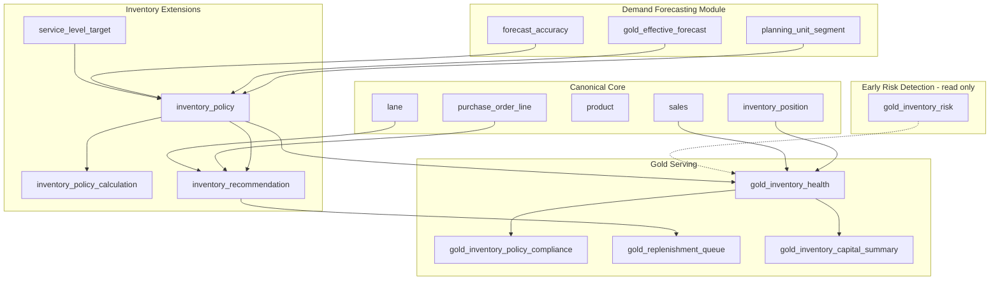

# Design — Inventory Optimization

> **Outcome package:** Smarter Demand and Inventory Decisions  
> **Use case:** Inventory Optimization  
> **Status:** Implemented (0.1-beta)  
> **Last updated:** 2026-07-21

## Business outcome

An inventory planning team sets and monitors **inventory policies** (safety stock, reorder points, min/max, target days of supply) that balance **service level** against **working capital**, segmented by demand variability and volume tier. The package answers:

- How much inventory should we hold at each location for each product?
- When should we reorder, and how much?
- Where is inventory **overstocked** (positive forecast bias, excess DoS) vs **understocked** (negative bias, low DoS)?
- What is the dollar impact of policy changes?

This module sits **downstream of demand forecasting** and **upstream of replenishment execution** (`purchase_order_line`, `shipment`).

---

## Industry patterns

Inventory optimization is often encoded as **ABC/XYZ playbook guidance** rather than explicit data entities. ORDM makes these policies **explicit and measurable** through policy tables and gold views:

| Industry signal | ORDM inventory optimization response |
|---|---|
| **AX** — high volume, stable demand | Tight safety stock; automate replenishment; investigate any accuracy drop |
| **AZ** — high volume, erratic demand | Higher safety stock buffer; planner overrides expected |
| **CZ** — tail volume, wild demand | Min/max or reactive buy; accept higher stockout rate |
| **Positive bias** → excess inventory | `inventory_health.overstock_flag`, working-capital exposure |
| **Negative bias** → stockouts | `inventory_health.understock_flag`, service-level gap |
| **Accuracy-to-capital impact** | `mv_inventory_capital_impact` metric view |
| **DC planning locations** | `store` with `store_type = distribution_center` |

---

## Builds on (canonical core)

| Canonical entity | Role in inventory optimization |
|---|---|
| `inventory_position` | Daily on-hand, in-transit, on-order, stockout flags at product × store × day |
| `sales` | Trailing velocity for days-of-supply and sell-through |
| `product` | Unit cost (`unit_cost`) for inventory valuation |
| `product_price` | Retail price for margin-at-risk calculations |
| `store` | Location type (store vs DC), geo for regional policy |
| `purchase_order_line` | Open orders, lead time actuals, fill rate |
| `shipment` / `shipment_line` | Inbound pipeline for DoS-with-transit |
| `lane` | Planned transit days for lead-time offset |
| `supplier` | Supplier-specific lead time and MOQ context |
| `fiscal_calendar` | Period grain for policy review cycles |

**From demand forecasting module (same package):**

| Extension entity | Role |
|---|---|
| `planning_unit` / `planning_unit_segment` | ABC/XYZ segmentation drives policy templates |
| `gold_effective_forecast` | Forward demand for projected DoS and reorder calc |
| `forecast_accuracy.bias_pct` | Bias-driven inventory adjustment signals |

**Cross-package (read-only):**

| Source | Role |
|---|---|
| `early-risk-detection.gold_inventory_risk` | Operational stockout risk score and `inventory_risk_tier` — do not duplicate; extend with **policy** context |
| `early-risk-detection.gold_supplier_scorecard` | Supplier reliability adjusts safety stock multiplier |

---

## Gaps in canonical core (recommended additions)

| Gap | Recommendation | Layer |
|---|---|---|
| `inventory_position` is snapshot-only; no movement ledger | Optional future core table `inventory_movement` (receipt, sale, adjustment, transfer) for audit trail; **not required for v1** — snapshot + sales sufficient for DoS | Core v1.x advisory |
| No inventory **policy** or **valuation** entities | Outcome extensions below | Outcome extension |
| No service-level target | `service_level_target` reference table | Outcome extension |
| `store` lacks explicit `store_type` enum for DC vs store | Confirm `store` CHECK constraint includes `distribution_center`, `store`, `dark_store`; add if missing | Core enhancement |

---

## Design principles

1. **Policies are versioned, not baked into masters.** Safety stock and reorder points live in `inventory_policy`, never on `product` or `store`.
2. **Segment-driven defaults.** ABC/XYZ from `planning_unit_segment` seeds policy templates; planners can override per SKU×location.
3. **Separate operational risk from policy optimization.** Early Risk Detection owns real-time triage; this module owns **target state** and **policy recommendations**.
4. **Money on DECIMAL.** Inventory value = quantity × `product.unit_cost`; extended value DECIMAL(18,2).

---

## Proposed extension tables

### `service_level_target`

Enterprise and segment-level service level goals.

| Column | Type | Notes |
|---|---|---|
| `service_level_target_sk` | BIGINT IDENTITY | PK |
| `service_level_target_id` | STRING | Business key |
| `abc_class` | STRING | Nullable — NULL = default |
| `xyz_class` | STRING | Nullable |
| `target_fill_rate_pct` | DECIMAL(5,4) | e.g. 0.9500 for 95% |
| `target_days_of_supply` | DECIMAL(8,2) | Alternative to fill rate |
| `effective_from_date` | DATE | |
| `effective_to_date` | DATE | |
| `is_current` | BOOLEAN | |

Tag: `dbx_data_type = reference`

### `inventory_policy`

Versioned replenishment policy per planning unit (or product × store).

| Column | Type | Notes |
|---|---|---|
| `inventory_policy_sk` | BIGINT IDENTITY | PK |
| `inventory_policy_id` | STRING | Business key |
| `planning_unit_sk` | BIGINT | FK (or product_sk + store_sk) |
| `policy_type` | STRING | CHECK: `min_max`, `reorder_point`, `periodic_review`, `days_of_supply` |
| `safety_stock_quantity` | DECIMAL(12,3) | Units |
| `reorder_point_quantity` | DECIMAL(12,3) | Units |
| `min_quantity` | DECIMAL(12,3) | Min shelf / min order |
| `max_quantity` | DECIMAL(12,3) | Max shelf / max order |
| `order_up_to_quantity` | DECIMAL(12,3) | For (s, S) policies |
| `review_period_days` | INT | For periodic review |
| `lead_time_days` | INT | Default; overridden by supplier lane |
| `service_level_target_sk` | BIGINT | FK |
| `policy_source` | STRING | CHECK: `system_calculated`, `planner_override`, `abc_xyz_template` |
| `effective_from_date` | DATE | |
| `effective_to_date` | DATE | |
| `is_current` | BOOLEAN | |

### `inventory_policy_calculation`

Audit log of how a policy was derived (transparency for planners).

| Column | Type | Notes |
|---|---|---|
| `policy_calculation_sk` | BIGINT IDENTITY | PK |
| `inventory_policy_sk` | BIGINT | FK |
| `calculated_at_timestamp` | TIMESTAMP | |
| `avg_daily_demand` | DECIMAL(12,3) | From trailing sales or forecast |
| `demand_std_dev` | DECIMAL(12,3) | |
| `forecast_bias_pct` | DOUBLE | From `forecast_accuracy` |
| `lead_time_days` | INT | |
| `lead_time_std_dev` | DOUBLE | |
| `safety_stock_formula` | STRING | e.g. `z_score * sqrt(lt) * sigma_d` |
| `z_score` | DOUBLE | From service level |
| `supplier_reliability_multiplier` | DOUBLE | From supplier scorecard |

### `inventory_recommendation`

System-generated replenishment recommendation (before PO creation).

| Column | Type | Notes |
|---|---|---|
| `inventory_recommendation_sk` | BIGINT IDENTITY | PK |
| `planning_unit_sk` | BIGINT | FK |
| `recommendation_date_key` | DATE | |
| `recommended_order_quantity` | DECIMAL(12,3) | |
| `recommended_order_date_key` | DATE | |
| `projected_days_of_supply` | DECIMAL(8,2) | Before recommendation |
| `projected_days_of_supply_after` | DECIMAL(8,2) | After receipt |
| `recommendation_reason` | STRING | CHECK: `below_rop`, `below_min`, `forecast_spike`, `promo_build` |
| `recommendation_status` | STRING | CHECK: `open`, `accepted`, `rejected`, `expired` |
| `inventory_policy_sk` | BIGINT | FK |

---

## Proposed gold views

### `gold_inventory_health`

Per product × store (or planning unit) health snapshot combining position, velocity, policy, and forecast.

| Output column | Source / logic |
|---|---|
| `units_on_hand_eod` | `inventory_position` (latest date) |
| `units_in_transit` | `inventory_position` |
| `avg_daily_sales` | Trailing 14-day `sales` (same window as early-risk-detection) |
| `avg_daily_forecast` | `gold_effective_forecast` forward 14 days |
| `days_of_supply` | `units_on_hand_eod / avg_daily_sales` |
| `days_of_supply_with_transit` | `(on_hand + in_transit) / avg_daily_sales` |
| `target_days_of_supply` | `inventory_policy` or `service_level_target` |
| `safety_stock_quantity` | `inventory_policy` |
| `reorder_point_quantity` | `inventory_policy` |
| `inventory_position_status` | CHECK-derived: `overstock`, `healthy`, `at_risk`, `stockout` |
| `overstock_quantity` | `GREATEST(0, on_hand - max_quantity)` |
| `understock_quantity` | `GREATEST(0, reorder_point - on_hand)` |
| `inventory_value` | `on_hand × product.unit_cost` |
| `excess_inventory_value` | Overstock × unit cost |
| `abc_class`, `xyz_class` | `planning_unit_segment` |
| `forecast_bias_pct` | Latest `forecast_accuracy` |

### `gold_inventory_policy_compliance`

Compares actual position against active policy.

| Output column | Logic |
|---|---|
| `is_below_rop` | `units_on_hand_eod < reorder_point_quantity` |
| `is_above_max` | `units_on_hand_eod > max_quantity` |
| `policy_compliance_pct` | % of SKU×store days in compliance over trailing period |

### `gold_replenishment_queue`

Open `inventory_recommendation` rows joined to `gold_inventory_health`, ranked by service impact (A-class first).

### `gold_inventory_capital_summary`

Aggregated working capital, excess inventory, and understock exposure by category and
ABC class. Valuation basis is explicit and never mixed in one figure: `inventory_value`
and `excess_inventory_value` are **cost basis** (units × `unit_cost`), while
`understock_margin_at_risk` is the **gross margin** at risk (units × `(list_price −
unit_cost)`), not full retail — full retail overstates the loss by counting COGS never
incurred.

---

## ABC/XYZ policy templates

Default policy templates applied when `inventory_policy.policy_source = 'abc_xyz_template'`:

| Segment | Safety stock | Reorder policy | Review cadence |
|---|---|---|---|
| **AX** | Low (1–3 days demand) | Automated ROP; tight max | Weekly |
| **AY** | Medium (5–7 days) | ROP + promo uplift from forecast | Weekly |
| **AZ** | High (10–14 days) | Min/max with wide band; planner approval | Daily during events |
| **BX/BY** | Medium | Periodic review | Bi-weekly |
| **BZ** | Medium-high | Promo-driven build from `promotion` calendar | Weekly |
| **CX** | Low | Simple min/max | Monthly |
| **CY/CZ** | Minimal or reactive | Min/max or discontinue review | Monthly / quarterly |

Z-class segments accept higher stockout rates; service level target defaults to 85% vs 98% for X-class.

## Safety-stock derivation (reference method)

`notebook-templates/safety_stock_sizing.sql` derives safety stock and reorder point
from the stored `inventory_policy_calculation` inputs rather than hardcoding them. The
governed *contract* is the stored inputs plus the `service_level_z` lookup; the sizing
*method* ships as an adaptable reference notebook (mirroring `oos_detection.sql`), which
is where ORDM places prescriptive compute of this kind rather than a shipped gold view:

- **Safety stock** uses the rigorous **combined demand-and-lead-time variance** form
  `SS = z · supplier_mult · σ_DDLT`, where `σ_DDLT = √(LT·σ_d² + D²·σ_LT²)` — the
  `D²·σ_LT²` lead-time-variance term is retained (the earlier stored formula string
  dropped it).
- **Reorder point** `ROP = D·LT + SS`, surfaced next to the stored value for comparison.
- **The safety factor is chosen per `service_measure_type`** from `service_level_z`
  (a service-level → z-score + unit-normal-loss lookup), because the definitions are
  not interchangeable and mis-sizing follows from conflating them:

**Service level vs fill rate (Type I vs Type II).**
- `cycle_service_level` (Type I / α) → `z` = the smallest tabulated z whose service
  level ≥ target (rounding **up** = conservative).
- `in_stock_rate` (share of time in stock / ready rate) → **approximated** by the
  cycle-service-level z path. Ready rate is time-weighted and is not the same object as
  cycle service level (P(no stockout per cycle)), so the CSL quantile tends to slightly
  over-provision; a dedicated ready-rate factor is a follow-up.
- `fill_rate` (Type II / β) → a z-score alone does **not** size a fill rate. Expected
  shortage per cycle is `σ_DDLT · L(z)`, so with cycle demand `Q = D · review_cycle`
  the required loss is `L(z) = (1 − β)·Q / σ_DDLT`; the view looks up the smallest
  adequate z via the seeded `L(z)` column, then applies the same SS formula.
- **Out-of-range targets are clamped, not dropped.** A target more demanding than the
  seeded `service_level_z` table (a cycle/in-stock target above the top seeded level, or
  a fill-rate loss below the smallest seeded `L(z)`) clamps to the most conservative
  seeded z rather than returning a NULL recommendation; `z_clamped_to_max` flags those
  rows so adopters can extend the seed at the tail.

`gold_service_level_attainment` measures the *achieved* level from core and reports the
gap to target **like-for-like** against the target's `service_measure_type`. It reports
two distinct measures: `attained_in_stock_rate` (time-based, `1 − stockout_days/total_days`
from `inventory_position.is_stockout`) and `attained_fill_rate` (demand-weighted Type II,
`units_sold / (units_sold + censoring-aware lost_units)`). A `fill_rate` target is
differenced against the fill rate, an `in_stock_rate` / `cycle_service_level` target
against the in-stock rate — never a Type-II target against a time-based measure.

## Deferred (v1.x / separate packages)

Named so adopters can distinguish *considered* from *absent*: full forecast-hierarchy
reconciliation (`planning_unit_member` + a reconciliation fact — the `grain_type`
dimension is the interim double-counting guard); EOQ / MOQ / case-pack lot-sizing;
and **Multi-Echelon Inventory Optimization (MEIO)** with a DC/node dimension, which is
a separate future package rather than part of this one.

---

## Proposed metric views

| Metric view | Measures | Dimensions |
|---|---|---|
| `mv_days_of_supply` | `days_of_supply`, `days_of_supply_with_transit`, `target_days_of_supply` | product, store, ABC, region — **coordinate with early-risk-detection** to avoid duplicate definitions |
| `mv_inventory_turnover` | `sell_through_rate`, `weeks_of_cover` | category, store format |
| `mv_inventory_capital_impact` | `inventory_value`, `excess_inventory_value`, `understock_revenue_at_risk` | segment, fiscal period |
| `mv_policy_compliance` | `policy_compliance_pct`, `below_rop_count` | region, supplier |
| `mv_safety_stock_adherence` | Actual vs target safety stock | ABC/XYZ cell |

**Note:** `mv_days_of_supply` already exists in `early-risk-detection`. This package should **extend** that definition with policy targets rather than redefine DoS. Options: (a) add policy columns to a new `mv_inventory_optimization` metric view that joins `gold_inventory_health`, or (b) contribute policy columns back to early-risk-detection in a coordinated PR. Prefer (a) for package isolation.

---

## Key metrics

| Metric | Definition |
|---|---|
| Days of supply (DoS) | `units_on_hand_eod / avg_daily_sales` |
| Weeks of cover (WOC) | DoS / 7 |
| Inventory turnover | `COGS / avg inventory value` (period) |
| In-stock rate (time-based) | `1 - (stockout_days / total_days)` from `inventory_position.is_stockout` |
| Fill rate (demand-weighted, Type II) | `units_sold / (units_sold + lost_units)` — units met over units demanded (censoring-aware lost demand) |
| Excess inventory % | `excess_inventory_value / total_inventory_value` |
| Service level | % of demand fulfilled without stockout |
| Forecast bias inventory impact | `bias_pct × avg_inventory_value` |

---

## Data flow

---

## Relationship to sibling modules

| Module | Handoff |
|---|---|
| **Demand and order forecasting** | Supplies `gold_effective_forecast`, `planning_unit_segment`, `forecast_accuracy.bias_pct` |
| **Out-of-stocks optimization** | Consumes `gold_inventory_health.inventory_position_status`, `understock_quantity`, and `inventory_recommendation` |
| **Early risk detection** | Operational `stockout_risk_score` informs but does not replace policy targets |
| **Balancing margin and volume** | Shares DoH/WOC concepts; inventory health feeds price elasticity stockout censoring |

---

## Implementation checklist

- [ ] `tables/service_level_target.sql`, `inventory_policy.sql`
- [ ] `tables/inventory_policy_calculation.sql`, `inventory_recommendation.sql`
- [ ] `gold/gold_inventory_health.sql`, `gold_inventory_policy_compliance.sql`
- [ ] `gold/gold_replenishment_queue.sql`, `gold_inventory_capital_summary.sql`
- [ ] `metric-views/mv_inventory_capital_impact.sql`, `mv_policy_compliance.sql`
- [ ] `relationships.sql`, `checks.sql`, `glossary.md`
- [ ] Coordinate `mv_days_of_supply` definition with early-risk-detection owners
- [ ] ABC/XYZ template seed data in synthetic generator
