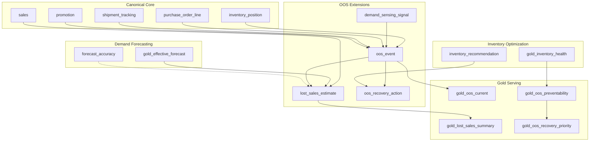
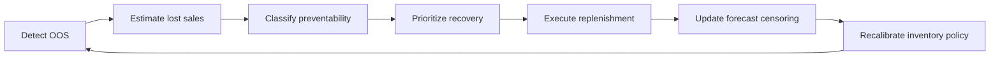

# Design — Out-of-Stocks Optimization

> **Outcome package:** Smarter Demand and Inventory Decisions  
> **Use case:** Out-of-Stocks Optimization  
> **Status:** Implemented (0.1-beta)  
> **Last updated:** 2026-07-21

## Business outcome

A retail or CPG team **detects, quantifies, and reduces out-of-stocks (OOS)** by connecting shelf availability signals to demand forecasts, inventory policies, and replenishment actions. The package answers:

- Where are we out of stock right now, and for how long?
- How much demand did we lose (lost sales) due to OOS?
- Which OOS events are **preventable** vs **demand-driven** vs **supply-constrained**?
- What replenishment or allocation actions will recover the most revenue?

This module closes the loop between **forecasting**, **inventory policy**, and **on-shelf execution**.

---

## Industry patterns

Many planning systems infer stockouts through **demand sensing** rather than modeling OOS as a first-class fact. ORDM elevates these inference patterns into **structured OOS entities** while preserving the core principle: never treat stockout-constrained sales as true demand.

| Industry mechanism | ORDM OOS optimization response |
|---|---|
| **Velocity collapse** — latest week actuals < 50% of trailing 8-week mean | `oos_event` with `detection_method = 'velocity_collapse'` |
| **Supply / retail stockout** incident types | `oos_event.oos_cause` enum |
| **Depressed POS ≠ depressed demand** | `lost_sales_estimate` with `censoring_adjusted = true` |
| **Competitor stockout spillover** | `oos_event.competitor_spillover_flag` |
| **Inventory misread** — transfer misread as sell-through | `oos_event.data_quality_flag` |
| **Demand sensing incidents** | `demand_sensing_signal` extension for short-horizon anomalies |
| **`inventory_position.is_stockout`** | Primary **observed** OOS signal at ORDM core |
| **`sales` + stockout flag** | Separates true zero demand from zero sales due to stockout (core design intent) |

---

## Builds on (canonical core)

| Canonical entity | Role in OOS optimization |
|---|---|
| `inventory_position` | `is_stockout`, `stockout_pct_day`, `size_availability_pct`, `replenishment_flag` |
| `sales` | Actual units; zero sales with `is_stockout = true` triggers lost-sales estimation |
| `product` | Category, brand for OOS concentration analysis |
| `store` | Location, format, region for geographic OOS patterns |
| `promotion` | Promo-period OOS is higher severity (promo waste) |
| `purchase_order_line` | Supply constraint root cause (late/missed delivery) |
| `shipment` / `shipment_tracking` | Inbound delay as OOS driver |
| `fiscal_calendar` | Period aggregation |

**From sibling modules (same package):**

| Entity | Role |
|---|---|
| `gold_effective_forecast` | Expected demand during OOS period |
| `gold_inventory_health` | Policy gap analysis (was OOS preventable?) |
| `inventory_recommendation` | Suggested recovery action |
| `forecast_accuracy.is_stockout_censored` | Historical forecast training hygiene |

**Cross-package (read-only):**

| Source | Role |
|---|---|
| `early-risk-detection.gold_inventory_risk` | `stockout_risk_score`, `inventory_risk_tier` for proactive OOS prevention |
| `early-risk-detection.disruption_event` | Supply disruption context for OOS root cause |
| `connected-store-signals` (future) | Smart shelf / RFID on-shelf availability for **observed** OOS vs inferred |

---

## OOS signal taxonomy

ORDM distinguishes three signal classes:

| Class | Source | Confidence | Example |
|---|---|---|---|
| **Observed** | `inventory_position.is_stockout = true` | High | System recorded zero on-hand |
| **Inferred** | Velocity collapse, forecast residual | Medium | Sales < 50% trailing mean |
| **Estimated impact** | Lost sales model | Modeled | `lost_sales_estimate` |

---

## Gaps in canonical core (recommended additions)

| Gap | Recommendation | Layer |
|---|---|---|
| No OOS **event** entity (only daily flags) | `oos_event` outcome extension | Outcome extension |
| No **lost sales** estimate | `lost_sales_estimate` outcome extension | Outcome extension |
| No shelf **availability** beyond `stockout_pct_day` | Optional `shelf_availability` if smart-shelf feeds exist; else gold view from `inventory_position` | Outcome extension or Connected Store Signals |
| No **on-shelf location** / planogram | Out of scope v1; note as v1.x hook for in-store experience package | Future |

---

## Proposed extension tables

### `oos_event`

One row per detected out-of-stock episode at product × store grain.

| Column | Type | Notes |
|---|---|---|
| `oos_event_sk` | BIGINT IDENTITY | PK |
| `oos_event_id` | STRING | Business key |
| `product_sk` / `product_id` | BIGINT / STRING | FK |
| `store_sk` / `store_id` | BIGINT / STRING | FK |
| `oos_start_date_key` | DATE | First day of OOS |
| `oos_end_date_key` | DATE | NULL if ongoing |
| `oos_duration_days` | INT | Computed or stored |
| `detection_method` | STRING | CHECK: `inventory_snapshot`, `velocity_collapse`, `pos_absence`, `smart_shelf`, `planner_reported` |
| `oos_cause` | STRING | CHECK: `replenishment_miss`, `supplier_delay`, `demand_spike`, `allocation_shortage`, `planogram_issue`, `unknown` |
| `oos_severity` | STRING | CHECK: `critical`, `high`, `medium`, `low` |
| `is_promo_period` | BOOLEAN | From `promotion` overlap |
| `stockout_pct_total` | DECIMAL(5,4) | Avg `stockout_pct_day` over episode |
| `competitor_spillover_flag` | BOOLEAN | Competitor stockout spillover pattern |
| `data_quality_flag` | BOOLEAN | Suspected data issue |
| `is_preventable` | BOOLEAN | Set by `gold_oos_preventability` |
| `linked_disruption_event_id` | STRING | Degenerate FK to early-risk-detection |
| Audit block | | `record_source`, `load_timestamp` |

Cluster: `(oos_start_date_key, product_sk, store_sk)`

### `lost_sales_estimate`

Quantifies demand not captured in `sales` due to OOS.

| Column | Type | Notes |
|---|---|---|
| `lost_sales_estimate_sk` | BIGINT IDENTITY | PK |
| `oos_event_sk` | BIGINT | FK |
| `estimate_date_key` | DATE | Day within OOS episode |
| `actual_units_sold` | INT | From `sales` (may be 0) |
| `expected_units_demand` | DECIMAL(12,3) | From forecast or unconstrained model |
| `lost_units` | DECIMAL(12,3) | `expected - actual` (floor 0) |
| `estimation_method` | STRING | CHECK: `forecast_residual`, `trailing_average`, `peer_store`, `ml_model` |
| `censoring_adjusted` | BOOLEAN | TRUE when forecast trained excluding stockout days |
| `lost_revenue` | DECIMAL(18,2) | `lost_units × product_price` |
| `confidence_score` | DOUBLE | 0–1 |

### `demand_sensing_signal`

Short-horizon anomaly feed for demand sensing. Append-only.

| Column | Type | Notes |
|---|---|---|
| `demand_sensing_signal_sk` | BIGINT IDENTITY | PK |
| `demand_sensing_signal_id` | STRING | Business key (stem matches the surrogate `demand_sensing_signal_sk` per ADR 0011) |
| `planning_unit_sk` | BIGINT | FK (optional) |
| `product_sk` / `store_sk` | BIGINT | FK |
| `signal_timestamp` | TIMESTAMP | |
| `signal_category` | STRING | CHECK: `supply`, `promo`, `weather`, `transport`, `social`, `data_quality`, `competitor` |
| `signal_type` | STRING | e.g. `retail_stockout`, `promo_manufacturer`, `promo_retailer`, `transport_delay` |
| `signal_description` | STRING | |
| `severity` | STRING | CHECK: `critical`, `high`, `medium`, `low` |
| `resolved_flag` | BOOLEAN | |
| `resolved_at_timestamp` | TIMESTAMP | |
| `linked_oos_event_sk` | BIGINT | FK when promoted to OOS event |

### `oos_recovery_action`

Recommended or executed action to resolve OOS.

| Column | Type | Notes |
|---|---|---|
| `oos_recovery_action_sk` | BIGINT IDENTITY | PK |
| `oos_event_sk` | BIGINT | FK |
| `action_type` | STRING | CHECK: `emergency_order`, `transfer`, `allocation_shift`, `substitute_product`, `expedite_shipment` |
| `recommended_quantity` | DECIMAL(12,3) | |
| `recommended_action_date_key` | DATE | |
| `estimated_recovery_date_key` | DATE | |
| `estimated_revenue_recovery` | DECIMAL(18,2) | |
| `action_status` | STRING | CHECK: `recommended`, `approved`, `executed`, `rejected` |
| `inventory_recommendation_sk` | BIGINT | FK to inventory module |
| `linked_po_line_sk` | BIGINT | FK when PO created |

---

## Proposed gold views

### `gold_oos_current`

Ongoing OOS episodes: membership is `oos_end_date_key IS NULL` (the episode has not
closed). Whether the product×store is *also* stocked out on the latest snapshot is
carried as the separate `is_stocked_out_now` flag — never as a membership filter, so
a long-closed episode does not resurface as "current" just because an unrelated later
stockout exists for the same product×store.

| Output column | Source |
|---|---|
| `product_id`, `store_id`, `product_name`, `store_name` | Dimensions |
| `oos_start_date_key`, `oos_duration_days` | `oos_event` |
| `detection_method`, `oos_cause`, `oos_severity` | `oos_event` |
| `units_on_hand_eod` | `inventory_position` (latest snapshot) |
| `is_stocked_out_now` | latest `inventory_position.is_stockout` (context flag) |
| `lost_units_to_date` | SUM `lost_sales_estimate.lost_units` |
| `lost_revenue_to_date` | SUM `lost_sales_estimate.lost_revenue` |
| `is_preventable` | `oos_event` |
| `abc_class` | `planning_unit_segment` |
| `open_recovery_actions` | COUNT from `oos_recovery_action` |

### `gold_oos_preventability`

Classifies whether OOS was preventable given policy and supply context, judged **as of
the episode start** (`oos_start_date_key`) — via an as-of join to `inventory_position`
and the `inventory_policy` version effective on that date, plus the most recent
`forecast_accuracy` bias known by then. It does **not** use the latest inventory
snapshot, which would classify every historical episode against today's position.
The stored `oos_event.is_preventable` (source/planner judgment) and the derived
`preventability_class` are both surfaced alongside a `preventability_agrees` flag so
the two sources of truth stay explicit.

| Preventability | Logic (as of episode start) |
|---|---|
| **Preventable** | On-hand at start was below the reorder point in force |
| **Partially preventable** | Most recent forecast bias was negative beyond −5pp |
| **Not preventable** | `oos_cause = 'demand_spike'` |
| **Unknown** | Insufficient policy/position/bias data |

### `gold_lost_sales_summary`

Aggregated lost sales by category, region, fiscal period, cause.

### `gold_oos_recovery_priority`

Ranks open OOS events by `estimated_revenue_recovery × recoverability_probability`, A-class products first.

### `gold_oos_rate`

OOS rate KPIs: `oos_rate_pct = stockout_sku_days / total_sku_days` from `inventory_position`.

---

## OOS severity matrix

Combines duration, promo context, and ABC class (A-class misses are highest impact):

| Severity | Criteria |
|---|---|
| **Critical** | A-class product AND (promo period OR duration > 3 days) |
| **High** | A-class any duration OR B-class promo period |
| **Medium** | B-class non-promo OR C-class promo |
| **Low** | C-class non-promo, duration ≤ 1 day |

---

## Lost sales estimation methods

| Method | When to use | Formula sketch |
|---|---|---|
| **Forecast residual** | Forecast available and not stockout-censored | `max(0, effective_forecast - actual_sales)` |
| **Trailing average** | Stable X-class demand | `max(0, trailing_8wk_avg - actual_sales)` |
| **Peer store** | Store has peers with stock | `peer_avg_sales - actual_sales` |
| **ML model** | Sufficient history, intermittent demand | Model-specific; store in `estimation_method` |

All methods set `censoring_adjusted = true` when `inventory_position.is_stockout = true` on the estimate date.

---

## Proposed metric views

| Metric view | Measures | Dimensions |
|---|---|---|
| `mv_oos_rate` | `oos_rate_pct`, `avg_oos_duration_days`, `stockout_sku_count` | store, category, region, fiscal period |
| `mv_lost_sales` | `lost_units`, `lost_revenue`, `lost_sales_pct_of_demand` | product, store, cause, ABC class |
| `mv_oos_preventability` | `preventable_oos_pct`, `preventable_lost_revenue` | region, supplier |
| `mv_oos_recovery` | `revenue_recovered`, `avg_time_to_recover_days` | action type |
| `mv_oos_forecast_impact` | Forecast accuracy degradation on stockout-censored periods | segment |

**Coordinate with early-risk-detection:** `mv_stockout_risk` is **proactive** (before stockout); `mv_oos_rate` is **reactive** (after/during). Different measures, complementary.

---

## Key metrics

| Metric | Definition |
|---|---|
| OOS rate | % of product × store × day with `is_stockout = true` |
| OOS duration | Days from `oos_start_date_key` to `oos_end_date_key` |
| Lost sales units | SUM `lost_sales_estimate.lost_units` |
| Lost sales revenue | SUM `lost_sales_estimate.lost_revenue` |
| Recoverable revenue | Lost revenue where `is_preventable = true` |
| Time to recover | Days from OOS start to `oos_end_date_key` or first positive on-hand |
| Forecast censoring rate | % of forecast training days excluded due to stockout |
| OOS during promo | Count / revenue where `is_promo_period = true` (highest waste) |

---

## Data flow

---

## End-to-end optimization loop

1. **Detect** — `inventory_position.is_stockout` + demand sensing signals → `oos_event`
2. **Quantify** — `lost_sales_estimate` using unconstrained demand
3. **Diagnose** — `gold_oos_preventability` links to forecast bias, policy gap, supplier failure
4. **Act** — `oos_recovery_action` → `inventory_recommendation` → `purchase_order_line`
5. **Learn** — Censor stockout days in `forecast_accuracy`; adjust `inventory_policy` safety stock

---

## Relationship to sibling modules

| Module | Handoff |
|---|---|
| **Demand and order forecasting** | `gold_effective_forecast` for lost sales; `is_stockout_censored` for model hygiene |
| **Inventory optimization** | `gold_inventory_health` for preventability; `inventory_recommendation` for recovery |
| **Early risk detection** | Proactive `stockout_risk_score` reduces OOS before it happens; `disruption_event` for root cause |
| **Promote with purpose** | Promo-period OOS severity weighting; promo ROI impact from lost sales |
| **Connected store signals** | Future observed shelf availability feeds `detection_method = 'smart_shelf'` |

---

## Implementation checklist

- [ ] `tables/oos_event.sql`, `lost_sales_estimate.sql`
- [ ] `tables/demand_sensing_signal.sql`, `oos_recovery_action.sql`
- [ ] `gold/gold_oos_current.sql`, `gold_oos_preventability.sql`
- [ ] `gold/gold_lost_sales_summary.sql`, `gold_oos_recovery_priority.sql`, `gold_oos_rate.sql`
- [ ] `metric-views/mv_oos_rate.sql`, `mv_lost_sales.sql`, `mv_oos_preventability.sql`
- [ ] `relationships.sql`, `checks.sql`, `glossary.md`, `comments.sql`
- [ ] Velocity-collapse detection logic in notebook template
- [ ] Synthetic OOS scenarios (promo stockout, supplier delay, demand spike)
