# Outcome Package — Actionable Customer Understanding

> Status: ✅ Published (0.5) · Marketplace listing: planned

## Business outcome

Four related customer-understanding capabilities:

1. **Customer Lifetime Value** — a per-customer view of historical realized margin plus a transparent forward estimate, with **RFM** segmentation and **value tiers** (stable fixed thresholds, reproducible across refreshes), consumable by promo targeting and category growth.
2. **Behavioral Segmentation** — the segments a CDP activates against. A wide, agent-discoverable per-customer **trait surface** (`gold_customer_behavioral_attributes`) plus append-only **segment membership** (`segment_membership`) over a shared segment-**definition** catalog (`marketing.audience`, [ADR 0022](../../governance/decisions/0022-promote-audience-to-silver-marketing.md)). Consent stays a separate plane: membership carries no consent flags; the net consent+preference+reachability gate is applied only in the Unified Customer View's `gold_activatable_audience_current`. Any consumer syncing `segment_membership` directly to a paid/non-owned destination must first anti-join UCV's `gold_person_do_not_target_current` (ADR 0028). For the full CDP loop across the core, ACU, and UCV, see [docs/cdp-composition.md](../../docs/cdp-composition.md).
3. **Market Analysis / UC-RET-0021 Competitive & Market Intelligence** — per-category, per-competitor price, promotion, distribution, availability, assortment, match-quality and detection context plus a separate licensed market-share surface. Four source interfaces retain sparse/unmatched observations and benchmark restatements; the two metric views recompute ratios from additive components. The use case is `done` (confirmed by its owner, 2026-10-09; record).
4. **Product Affinity** — two recommendation modalities derived from `customer_order_line`: rules-based **market-basket association rules** (support/confidence/lift, "frequently bought together") in `gold_product_affinity_pairwise`, and an individualized recency-weighted **customer→product affinity** score in `gold_customer_product_affinity`, with a governed metric surface `mv_product_affinity`. Keys on durable `product_id`/`profile_id`; no raw PII. The ML vector-embedding modality (product/customer embeddings + ANN search) is a documented follow-on — see Design notes.

The customer-level capabilities (CLV, Behavioral Segmentation, Product Affinity) build on `customer_order_line`, product margin, the NRF 4-5-4 calendar and the customer core; they key on durable pseudonymous `profile_id` and carry no raw PII. Market Analysis is aggregate-only competitor/market intelligence with no person-level source or key.

### Files

| Layer | Object |
|---|---|
| Gold view (CLV) | [`gold/gold_customer_ltv.sql`](gold/gold_customer_ltv.sql) |
| Gold view (behavioral traits) | [`gold/gold_customer_behavioral_attributes.sql`](gold/gold_customer_behavioral_attributes.sql) |
| Gold view (competitive position) | [`gold/gold_competitive_position.sql`](gold/gold_competitive_position.sql) |
| Gold view (market share) | [`gold/gold_market_share.sql`](gold/gold_market_share.sql) |
| Extension table (membership) | [`tables/segment_membership.sql`](tables/segment_membership.sql) |
| Extension tables (Market Analysis) | [`tables/competitor_promotion.sql`](tables/competitor_promotion.sql), [`tables/competitor_assortment.sql`](tables/competitor_assortment.sql), [`tables/competitor_product_match.sql`](tables/competitor_product_match.sql), [`tables/market_benchmark.sql`](tables/market_benchmark.sql) |
| Metric view (segment size/reach) | [`metric-views/segment_performance.sql`](metric-views/segment_performance.sql) |
| Metric view (competitive position) | [`metric-views/competitive_position.sql`](metric-views/competitive_position.sql) |
| Metric view (market share) | [`metric-views/market_share.sql`](metric-views/market_share.sql) |
| Gold view (product affinity, pairwise) | [`gold/gold_product_affinity_pairwise.sql`](gold/gold_product_affinity_pairwise.sql) |
| Gold view (customer→product affinity) | [`gold/gold_customer_product_affinity.sql`](gold/gold_customer_product_affinity.sql) |
| Metric view (product affinity) | [`metric-views/product_affinity.sql`](metric-views/product_affinity.sql) |
| Notebook template (recommendations) | [`notebook-templates/product_affinity_recommendations.sql`](notebook-templates/product_affinity_recommendations.sql) |
| Relationships | [`relationships.sql`](relationships.sql) |
| Data quality | [`checks.sql`](checks.sql) |
| Glossary | [`glossary.md`](glossary.md) |
| Synthetic data | `runtime/synthetic-data/generators/customer_ltv.py` + `_market_analysis.py` helper |
| Builds on | `customer_order_line` (canonical-core/order), `profile`, `consent`, `account` (customer), `product`, `fiscal_calendar`, `audience` + `promotion` (marketing), `promotion_scope` (Promote with Purpose), `sales` (transaction), and BMV `competitor` + `competitor_price` |

## Contents

The layout is the same in every outcome package. One file per table / per metric view keeps parallel work conflict-free.

| Path | Purpose |
|---|---|
| `tables/<table>.sql` | Outcome-specific extension tables (one file each) |
| `metric-views/<metric>.sql` | One UC Metric View per file (measures, dimensions, joins) |
| `comments.sql` | Synonyms, display names, glossary terms for Genie / AI-BI |
| `sample-queries.sql` | Example queries |
| `notebook-templates/` | Reusable notebooks |

## Builds on (canonical core)

- **Order**: `customer_order_line` — the base fact for LTV + behavioral signals (recency, frequency, spend, affinity, promo responsiveness).
- **Customer**: `profile` (durable customer key), `consent` (opt-in attribute; NOT the gate), `account` (B2B account attributes).
- **Product**: `product` — margin (for realized CLV) + category/brand (for affinity).
- **Calendar**: `fiscal_calendar` — NRF 4-5-4 periods for recency/tenure.
- **Marketing / Promote with Purpose**: `audience`, plus canonical `promotion` and the outcome-owned `promotion_scope` bridge for own promoted product-days (ADRs 0006, 0022, and 0042).
- **Transaction**: `sales` — own units collapsed to durable product × day before competitive joins.
- **Balancing Margin and Volume**: `competitor` (SCD2 identity) and silver `competitor_price` observations. Market Analysis reads every competitor directly; it does not read BMV's cheapest-competitor gold view.

## Market Analysis contract

`gold_competitive_position` is one row per **category × durable `competitor_id` × `channel_code` × NRF fiscal period**. National BMV price rows use `channel_code='all'`; promotion and assortment rows retain the source-observed channel and the v1 location sentinel `ALL`. `measure_scope` is `price`, `promotion`, `assortment`, or `promotion_assortment`; combined price scopes are unreachable by design. Each observation family is aggregated independently before its grain keys are joined, so sparse feeds degrade by data instead of multiplying or dropping rows. Competitor names resolve as of period end only after durable-ID aggregation.

Safe rollups are structural: the gold view publishes additive price-relative sums/counts, promotion presence/depth/vehicle counts, listing and stock-state counts, overlap/union/match counts, search-rank sums, and detection-lag/cadence sums and counts. `mv_competitive_position` recomputes rollups from those components instead of averaging already-aggregated gold-row KPIs. Count-based shares and rates divide underlying count sums. The two price indices are respectively unweighted and own-unit-weighted arithmetic means of product-day price relatives, while average discount depth is the arithmetic mean of observed or ingest-derived percentages; none is a ratio of aggregate own and competitor price totals. Use `sales_weighted_price_index_vs_competitor` when own-unit importance weighting is desired. Assortment rollups across competitors or channels are presence-weighted averages of per-grain overlap—not a union over the own catalog—and the metric metadata says so. Price remains regular-vs-regular: own SCD2 `product.list_price` divided by positive same-currency `competitor_price.competitor_mrp`.

The source contracts are explicit:

- `competitor_promotion` and `competitor_assortment` are append-only. Their durable IDs are `record_source|source_observation_id`, independent of mutable product matching, and observations retain their point-in-time match snapshot.
- `competitor_product_match` is Type 1 at durable competitor × competitor-item grain. Its ID excludes mutable `product_id`; v1 serving uses point-in-time observation snapshots, while a warn check compares the latest snapshot with the active registry. There is deliberately no observation-to-registry FK.
- Promotion SOV counts own and competitor promoted product-days over the same population of own product-days covered by any competitor observation. It is restricted to the promoted-product-day observation basis; vehicle placement and syndicated spend bases are not blended.
- Availability exposes listed channels plus observed location points, with no fabricated ACV weighting. Unmatched listed items are labelled as match-quality evidence, not a directional distribution gap; the true own-vs-competitor presence gap awaits own channel-ranging input.
- Assortment overlap uses observed active own products, publishes full-catalog coverage, and separately counts confidence-qualified matches excluded because the own product is inactive.
- Detection lag is an **upper bound**. Promotion and assortment means are published separately with cadence; median/percentile bounds remain a follow-on.

`gold_market_share` / `mv_market_share` remain separate at **record source × market definition × geography × category × non-total subject × provider period** grain. `market_benchmark` deliveries append versions under stable `benchmark_cell_id`, including `geography_level` and adopter `category_ref` in the identity; current cells resolve by provider update, observation timestamp, then load timestamp. A category remap intentionally creates a new logical cell rather than silently rewriting history, so adopters must govern remaps as effective-dated migrations/backfills and suppress the superseded mapping before serving. Market share is recomputed as subject-sales/total-category-sales ratio-of-sums. Total-category cells supply the denominator inside the gold view but are excluded from the serving surface, preventing their full-market sales from entering a subject-share numerator. Provider share/growth remain reconciliation measures. `fair_share_gap_pct` is deferred because the provider distribution fields are non-additive and no additive footprint denominator ships. Physical competitor share-of-shelf still requires a separate sensing/imagery program; top-N digital share-of-shelf is also deferred, so average search rank is not relabelled as share.

The serving objects carry no person-level data. Static and deployed checks prohibit person-level sources/columns and enforce the antitrust wall: Market Analysis may read competitor prices, but no price-, margin-, offer-, elasticity-, cost- or promotion-producing surface may depend on Market Analysis. `standards/rules.yaml` owns the protected objects, schemas and deployed name pattern; the static repository-wide backstop remains broader. Autonomy is `recommend_confirm`; outputs inform human review and never set prices.

Legal boundary: ORDM ships synthetic data only. Adopters should prefer licensed feeds; any public-page collection must be logged-out, robots-respecting and reviewed against applicable terms. Syndicated data remains internal-use-only under its contract, and a registry-driven DQ wall blocks the benchmark source and serving views from DSWS sharing/clean-room/Delta-Sharing surfaces. MAP/RPM enforcement is outside this capability.

## Design notes

Follows the ORDM [data model principles](../../docs/data-model-standards.md). [ADR 0042](../../governance/decisions/0042-market-analysis-reads-bmv-competitor-foundation.md) records the read-only ACU → BMV dependency, compliance registries, generator-wave consequence, and deferred v1 metrics. The Spark helper now removes global windows and samples each competitor's product axis; a dbldatagen row-target/partition rewrite is deferred until production-scale synthetic volumes are required. Market share remains separate from competitive-position grain.

**Product Affinity** is served by two gold surfaces with different consumption models: the customer×product surface (`gold_customer_product_affinity`) has a governed metric view (`mv_product_affinity`), while the pairwise market-basket surface (`gold_product_affinity_pairwise`) is consumed **directly** — its pair-level `support`/`confidence`/`lift` are non-additive, so it is ranked/looked up by key (sample queries + notebook) rather than aggregated through a semantic layer. Both are delivered as gold materialized views computed from `customer_order_line` + `product` — the ORDM-idiomatic form of the source model's batch "affinity engine" (a scheduled `INSERT INTO` an affinity table becomes a refreshed materialized view), so the capability ships no stored affinity table and no synthetic producer. Co-occurrence is computed on the durable `product_id`/`profile_id` the order fact carries, so no version-specific `_sk` enters a GROUP BY or COUNT(DISTINCT) and `product` is read (current version) for display labels only — clean against the SCD2-join-contract (§A.16). **Synthetic-data note:** raw uniform-random baskets carry no real co-purchase correlation, so the pairwise surface would be empty (nothing clears `min_lift = 1.05`). To make the flagship surface demonstrable, the order generator (`customer_ltv.build_order_lines`) can seed a **light, seed-deterministic co-purchase pattern** — on ~1/4 of multi-line baskets it forces the first two lines to a fixed product pair — so `gold_product_affinity_pairwise` **populates** in the deployed demo with a small set of genuine high-lift pairs (and its `severity: error` DQ checks then bite). The generator has an **opt-in** co-purchase seeding (`affinity_copurchase_denom`, `seeds.yaml`) but the **shipped demo ships it OFF** (`= 0`): `customer_order_line` is a **strictly neutral uniform draw**, so CLV, Behavioral Segmentation and Market Analysis read an unshaped shared core — no one package's demo need reshapes the fact. The consequence is that the pairwise "frequently bought together" surface is **intentionally sparse/empty on the shipped demo data** (uniform baskets clear no `min_lift`), and its `severity: error` DQ checks pass vacuously there; the market-basket algebra and windowing are proven on a correlated fixture, and end-to-end on the real generator with seeding enabled, in `tests/test_product_affinity.py`. Set `affinity_copurchase_denom` > 0 (e.g. `4`) to seed light co-purchase correlation and populate the surface — that lightly shapes the shared order fact, a deliberate trade-off. The seeding, when on, is light (only the first two lines of ~1/denom multi-line baskets) and fully reproducible; the algebra + trailing windows are proven on a correlated fixture, and the end-to-end population is proven by running the real generator + view in `tests/test_product_affinity.py`. The glossary carries the same note for readers exploring the deployed model. **Deferred:** the source model's ML vector-embedding modality (`dim_product_embedding`/`dim_customer_embedding`, pgvector `VECTOR(768)` + ANN/HNSW) is out of v1 — on Databricks it is Vector Search synced from Delta, not stored pgvector columns/indexes (strict typing has no `VECTOR` type), and it layers on top of the data model rather than living in it; likewise the browse-behavior (`BROWSE_BEHAVIOR`) affinity driver. The pairwise view computes trailing-window rules (`30D`/`90D`/`ALL_TIME`) anchored to `MAX(order_date)`.

## Entity relationships

<!-- ORDM:ERD:START -->
<picture>
  <source media="(prefers-color-scheme: dark)" srcset="diagrams/actionable-customer-understanding.dark.svg">
  
</picture>

Generated from the DDL · <a href="diagrams/actionable-customer-understanding.light.svg">full SVG</a> · Mermaid <a href="diagrams/actionable-customer-understanding.light.mmd">light</a>/<a href="diagrams/actionable-customer-understanding.dark.mmd">dark</a> · <a href="diagrams/actionable-customer-understanding.dbml">DBML</a>
<!-- ORDM:ERD:END -->
