# Outcome Package — Agentic Commerce

> Status: ✅ Published (0.5) · Marketplace listing: planned
>
> MUST tier is complete for all three use cases. The domain-reviewer sign-off is recorded in #165, so the package reached 🟢 Review complete (CONTRIBUTING §9) and was ✅ Published in 0.5. Intent Product Discovery and Conversational Shopping Assistant now include UC Metric Views; together with A2A metric views, the SHOULD tier is complete.

## Scope

This package spans two independent grains that share the `agentic_commerce` schema but never share a spine table:

- **Human-to-assistant conversational shopping** — a person interacting with a shopping assistant across web, mobile, kiosk, voice, associate, or API surfaces. Two completed slices: **Intent Product Discovery** and **Conversational Shopping Assistant**, modeled by the `conversation_session` / `assistant_turn_event` / `discovery_*` tables.
- **Autonomous agent-to-agent (A2A) commerce** — a buyer's AI agent negotiating and transacting with a seller's AI agent. Modeled by the `a2a_`-prefixed tables.

The grain boundary is deliberate: `conversation_session` is **human↔assistant** and `a2a_session` is **agent↔agent**. They are never joined on a shared spine key; each has its own session grain, lifecycle, and gold surfaces. The two slices were initialized in parallel (the A2A slice landed on `main`, the conversational slices on this branch) and reconciled into one package on merge, per [CONTRIBUTING §6a](../../CONTRIBUTING.md).

## Business outcome

A retailer can turn shopper intent into relevant, buyable product discovery experiences across web, mobile,
kiosk, associate, voice, and agent surfaces. The first slice is **Intent Product Discovery**: it records the
privacy-safe organic intent signal, the ranked products returned, and downstream engagement so teams can
measure whether the experience found products that shoppers viewed, selected, added to cart, or purchased.
The second slice consolidates the former **Shopping Assistant** and **Conversational Shopping** planning labels
into **Conversational Shopping Assistant**: the assistant is the persona, conversation is the interaction mode,
and both share the same privacy-safe session / turn / discovery outcome grain.

The A2A slice enables **AI agents to negotiate and transact on behalf of buyers and sellers**, automating the
discovery-to-purchase journey between a buying agent (acting for a customer) and a selling agent (acting for a
retailer/store), with full session-lifecycle tracking, an append-only negotiation log, an SCD2 agent registry,
and SCD2 mandates that bound what a buying agent may do on a customer's behalf.

## Retail journeys supported

These sub-domains support the customer-facing journeys retailers are already trying to measure:

- **Guided product finder.** A shopper asks for a need, occasion, fit, compatibility, or replenishment item. Intent Product Discovery records the normalized intent, the ranked products returned, and whether those results were selected, added to cart, or purchased.
- **Save-the-sale discovery.** A shopper or associate searches for an item and needs an available substitute, complement, or nearby option. The candidate and performance views connect product attributes, current price, inventory availability, result rank, and engagement.
- **Digital shopping assistant.** A web, mobile, kiosk, voice, API, or associate-assisted conversation guides the shopper across multiple turns. Conversational Shopping Assistant measures the session path, fallback/handoff behavior, turns to discovery, and assisted conversion.
- **Clienteling / associate-assisted selling.** A store associate can use the same journey grain as a digital assistant: session, structured turn, product discovery, and downstream engagement, without storing raw conversation transcripts or application workflow state.
- **Autonomous agent-to-agent negotiation.** A buyer's agent and a seller's agent negotiate price and terms end to end. The A2A tables track the session lifecycle, every negotiation step, the agents as versioned actors, and the customer's delegated mandate.

The package intentionally stops at analytical journey evidence and serving-ready gold surfaces. It does not
model cart mutation, assistant memory, transcript storage, agent orchestration state, or the runtime of the
agent-to-agent transaction protocol itself.

## Databricks solution context

This repo does not define the full agentic commerce application. It defines the ORDM contracts and analytical
surfaces that a Databricks-native solution can emit and consume. A reference implementation can run the shopper
or associate experience on Databricks Apps, with the agent hosted through Agent Serving or Model Serving.
Lakebase can hold the low-latency backend state for active conversations, agent decisions, tool/action state,
and workflow checkpoints. Those operational records then produce the ORDM analytical contracts through a
Lakebase change stream / CDC pattern, Zerobus or another event stream, or direct application telemetry into
Delta. For mutable backend session state, a CDC pipeline must aggregate upstream state changes and emit exactly
one immutable `conversation_session` row per `conversation_session_id`; it must not land every active-to-closed
state transition as separate ORDM session rows.

The ORDM boundary is the contract, not the runtime. `conversation_session`, `assistant_turn_event`,
`discovery_intent_event`, `discovery_result_event`, and `discovery_engagement_event` describe the durable
analytical events an agentic backend emits. The gold views make those events usable for measurement and
retrieval. For semantic product discovery, the recommended Databricks-native path is to use
`gold_product_discovery_candidate_current` as the curated Delta source for embeddings and sync it to Databricks
Vector Search. Lakebase may still cache product/session context for the app, but Vector Search is the preferred
retrieval index for product candidates.

## Files

### Intent Product Discovery

| Layer | Object | Purpose |
|---|---|---|
| Extension facts | [`tables/discovery_intent_event.sql`](tables/discovery_intent_event.sql), [`tables/discovery_result_event.sql`](tables/discovery_result_event.sql), [`tables/discovery_engagement_event.sql`](tables/discovery_engagement_event.sql) | Organic intent, ranked products, and result engagement. |
| Gold views | [`gold/gold_product_discovery_candidate_current.sql`](gold/gold_product_discovery_candidate_current.sql), [`gold/gold_intent_product_discovery_performance.sql`](gold/gold_intent_product_discovery_performance.sql) | Current product candidate surface and result-level performance. |

### Conversational Shopping Assistant

| Layer | Object | Purpose |
|---|---|---|
| Extension facts | [`tables/conversation_session.sql`](tables/conversation_session.sql), [`tables/assistant_turn_event.sql`](tables/assistant_turn_event.sql) | Privacy-safe session summaries and structured assistant/shopper turns. |
| Gold views | [`gold/gold_conversational_shopping_session.sql`](gold/gold_conversational_shopping_session.sql), [`gold/gold_conversational_shopping_performance.sql`](gold/gold_conversational_shopping_performance.sql) | Session-level rollup and KPI-ready performance by channel, intent, and resolution. |
| Builds on | Intent Product Discovery tables plus `profile`, `store`, and `customer_order_line` | Reuses discovery results and engagement rather than redefining product-ranking behavior. |

### Agent-to-Agent transactions

| Layer | Object |
|---|---|
| Extension tables | [`tables/a2a_session.sql`](tables/a2a_session.sql), [`tables/a2a_agent.sql`](tables/a2a_agent.sql), [`tables/a2a_negotiation_event.sql`](tables/a2a_negotiation_event.sql), [`tables/a2a_mandate.sql`](tables/a2a_mandate.sql) |
| Gold views | [`gold/gold_a2a_session_summary.sql`](gold/gold_a2a_session_summary.sql), [`gold/gold_a2a_negotiation_funnel.sql`](gold/gold_a2a_negotiation_funnel.sql), [`gold/gold_a2a_agent_scorecard.sql`](gold/gold_a2a_agent_scorecard.sql) |
| Metric views | [`metric-views/negotiation_outcomes.sql`](metric-views/negotiation_outcomes.sql), [`metric-views/negotiation_economics.sql`](metric-views/negotiation_economics.sql), [`metric-views/agent_performance.sql`](metric-views/agent_performance.sql) |

### Shared wiring

| Layer | Object |
|---|---|
| Relationships | [`relationships.sql`](relationships.sql) |
| Data quality | [`checks.sql`](checks.sql) |
| Comments | [`comments.sql`](comments.sql) |
| Glossary | [`glossary.md`](glossary.md) |
| Sample queries | [`sample-queries.sql`](sample-queries.sql) |
| Synthetic data | [`runtime/synthetic-data/generators/agentic_commerce.py`](../../runtime/synthetic-data/generators/agentic_commerce.py) |

## Builds on (canonical core)

- `product` / `product_price` (canonical-core/product) — discoverable SKU, GTIN, category, brand, and price context; the product(s) under negotiation.
- `profile` (canonical-core/customer) — resolved shopper when known, and the individual a buying agent acts for; gold views avoid raw PII and customer identifiers.
- `store` (canonical-core/store) — store/location context for availability and local discovery, and the retailer/channel a selling agent represents.
- `inventory_position` (canonical-core/inventory) — latest product-store availability and stockout signal.
- `customer_order_line` (canonical-core/order) — optional purchase attribution after discovery engagement.
- `consent` (canonical-core/customer) — the authorizing consent decision an A2A mandate references (durable `consent_id` logical link).

## Questions this answers

- Which shopper intents drive product selection, add-to-cart, and purchase?
- Which categories or products are frequently selected but not buyable because availability was poor?
- Which channels or stores need associate handoff most often?
- How many turns does it take before a shopper reaches product discovery?
- Which guided shopping sessions convert, stall, fall back, or abandon?
- Where do zero-result or low-result discovery experiences appear?
- What fraction of agent-to-agent sessions reach agreement, and how much price concession does the seller give?
- Which agents complete negotiations fastest, and how often do agents escalate to a human?

## Design notes

Follows the ORDM [data model standards](../../docs/data-model-standards.md).

Conversational shopping / intent product discovery:

- **Organic discovery, not retail media.** Commerce Media Networks owns paid search targeting (`keyword`) and sponsored media events. This package owns shopper intent and organic ranked product discovery.
- **Event spine and session summary.** Intent, returned results, engagements, assistant turns, and `conversation_session` are append-only analytical facts so updates to cart/application state do not land in ORDM. `conversation_session` is emitted exactly once per durable session key when the backend decides the session is reportable, usually after close; ORDM does not refresh it in place.
- **Session identifiers.** `conversation_session_id` is the durable ORDM session key and should be used for dedupe and business-key joins. `session_id` and `conversation_id` are pseudonymous source identifiers retained as degenerate attributes, not runtime state.
- **Consolidated assistant use case.** Shopping Assistant and Conversational Shopping are modeled together because they differ by product wording, not by data grain.
- **Privacy-safe by default.** Raw shopper prompts and conversation transcripts are out of scope. The intent event stores a hash of redacted normalized text; gold views expose category/eligibility/performance, not raw text, hashes, session IDs, or customer IDs.
- **Vector Search for retrieval.** The product candidate gold view is the source for semantic product retrieval. Prefer Databricks Vector Search for the retrieval index; treat Lakebase / pgvector as an optional backend-specific cache or alternate implementation.

Agent-to-agent transactions:

- **Mutable session lifecycle** (`a2a_session`) — unlike an append-only event log, the session status is updated as the negotiation progresses. Lifecycle timestamps (`initiated_timestamp`, `last_activity_timestamp`, `completed_timestamp`) track progression; the audit block (`record_source`, `source_updated_timestamp`, `load_timestamp`) tracks the data pipeline and in-place updates.
- **Agents as first-class actors** (`a2a_agent`) — unlike human-to-assistant shopping, A2A commerce has autonomous agents on *both* sides, so they are modeled as an SCD2 master (trust status and protocol version change over time), not inlined onto the session. `a2a_session` carries role-qualified refs (`initiating_agent_sk` / `responding_agent_sk`) to it.
- **Append-only negotiation history** (`a2a_negotiation_event`) — the immutable per-step log (offer / counter-offer / acceptance / escalation) behind the session's current state, following the streaming-ready event pattern (`event_timestamp` + `ingest_timestamp` + `latency_seconds`). Monetary steps carry `proposed_price` (DECIMAL) + `currency_code` for a single-reporting-currency DQ check.
- **Mandate as delegated authority** (`a2a_mandate`) — the guardrails a customer sets on a buying agent (spend ceiling, per-transaction limit, approval threshold, categories), SCD2 because customers revise them. It references the authorizing `consent` decision by durable `consent_id` (a logical link — consent is SCD2 in the core).
- **Agreed terms live on the event, not the session** — `gold_a2a_session_summary` rolls the accepted price/quantity up from the `acceptance` event in `a2a_negotiation_event`; the session row holds only current lifecycle state. This keeps one source of truth for negotiated values.
- **No order/payment FK on session** — a session may not result in a purchase. The linkage from completed sessions to `customer_order_line` and `payment` belongs in a gold serving view, not on the transactional table.
- **PII-safe** — `session_summary` is tagged `dbx_pii` because agents may relay customer details in free text. All customer PII lives in the canonical-core `profile` table, not here.

Package-wide:

- **Runtime boundary.** Databricks Apps, Agent Serving / Model Serving, Lakebase backend state, Zerobus event streaming, and Vector Search can implement the agentic experience around this package. ORDM owns the Delta event contracts, gold views, checks, glossary, examples, and generated contracts.
- **Metric views for every slice.** The A2A slice ships UC Metric Views (negotiation outcomes, economics, agent performance). Intent Product Discovery ships `mv_intent_discovery_result_performance` (result CTR, add-to-cart rate, discovery conversion rate, at result grain) and `mv_intent_discovery_intents` (zero-result rate, at intent grain, so intents with no results are counted). Conversational Shopping Assistant ships `mv_conversational_shopping_session` (assisted conversion, handoff and fallback rate, at session grain). Every rate is a ratio of sums.

## Entity relationships

<!-- ORDM:ERD:START -->
<picture>
  <source media="(prefers-color-scheme: dark)" srcset="diagrams/agentic-commerce.dark.svg">
  
</picture>

Generated from the DDL · <a href="diagrams/agentic-commerce.light.svg">full SVG</a> · Mermaid <a href="diagrams/agentic-commerce.light.mmd">light</a>/<a href="diagrams/agentic-commerce.dark.mmd">dark</a> · <a href="diagrams/agentic-commerce.dbml">DBML</a>
<!-- ORDM:ERD:END -->
