# Outcome Package — AI-Assisted Store Associates

> Status: ✅ Published (0.5) · Marketplace listing: planned

## Business outcome

A **Next Best Action (NBA)** engine for the store floor: normalize every real-time trigger — a VIP dwelling
in a high-value zone, a high-margin shelf going empty, a BOPIS order nearing its SLA, a safety event — into
a single prioritized task queue, route each task to a qualified, available associate, and then **close the
loop** by capturing the associate's response and the real-world outcome. The result is that associates are
always working the highest-value activity at that moment, and the retailer gets a measurable ROI signal plus
the labeled history to train future expected-value models.

The package is built **on the canonical core**, not beside it: customer, product, and store context are
foreign keys into `customer.profile` / `product.product` / `store.store`, and the raw trigger signals map to
entities that already exist in the model (see *Builds on*). What this package adds is only what is genuinely
new — the store-**workforce** dimension and the **action-engine + feedback** facts.

### Real-Time Data Access

Give store associates (and associate-facing apps) a **governed, low-latency, explainable** operational context layer — product availability, price/promotion, safe order/fulfillment status, and store operations signals — without exposing customer PII, margins, or loss-prevention detail.

This package is a **real-time data-access foundation**, not a consumer chatbot. Downstream Genie / AI/BI / mobile / POS companions consume the curated gold views and the structured lookup contract in `tools/associate_realtime_access/`.

## Files

| Layer | Object | Purpose |
|---|---|---|
| Master (extension) | [`tables/associate.sql`](tables/associate.sql) | Store-workforce dimension (SCD2): role, skills, home store, employment type. No raw employee PII. |
| Fact | [`tables/suggested_action.sql`](tables/suggested_action.sql) | Append-only record of each generated NBA routed to an associate; lifecycle lives in `action_response_log`. Adopter-owned schema; ORDM demo deployments include synthetic data (derived from canonical-core entities and business logic). |
| Fact | [`tables/action_response_log.sql`](tables/action_response_log.sql) | Append-only log of associate responses (accept / reject / defer / complete / expire) + reason — the authoritative action lifecycle. Adopter-owned schema; demo deployments include synthetic rows. |
| Fact | [`tables/outcome_resolution.sql`](tables/outcome_resolution.sql) | Append-only real-world outcome of an action (sale, restock, resolution) + realized value. Adopter-owned schema; demo deployments include synthetic rows. |
| Gold view | [`gold/gold_associate_action_queue_current.sql`](gold/gold_associate_action_queue_current.sql) | The live prioritized queue an associate sees, ranked within associate by the time-decayed `current_priority_score`; open-state derived from the response log. |
| Gold view | [`gold/gold_action_outcome_funnel_daily.sql`](gold/gold_action_outcome_funnel_daily.sql) | Per store × zone × associate × trading date × action_type funnel: generated/accepted/rejected/completed/expired, rates, response time, realized value. |
| Metric view | [`metric-views/associate_action_performance.sql`](metric-views/associate_action_performance.sql) | UC Metric View over the daily funnel (acceptance, completion, responsiveness, realized value). |
| Metric view | [`metric-views/associate_inventory_availability.sql`](metric-views/associate_inventory_availability.sql) | UC Metric View over associate-facing product availability by store and stock status. |
| Metric view | [`metric-views/associate_lookup_audit_metrics.sql`](metric-views/associate_lookup_audit_metrics.sql) | UC Metric View over lookup allow/deny audit metrics and access patterns. |
| Metric view | [`metric-views/associate_lookup_freshness.sql`](metric-views/associate_lookup_freshness.sql) | UC Metric View over data feed freshness and SLA status. |
| Relationships | [`relationships.sql`](relationships.sql) | Informational FKs to `store` / `customer.profile` / `product` + the intra-package facts, and enum/range CHECKs. |
| Data quality | [`checks.sql`](checks.sql) | Grain, key, SCD2, FK-orphan, and single-currency schema/contract guards. |
| Comments | [`comments.sql`](comments.sql) | Column-level descriptions for the gold views (feeds the ODCS contract + Genie/AI-BI). |
| Glossary | [`glossary.md`](glossary.md) | Business terms, the Business Value Score / decay logic, `context_payload` shapes, and metric definitions. |
| Samples | [`sample-queries.sql`](sample-queries.sql) | Example queries against the gold views. |

## Contents

The layout is the same in every outcome package. One file per table / per metric view keeps parallel work conflict-free.

| Path | Purpose |
|---|---|
| `tables/<table>.sql` | Outcome-specific extension tables (one file each) |
| `metric-views/<metric>.sql` | One UC Metric View per file (measures, dimensions, joins) |
| `comments.sql` | Synonyms, display names, glossary terms for Genie / AI-BI |
| `sample-queries.sql` | Example queries |
| `notebook-templates/` | Reusable notebooks |

### Real-Time Data Access artifacts

| Path | Purpose |
|---|---|
| `tables/associate_context_event.sql` | Append-only streaming-ready event contract |
| `tables/associate_fulfillment_status.sql` | Associate-safe order/fulfillment current state |
| `tables/associate_lookup_audit.sql` | Lookup allow/deny audit trail (hashed keys only) |
| `gold/gold_associate_product_inventory_current.sql` | Product × store availability (**materialized view**, `CLUSTER BY (store_id, product_id)`) |
| `gold/gold_associate_price_promotion_current.sql` | Price + store-scoped promo (plain view) |
| `gold/gold_associate_order_status_current.sql` | Safe order/fulfillment status (**materialized view**, `CLUSTER BY (store_id, order_id)`) |
| `gold/gold_associate_operational_context_current.sql` | Replenishment + equipment signals (plain view) |
| `gold/gold_associate_data_freshness.sql` | Feed freshness / SLA (plain view) |
| `filters.sql` | Optional UC store-scope row filter (adopter-applied; not in `apply_model_ddl`) |
| `notebook-templates/store_scope_row_filters.sql` | Deploy walkthrough for `filters.sql` |
| `notebook-templates/associate_context_event_ingest.sql` | Adopter Auto Loader / SDP → MERGE → MV refresh template |
| `genie_space.json` | Genie Space instructions (honesty fields, no PII / no invented shelf coords) |
| `LAKEBASE_SERVING.md` | Adopter Delta MV → Lakebase sync serving spec (ADR 0005) |
| `metric-views/` | UC Metric Views with agent metadata |
| `../../tools/associate_realtime_access/` | Request/response + policy contract (repo-root `tools/`, not co-located) |

## Builds on (canonical core)

- `store` (canonical-core/store) — the associate's home store and the action's store, resolved via `store_sk`.
- `profile` (canonical-core/customer) — the customer an action concerns (pseudonymous), via `profile_sk`.
- `product` (canonical-core/product) — the product an action concerns (restock, price check), via `product_sk`.

Trigger and context signals are **mapped, not redefined** (the source model's own tables in parentheses):

- Sensor / IoT triggers (`Sensor_Event`) → the `connected-store-signals` telemetry facts.
- Live sales triggers (`POS_Transaction`) → `transaction.sales`.
- In-store digital-intent triggers (`Digital_Interaction`) → `interaction.touchpoint`.
- The target zone (`Store_Topology`) → a logical `store_zone_id` reference to `connected-store-signals.store_zone`.
- Derived customer attributes (`LTV_Tier`, `Return_Rate`) live in `actionable-customer-understanding`, not on any master here.

### Real-Time Data Access sources

| Domain | Objects used |
|---|---|
| Product | `product`, `product_price` |
| Store | `store` |
| Inventory | `inventory_position` (day-grain snapshot) |
| Marketing | `promotion` |
| Promote with Purpose | `promotion_scope` |
| Equipment | `equipment`, `equipment_reading` |
| Labor | `employee` (pseudonymous associate identity; authorization context) |

## Scope — Real-Time Data Access

| In scope | Out of scope |
|---|---|
| Curated gold current-state views | Consumer conversational assistant |
| Streaming-ready event contract + synthetic fixtures | Ingestion / CDC / Structured Streaming jobs (ORDM does not ship pipelines — CONTRIBUTING §2) |
| Associate-safe order fulfillment extension | Write-back (price/inventory/order changes) |
| Policy + audit lookup contract (Python) | Unbounded LLM tool use against raw PII tables |
| Freshness / SLA metrics | Duplicate product/inventory/order masters |

## Domain extension (documented)

Canonical-core `order.customer_order_line` is a purchase-line fact for analytics (CLV) and **does not** model BOPIS / curbside fulfillment lifecycle. This package adds `associate_fulfillment_status` as the smallest associate-safe extension for pickup/fulfillment lookup. It never stores customer PII.

## Real-time strategy and freshness target

ORDM publishes **current-state serving views** over conformed facts and a streaming-ready event table. Adopters wire CDC / Structured Streaming / micro-batch into `associate_context_event`; ORDM does not ship the pipeline. Start from `notebook-templates/associate_context_event_ingest.sql` (Auto Loader → MERGE on event id → MV refresh).

| Feed | Grain | Freshness objective | Notes |
|---|---|---|---|
| Inventory snapshot | product × store × day | End-of-day | `inventory_basis = daily_snapshot` — **not** live shelf counts |
| Inventory event overlay | product × store | ≤ 5 min from ingest (adopter streaming) | `inventory_basis = event_overlay`; latest `event_timestamp` wins |
| Price / promotion | product × store | ≤ 60 min | SCD2 current + optional events |
| Order fulfillment | order | ≤ 60 min | Extension table + order events |
| Overall SLA classification | feed × store | fresh &lt; 60m · delayed 60–1440m · stale &gt; 1440m | Event overlays / non-inventory feeds; snapshot age uses calendar `date_key` |

**Associate UI rule:** always show `inventory_basis` + `warning`. `fresh` on a daily snapshot means “today’s EOD row exists,” not “counted in the last hour.”

### Known model boundaries (honest)

| Topic | Behavior |
|---|---|
| Shelf / bay geo | **Not modeled.** Optional free-text `location_code` only (`location_basis`). |
| Nearby store | Same `region` + on-hand &gt; 0 (`nearby_store_match_basis = same_region_on_hand`) — **not** distance. |
| Action and outcome data | `suggested_action`, `action_response_log` and `outcome_resolution` are adopter-owned. The demo deploy fills them with synthetic rows derived from ORDM core synthetic data, so demo rates and values are illustrative, not benchmarks. |

## Authorization model

- Store associates see **only their authorized store** (`authorized_store_ids` / home store).
- Cross-store roles: `supervisor`, `store_manager`, `district_manager`.
- Order lookup requires an **exact `order_id`** — never broad search text.
- Customer identifiers require `customer_context_present` + `customer_verified`.
- Gold outputs omit PII, `unit_cost`, margin, payment, and loss-prevention fields.
- Every lookup emits an audit row (allow/deny, reason, latency, hashed product/order ids).
- **Genie / DBSQL defence in depth:** after gold deploy, apply `filters.sql` so `store_id` rows are gated by UC groups (`aasa_cross_store` / `aasa_store_<store_id>`). See `REALTIME_DATA_ACCESS.md`.
- **Certified gold + metric views:** `comments.sql` sets `system.certification_status = certified` (ADR 0010). Import `genie_space.json` (substitute catalog/schema tokens) for honesty-enforcing Genie instructions.

## Lookup capabilities

| Capability | Required context |
|---|---|
| `get_product_availability` | `store_id` + exact `product_id` |
| `get_product_location` | `store_id` + exact `product_id` |
| `get_price_and_promotions` | `store_id` + exact `product_id` |
| `get_order_fulfillment_status` | `store_id` + exact `order_id` (+ verification when flagged) |
| `get_store_operations_context` | `store_id` |
| `get_associate_context_summary` | `store_id` + optional product/order |

Response envelope: `request_id`, `status`, `data`, `warnings`, `freshness`, `source_lineage`, `access_decision`, `generated_at`, `correlation_id`.

Statuses: `SUCCESS`, `NOT_FOUND`, `NOT_AVAILABLE`, `STALE_DATA`, `ACCESS_DENIED`, `INVALID_REQUEST`, `PARTIAL_RESULT`, `UPSTREAM_DATA_DELAY`.

## Deployment

Schema token: `${catalog}.${aasa_schema}` (default schema `ai_assisted_store_associates`).

```bash
databricks bundle deploy -t dev
databricks bundle run deploy_ordm
```

Synthetic data:

```bash
# after product/store/inventory generators
python runtime/synthetic-data/generators/ai_assisted_store_associates.py --catalog <catalog>
```

## Testing

```bash
pytest -q tests/test_associate_realtime_access.py
pytest -q -k associate
```

## Use cases in this package

| Use case | Status | What ships |
|---|---|---|
| Real-Time Data Access | **done** | Gold views, event/fulfillment/audit tables, lookup policy contract, freshness metrics |
| Associates Best Next Actions | **done** | Prioritized action queue (`gold_associate_action_queue_current`), action/response/outcome tables, checks; populated on the demo deploy from synthetic data |
| Digital Assistant Selling Tools | **done** | Outcome funnel (`gold_action_outcome_funnel_daily`), `mv_associate_action_performance`, checks; populated on the demo deploy from synthetic data |

## Design notes

Follows the ORDM [data model standards](../../docs/data-model-standards.md).

**Idiomatic, not a 1:1 port.** The raw NBA schema had nine tables; six of them duplicated concepts ORDM
already defines. Per the "one source of truth, no redefinitions, build on the core" principle (§B), only the
four genuinely-new entities are materialized here; the rest are foreign keys and documented mappings.

**No mutable workflow state (§0).** All three facts are **append-only**. `suggested_action` records one
immutable row per action *generated* and is never restated; the action's lifecycle
(accepted/rejected/deferred/completed/expired) is the append-only `action_response_log`, and the live open
queue plus each action's `current_state` are **derived** from that log in the gold queue view — so ORDM holds
no mutable application/workflow write-state. `priority_score` is the score at generation; time-decay is
applied downstream in the queue view, so the stored score is never rewritten. Fast-changing associate floor
status/zone (source `Current_Status` / `Current_Zone`) are likewise kept off the SCD2 master. All three are
**adopter-owned** producers: ORDM ships the schema + DQ contract. Demo deployments include synthetic data
(deterministically derived from canonical-core entities and business logic); adopter data replaces it in
production. DQ checks validate both synthetic and adopter-fed flows.

**Demo synthetic actions.** The generator (`runtime/synthetic-data/generators/ai_assisted_store_associates.py`)
projects `associate` 1:1 from the current `labor.employee` rows (skills from `labor.employee_skill`) and
writes actions, responses and outcomes anchored to the UTC run date (override with `AASA_ANCHOR_DATE`):
- a **history** slice over the 14 days before the run date (`action_history_days`, `actions_per_store_day`
  in `seeds.yaml`), where every action runs its full lifecycle and completed actions get an outcome
  (`sale_closed` with a value only after a completed `customer_assist` or `clienteling` action). This feeds
  `gold_action_outcome_funnel_daily` and `mv_associate_action_performance`;
- an **open queue** slice of 2 to 5 actions per associate generated in the 12 hours before the run date,
  with no terminal response. About 70% are persistent tasks (no decay) that stay open 7 to 30 days;
  the rest decay and expire 2 to 7 days out. The daily deploy regenerates the slice, and even without
  a redeploy `gold_associate_action_queue_current` keeps rows for about a week.

Actions route only to associates of the same store; about 10% stay unrouted and expire unanswered. The
same seed and run date give the same rows. Sample query 4 (`minutes_to_expiry <= 5`) returns rows only when
it is read close to a live action's expiry.

**SCD2 join contract.** `associate` is the only SCD2 table in the package; the gold queue joins it on its
version-specific primary-key surrogate (`associate_sk`, the version at dispatch) with no `is_current` filter,
and partitions/aggregates on the durable `associate_id` — so a re-versioned associate never fragments or
drops from the queue (§A.16).

**Scoring & decay live in the glossary.** The Business Value Score (base-score hierarchy × dynamic
multipliers, then linear / exponential / immediate-nullification decay) and the `context_payload` JSON shapes
are captured engine-neutrally in [`glossary.md`](glossary.md); `suggested_action` carries `base_score`,
`priority_score`, and `decay_type` so any engine can implement them.

### Real-Time Data Access

Follows the ORDM [data model standards](../../docs/data-model-standards.md). See [REALTIME_DATA_ACCESS.md](REALTIME_DATA_ACCESS.md) for architecture, runbook, and examples.

## Entity relationships

<!-- ORDM:ERD:START -->
<picture>
  <source media="(prefers-color-scheme: dark)" srcset="diagrams/ai-assisted-store-associates.dark.svg">
  
</picture>

<sub>Generated from the DDL · <a href="diagrams/ai-assisted-store-associates.light.svg">full SVG</a> · Mermaid <a href="diagrams/ai-assisted-store-associates.light.mmd">light</a>/<a href="diagrams/ai-assisted-store-associates.dark.mmd">dark</a> · <a href="diagrams/ai-assisted-store-associates.dbml">DBML</a></sub>
<!-- ORDM:ERD:END -->
