# Outcome Package — Balancing Margin and Volume

> Status: ✅ Published (0.5) · Marketplace listing: planned

## Business outcome

_Optimizes pricing and promotional strategies to maximize margins without sacrificing volume. It identifies optimal price points and relationships (substitutes/complements) to balance revenue and profitability across the product portfolio._

## Key Metrics (KPIs)
- **Space Productivity**: Revenue per Square Foot, Revenue per Facing.
- **Inventory Health**: Days on Hand, Weeks of Supply.
- **Inventory Movement**: Sell-Through Rate (one `sell_through_pct` measure; group by `fiscal_season` for season-to-date or filter `date_key` for a trailing window).
- **Realized Margin & Revenue Leakage**: Booked Revenue, Realized Revenue (after unsettled order sales, refunds, chargebacks, adjustments), Revenue Leakage Rate (total and order-channel), Unsettled Sales, Realized Margin, Order Channel Share (%); event-date refund, chargeback and adjustment rates in mv_payment_actuals.

## Contents

The layout is the same in every outcome package. One file per table / per metric view keeps parallel work conflict-free.

| Path                          | Purpose                                                                          |
| ----------------------------- | -------------------------------------------------------------------------------- |
| `tables/`: `competitor.sql`, `competitor_price.sql`, `planogram.sql`, `product_relationship.sql` | Outcome-specific extension tables |
| `relationships.sql`, `checks.sql` | FKs and CHECKs; data-quality checks |
| `glossary.md`, `use-cases.yaml` | Business terms; use-case planning cards |
| `gold/`: `gold_affinity_features.sql`, `gold_assortment_optimization.sql`, `gold_bucket_features.sql`, `gold_competitor_analysis.sql`, `gold_external_signals.sql`, `gold_payment_actuals.sql`, `gold_price_actuals.sql`, `gold_pricing_constraints.sql`, `gold_promotional_features.sql`, `gold_realized_margin.sql`, `gold_sales_actuals.sql`, `gold_seasonality_features.sql` | Final consumable metrics and materialized views |
| `metric-views/`: `aggregation_features.sql`, `assortment_performance.sql`, `assortment_recommendations.sql`, `competitor_analysis.sql`, `lagging_features.sql`, `outcome_variables.sql`, `payment_actuals.sql`, `price_actuals.sql`, `realized_margin.sql`, `rolling_features.sql`, `sales_actuals.sql`, `trend_features.sql` | One UC Metric View per file (measures, dimensions, joins) |
| `comments.sql`              | Column-level business definitions for Genie / AI-BI / Unity Catalog              |
| `sample-queries.sql`        | Example queries                                                                  |
| `notebook-templates/`       | Reusable notebooks                                                               |

## Deprecation Note

**0.1-beta Changes**: The physical tables for the metric views have been renamed from `gold_` prefix to `mv_` prefix (e.g., `gold_outcome_variables` is now `mv_outcome_variables`). Any external consumer or notebook template referencing the old names should migrate to the new `mv_` prefixed names.

**Measure rename (#102/#104)**: the two byte-identical measures `rolling_90d_sell_through_pct` and `fiscal_season_sell_through_pct` on `mv_sales_actuals` were collapsed into one `sell_through_pct` (their exprs never carried window/season logic — alignment is a query-time GROUP BY the `fiscal_season` dimension or a `date_key` window). Both old names are retained as **synonyms** on the new measure for discovery; a consumer bound to the old measure IDs should migrate to `sell_through_pct`.

## Builds on (canonical core)

- **Product**: `product` (for catalog relationships and price gap matching)
- **Store**: `store` (for spatial constraints and localized planograms)
- **Inventory**: `inventory_position` (to identify stockouts affecting pricing effectiveness)
- **Calendar**: `fiscal_calendar` (for temporal aggregation of price trends)
- **Payment**: `payment` (refunds, chargebacks, adjustments, and settled-sale base — the realized-margin / revenue-leakage lens in `gold_payment_actuals`)
- **Order**: `customer_order_line` (the order→line bridge that allocates order-grain payment events to product × store)

## Design notes

Follows the ORDM [data model principles](../../docs/data-model-standards.md).

- **Competitor Table Placement**: Currently, `competitor` is defined as a full SCD2 master inside this outcome package because it's a single-outcome concept. If a sibling pricing outcome (e.g. smarter-demand-and-inventory-decisions) needs to re-reference competitor identity and pricing in the future, the `competitor` table should be promoted to a canonical-core domain per the promotion path guidelines (CONTRIBUTING §6), rather than duplicating the definition.

## Placeholder Data

Several gold views contain `NULL` or hardcoded placeholders for columns where the necessary upstream data or predictive models are not yet available. These will structurally return `NULL` or constant values until the data is populated:

- `gold_bucket_features.article_age_bucket` (`NULL`)
- `gold_bucket_features.weeks_of_cover_bucket` (`NULL`)
- `gold_external_signals`: All external macro and weather variables are `NULL`.
- `gold_sales_actuals`: `baseline_units_sold` and `incremental_lift_units` are `NULL`.
- `mv_trend_features`: `subcategory_yoy_growth_pct` and `baseline_units_sold_forecast` are `NULL`.
- `gold_seasonality_features`: `days_to_next_holiday` and `days_since_last_holiday` are `NULL`.
- `gold_assortment_optimization`: every output is now **computed** from ORDM data, none is a placeholder. `margin_contribution_pct` (14d realized gross-margin rate), `baseline_velocity` (28d non-promo observed mean) and the rule-based `recommendation` (KEEP/DROP/EXPAND) are as before. The model outputs are **heuristic estimators and scenario projections**, deterministic SQL rather than a fitted causal model, and adopters can replace any of them with their own model's output:
  - `space_elasticity` (with `space_elasticity_se` and `space_elasticity_n_obs`): per space-planning category, the within-product, cross-store log-log slope of non-promo velocity on planogram facings, shrunk toward a 0.17 prior (the meta-analytic average in Eisend 2014, *Journal of Retailing* 90(2)) by its standard error and clamped to [0, 1]. It is observational: retailers give fast sellers more facings, which biases a cross-store slope upward. `NULL` where the SKU x store has no planogram allocation.
  - `projected_volume_lift`: the SKU's own change in units per selling day at the baseline rate if the recommendation is applied. EXPAND adds one facing at the estimated elasticity, DROP removes the SKU's baseline units, KEEP is 0.
  - `cannibalization_drag_lc`: margin per selling day the action takes from mapped substitutes (`projected_volume_lift` x the store-conditional transfer share x their affinity-weighted unit margin, both counting only substitutes sold in the same store, so the product-level `substitute_demand_transfer_pct` is the all-substitutes ceiling; 0 when the store carries none). Positive on EXPAND, negative (recapture) on DROP.
  - `projected_margin_lift_lc`: `projected_volume_lift` x own unit margin minus `cannibalization_drag_lc`.
  - **Per selling day, not per calendar day.** `gold_sales_actuals` has a row only for days with a sale, and the rolling windows (14-day velocity, 28-day baseline) count those rows. So the three projections, like `baseline_velocity` and `rolling_sales_velocity_14d`, are rates per selling day. On sparse sales (the synthetic data sells on about 6% of days) they read well above the calendar-day effect, so don't sum them into calendar-period totals. The space-elasticity fit also uses selling days only, so it captures the quantity response to facings but not the incidence response, which likely pulls it toward 0 on real data. A calendar-day baseline is a planned follow-up.
  - `gold_affinity_features.substitute_demand_transfer_pct` is the demand-transfer input: 1 - product of (1 - `affinity_coefficient`) over a SKU's substitutes, which reads each affinity as the share of shoppers who would accept that substitute. It is an assumption over `product_relationship`, not estimated from observed substitution, and is 0 when no substitute is mapped.
  - **Measures restored:** `avg_space_elasticity` (`mv_assortment_performance`) and `total_projected_volume_lift`, `total_projected_margin_lift_lc`, `total_cannibalization_drag_lc` (`mv_assortment_recommendations`). These were removed in `0.1-beta` (§15 deprecation note) while their columns were 100% `NULL`. The two projected-lift measures return as sums (`total_` rather than the old `avg_` names) because the lifts are additive per-day quantities.
  - On the shipped synthetic data, sales respond to the planogram's facings with a known per-category elasticity (`runtime/synthetic-data/generators/_common.py`, `SPACE_ELASTICITY_BY_CATEGORY`), so the estimate can be checked against the true value; `tests/test_assortment_optimization.py` does the same on a fixture.
- `mv_outcome_variables`: All ML prediction/recommendation columns are `NULL` (e.g., `recommended_optimal_price_lc`, `predicted_units_at_optimal_price`, `point_own_price_elasticity`), and business multipliers are hardcoded placeholders. **Consequently, the following KPIs in the metric views will return NULL until models land**: `avg_recommended_price`, `total_predicted_revenue`, `predicted_revenue_lift`, `base_elasticity`, `promo_elasticity`, `volume_weighted_cross_elasticity`, `elasticity_confidence_spread`, `pricing_power_index`, `predicted_profit_lift`.

## Realized Margin & Revenue Leakage

`gold_payment_actuals` and `gold_realized_margin` are computed from the canonical-core payment, order and sales domains. `gold_payment_actuals` allocates payment events (settled, refund, chargeback, adjustment) to order lines by net-amount share, dated by payment event (cash basis). `gold_realized_margin` tracks both POS and order channels at product x store x sale-day grain, computing booked revenue (accrual), realized revenue (after refunds/chargebacks/adjustments), revenue leakage, and realized margin. Both metric views (mv_payment_actuals and mv_realized_margin) compute rates as ratio-of-sums. Stated assumptions: revenue allocation uses order-line net-amount proxy; refunded merchandise is not assumed restocked so COGS is not recovered (conservative); recent cohorts are immature (reversals land weeks after the sale); operational estimates, not an accounting close (no refund reserve, no chargeback fee, no processing fee).

**Amount basis.** Payment sale amounts are expected on the same tax- and shipping-exclusive basis as `customer_order_line.net_amount`. If your tenders include tax or shipping, net them out upstream; otherwise settled sales exceed booked sales, unsettled sales go negative and leakage is understated (`bmv_realized_margin_unsettled_sanity` warns). `gold_payment_actuals` shares this basis.

### Scope boundaries

The `gold_realized_margin` and payment leakage metric views (`mv_realized_margin`, `mv_payment_actuals`) include refunds, chargebacks, adjustments, and unsettled order revenue in their calculation of booked vs. realized revenue across POS and order channels. Out of scope and explicitly excluded: payment processing fees (no fee data in ORDM), inventory shrink (no write-off facts available), discount and price-realization leakage (synthetic data fixture applies promotions deterministically, making discount variance 0), and return reason codes or chargeback dispute outcomes (not captured in the canonical payment contract). The realized margin figures are operational estimates, not an accounting close: they do not reserve for pending refunds, subtract chargeback fees, or deduct processing fees.

## Entity relationships

<!-- ORDM:ERD:START -->
<picture>
  <source media="(prefers-color-scheme: dark)" srcset="diagrams/balancing-margin-and-volume.dark.svg">
  
</picture>

Generated from the DDL · <a href="diagrams/balancing-margin-and-volume.light.svg">full SVG</a> · Mermaid <a href="diagrams/balancing-margin-and-volume.light.mmd">light</a>/<a href="diagrams/balancing-margin-and-volume.dark.mmd">dark</a> · <a href="diagrams/balancing-margin-and-volume.dbml">DBML</a>
<!-- ORDM:ERD:END -->
