# Outcome Package — Commerce Media Networks

> Status: ✅ Published (0.5) · Marketplace listing: planned

## Business outcome

Run a retail-media network end to end: measure ad **delivery** (impressions/views/clicks/plays with MRC/IAB
viewability + invalid-traffic filtering), **attribute** sales to campaigns (same-SKU vs halo, new-to-brand,
declared click/view windows), prove **incrementality** (lift, iROAS, confidence intervals) via
treatment/control experiments, and **pace budgets** — then publish supplier-safe campaign reports. It
reconciles the four retail-media briefs (sponsored-products, in-store-digital-ads, cross-platform-retail-mgmt,
incrementality-testing) onto one conformed fact set on the co-located retail-media dimensions (gold; ADR 0021).

## Files

| Layer | Object | Purpose |
|---|---|---|
| Facts (person-level) | `tables/media_event.sql`, `conversion_event.sql`, `attributed_outcome.sql`, `experiment_assignment_bridge.sql` | Delivery/engagement, conversion measurement projection (ADR 0029), attribution, experiment assignment (hashed keys, masked). |
| Facts (aggregate) | `tables/campaign_day.sql`, `incrementality_result.sql`, `experiment_daily.sql`, `budget_allocation.sql`, `pacing_snapshot.sql`, `product_store_day.sql` | Supplier-safe rollups, incrementality results, budget/pacing, in-store availability input. |
| Gold | `gold/gold_campaign_performance.sql`, `gold_incrementality_readout.sql`, `gold_pacing_current.sql`, `gold_supplier_campaign_report.sql` | ROAS/CTR/CVR/iROAS/lift KPIs (engine-neutral views). |
| Gold (deprecated) | `gold/store_zone_interval.sql` | Exact-name and exact-shape compatibility view over CSS shared zone traffic. New OTS is NULL pending a governed CMN derivation (ADR 0033). |
| Wiring | `relationships.sql`, `checks.sql`, `masks.sql`, `comments.sql`, `glossary.md`, `sample-queries.sql` | FKs+CHECKs, DQ (FK-orphan/single-currency/no-PII), PII masks, KPI definitions. |

## Contents

The layout is the same in every outcome package. One file per table / per metric view keeps parallel work conflict-free.

| Path | Purpose |
|---|---|
| `tables/<table>.sql` | Outcome-specific extension tables (one file each) |
| `metric-views/<metric>.sql` | One UC Metric View per file (`CREATE … WITH METRICS LANGUAGE YAML`) |
| `comments.sql` | Synonyms, display names, glossary terms for Genie / AI-BI |
| `sample-queries.sql` | Example queries |

## Retail-media dimensions (in this package)

- `advertiser` (thin gold dim; FKs to silver `supplier`) / `campaign` / `ad_group` / `creative` / `placement` / `experiment` / `experiment_cell` / `delivery_channel` (the coarse distribution/delivery channel) / `keyword` (search targeting, for query-level reporting) — the conformed retail-media dimensions, co-located here because they are consumed by this one outcome (ADR 0021). The targeting `audience` dimension was promoted to shared silver `marketing` (ADR 0022) and is now referenced, not co-located.

## Builds on (canonical core)

- `supplier` (canonical-core/supplier) — the party the `advertiser` gold dim reuses in an advertiser role.
- `promotion` (canonical-core/marketing) — the conformed trade-promotion dimension (referenced by conversion/attribution facts as a same-window price/promo control).
- `audience` (canonical-core/marketing) — the shared conformed audience / segment-definition dimension; `ad_group`, `media_event`, and `campaign_day` target `audience_sk` (ADR 0022).
- `product` (canonical-core/product) — SKU/GTIN, brand, parent-SKU.
- `store` (canonical-core/store) — in-store locations.
- `profile` (canonical-core/customer) — resolved customer for internal person-level linkage.
- `customer_order_line` (canonical-core/order) — the purchase fact attributed sales tie back to.

> **Do-not-target obligation (ADR 0028).** This package targets `marketing.audience` directly and can onboard people over ACU `segment_membership` — a paid/non-owned activation plane, and (for retail media) a selling/sharing one. Any such onboarding sync carries **two** obligations, and anti-joining the do-not-target view alone is **not** sufficient: **(a)** anti-join UCV's [`gold_person_do_not_target_current`](../unified-customer-view/gold/gold_person_do_not_target_current.sql) on `profile_id`, so a person-level do-not-target customer (deceased / fraud / do_not_contact / legal_objection; GDPR Art.21) is never activated; **and (b)** honor the CCPA/CPRA **do-not-sell / do-not-share** opt-out — drop anyone with a current `data_sale` (do-not-sell) or `third_party_sharing` (do-not-share) consent that is withdrawn or suppression-flagged, since the do-not-target view is scoped to the four person-level reasons and does not cover consent. Do **not** substitute the owned gate (`gold_customer_activation_eligibility_current`) for leg (b): the gate is opt-**in** / fail-closed (a `data_sale` / `retail_media` row is eligible only where consent is `granted`, so a never-decided profile is absent = not eligible), whereas the CCPA/CPRA opt-out leg treats a never-decided profile as permitted -- opposite populations for a never-decided consumer. A selling/sharing plane governed by opt-out MUST apply leg (b) directly. See UCV `sample-queries.sql` #11 for the worked shape. ORDM ships the governed set + the contract; enforcing it on a sync it does not run is the adopter's obligation.

## Design notes

Follows the ORDM [data model standards](../../docs/data-model-standards.md). Gold KPIs are plain views + glossary
metric definitions, with **UC Metric Views** (`metric-views/`: `campaign_performance`, `incrementality`, `pacing`, `supplier_campaign_report`) over
the campaign-performance and incrementality surfaces for the Genie / AI-BI semantic layer. **Privacy-tiered**:
person-level facts carry hashed identifiers (`dbx_pii_identifier`, masked) + `consent_status`; aggregates are
supplier-safe with threshold suppression; gold exposes no hashed keys (`cmn_gold_no_raw_pii` check). The
fact-plane dedup and the experiment-reuse design are recorded in
[`governance/decisions/0018-commerce-media-networks-fact-dedup.md`](../../governance/decisions/0018-commerce-media-networks-fact-dedup.md).

**Footfall has moved out of this package (ADR 0033).** `store_zone_interval` was authored here because CMN's
OTS impression math was its first consumer, but footfall/dwell is store-operations subject matter and
`CONTRIBUTING.md` §2 names the case directly. The entity now lives in `connected-store-signals` as
`sensor_report_interval`, generalised from *footfall over a zone-interval* to *any sensor report over a
subject-interval* (ADR 0032). CMN reads it cross-package — legal under ADR 0024, which forbids only
canonical-core FKs into an outcome schema.

`opportunity_to_see` did **not** move with it. OTS is a media measure, and leaving it on a
CSS-owned fact would have re-created, in the opposite direction, exactly the inverted
ownership ADR 0021 removed. `gold/store_zone_interval.sql` preserves the original object name,
ordered columns, and types over CSS's disclosure-controlled zone-day view. It returns NULL OTS
for new rows until CMN approves a versioned placement-level derivation; historical OTS remains
in the CMN-owned legacy mapping during the documented manual migration.

**Single-outcome in-store input (single-ownership flag):** `product_store_day` conforms the ISDA availability
fact feeding CMN's in-stock impression adjustment, and is correctly gold here (§6, single-outcome). It is
product-scoped rather than sensor-scoped, which is why it stayed.

**Shared `audience` dimension (promoted to silver, ADR 0022):** `audience` was gold here while retail-media ad
delivery was its only consumer (ADR 0021, amendment 2). Behavioral segmentation (actionable-customer-understanding)
is now a second consumer, so — per the promote-back rule this package recorded — `audience` was **promoted to the
shared silver `marketing`** conformed dimension (one source of truth for a segment definition). CMN's `ad_group`,
`media_event`, and `campaign_day` now reference `marketing.audience` by `audience_sk`; the keys and column names are
unchanged, only the schema. The definition catalog gained segment-definition attributes (segmentation_basis,
definition_origin/method, criteria_expression, evaluation_mode, iab_taxonomy_code) that legacy retail-media rows
leave NULL.

## Entity relationships

<!-- ORDM:ERD:START -->
<picture>
  <source media="(prefers-color-scheme: dark)" srcset="diagrams/commerce-media-networks.dark.svg">
  
</picture>

Generated from the DDL · <a href="diagrams/commerce-media-networks.light.svg">full SVG</a> · Mermaid <a href="diagrams/commerce-media-networks.light.mmd">light</a>/<a href="diagrams/commerce-media-networks.dark.mmd">dark</a> · <a href="diagrams/commerce-media-networks.dbml">DBML</a>
<!-- ORDM:ERD:END -->

