# Outcome Package — Connected Store Signals

> Status: ✅ Published (0.5) · Marketplace listing: planned

## Business outcome

Turns in-store sensing into decisions a store manager can act on: how many shoppers came,
where they went, how long they stayed, whether the estate producing those numbers was
actually working, whether refrigerated stock stayed in range, where serialized inventory
was last observed, whether products are available and correctly presented on the shelf, and
whether displayed prices match the price of record. Four use cases share one model:
all four (**Foot Traffic Analysis**, **IoT Sensor Monitoring**, **RFID Tracking** and
**Smart Shelf**) are done. The domain-reviewer sign-off is recorded in #165, so the package reached
🟢 Review complete and was ✅ Published in 0.5; that package artifact status is independent of the use-case completion axis.

The package is **aggregate-only by construction**. There is no person-level tier, and there
is no privately-held one either: the never-publish list — MAC address hashed or otherwise,
device identifier, face template, re-identification key, person track id, journey path,
per-individual dwell, emotion or sentiment inference, and demographic inference — is
asserted absent by a schema-level check at error severity, not merely documented
([ADR 0029](../../governance/decisions/0029-aggregate-only-sensing-publication-and-k10-suppression.md)).

## Files

| Layer | Object | Purpose |
|---|---|---|
| Dimensions (SCD2) | `tables/store_zone.sql`, `sensor_device.sql`, `sensing_deployment.sql`, `sensing_disclosure_policy.sql` | Spatial hierarchy, device registry, deployment governance, and effective disclosure configuration. |
| Shared interval envelope | `tables/sensor_report_interval.sql` | Narrow EPCIS-shaped scalar-series fields reusable across Foot Traffic, IoT, and future item/shelf intervals. RFID v1 events remain outside it. |
| Traffic extension | `tables/foot_traffic_interval_detail.sql` | One-to-one traffic, counting-convention, staff, occupancy, and dwell measures for `gs1:Count` intervals. |
| Automation loop | `tables/actuator_capability.sql`, `evaluation_rule.sql`, `automation_action.sql`, `execution_log.sql` | The **IoT Sensor Monitoring** control loop: sense → evaluate → act → log. Reuses `sensor_device` / `sensor_report_interval` / `equipment` rather than redefining a device registry. |
| RFID registry and facts | `tables/tagged_item.sql`, `rfid_count_session.sql`, `rfid_read_event.sql` | Serialized-item identity, bounded count headers, and append-only EPC visibility events. |
| Smart Shelf expected and observed state | `tables/shelf_position_assignment.sql`, `shelf_state_observation.sql` | Position-level expected product/facings and restatable shelf observations outside the scalar interval envelope. |
| ESL observed display state | `tables/esl_label.sql`, `esl_label_assignment.sql`, `esl_price_observation.sql` | Label endpoints, instant-grained bindings, and append-only displayed-price evidence. Observation only: no price commands, schedules, campaigns, or actuation entities. |
| Operational gold | `gold/gold_store_traffic_daily_current.sql`, `gold_zone_traffic_current.sql`, `gold_traffic_sales_productivity_current.sql`, `gold_css_device_health.sql`, `gold_css_automation_response.sql` | Complete operational store/zone traffic, honest sales productivity, fleet health, and the automation-loop response audit. |
| Environmental monitoring gold | `gold/gold_css_environmental_compliance_daily.sql`, `gold_css_excursion_episodes.sql`, `gold_css_rule_effectiveness_daily.sql` | Daily compliance of each monitored asset against its current control rule, excursions as contiguous episodes with time to the first successful action, and per-rule control-loop effectiveness. Compliance is measured against the adopter-configured rule, not certified against any regulation. |
| RFID gold | `gold/gold_item_current_state.sql`, `gold_zone_item_presence_current.sql`, `gold_item_visibility_daily.sql`, `gold_inventory_accuracy_daily.sql`, `gold_inventory_accuracy_daily_latest.sql`, `gold_count_session_summary.sql`, `gold_zone_count_coverage.sql`, `gold_receiving_verification.sql`, `gold_rfid_oos_candidates.sql`, `gold_unaccounted_exits.sql` | Current item presence, visibility quality, basis-aware reconciliation, count execution, receiving evidence, and item-side exception seams. |
| Smart Shelf gold | `gold/gold_shelf_state_current.sql`, `gold_osa_daily_current.sql`, `gold_planogram_compliance_current.sql`, `gold_share_of_shelf_current.sql`, `gold_price_accuracy_current.sql`, `gold_observed_oos_episodes.sql`, `gold_shelf_vs_system_variance_daily.sql` | Latest-capture shelf truth, honest OSA/compliance denominators, facings-based share of shelf, price-display accuracy, OOS episodes, and same-day shelf-versus-book variance. `gold_css_device_health` also adds ESL gateway acknowledgement-health rows. |
| Shared gold | `gold/gold_store_traffic_daily_shared.sql`, `gold_zone_traffic_shared.sql`, `gold_zone_traffic_interval_shared.sql` | Effective-policy disclosure projections at daily and interval grain (the interval view omits suppressed intervals rather than publishing NULL cells); zero/below-k suppression and same-cell dependent-measure suppression are applied here only. |
| Metric views | `metric-views/store_foot_traffic.sql`, `metric-views/zone_foot_traffic.sql`, `metric-views/traffic_sales_productivity.sql`, `metric-views/device_health.sql`, `metric-views/inventory_accuracy.sql`, `metric-views/item_visibility.sql`, `metric-views/count_operations.sql`, `metric-views/phantom_stock_candidates.sql`, `metric-views/on_shelf_availability.sql`, `metric-views/planogram_compliance.sql`, `metric-views/price_accuracy.sql`, `metric-views/oos_episodes.sql`, `metric-views/automation_response.sql`, `metric-views/environmental_compliance.sql`, `metric-views/excursion_episodes.sql` | The Genie / AI-BI semantic layer for all four use cases. |
| Notebook templates | `notebook-templates/foot_traffic_analysis.sql`, `notebook-templates/iot_environmental_monitoring.sql`, `notebook-templates/rfid_inventory_accuracy.sql`, `notebook-templates/smart_shelf_replenishment_alert.sql` | One starter analysis per use case. |
| Wiring | `relationships.sql`, `checks.sql`, `comments.sql`, `glossary.md`, `sample-queries.sql` | FKs + CHECKs, DQ checks, Genie metadata, KPI definitions. |

There is deliberately **no `masks.sql`**. Other packages need one because they hold personal data
that must be masked for some readers; ADR 0029 — Aggregate-only sensing schema with
policy-driven shared disclosure — makes this package aggregate-only, so there is no
person-level column to mask and an empty masking file would imply the risk had been assessed and
handled rather than designed out. `sri_no_person_level_columns` asserts the absence.

## Builds on (canonical core)

- `store` (canonical-core/store) — every zone, device and measurement hangs off a store.
- `fiscal_calendar` (canonical-core/calendar) — NRF 4-5-4 alignment, joined **logically** on
  `trading_date = date_key`; see `relationships.sql` for why it cannot be a foreign key.
- `equipment` (canonical-core/equipment) — the asset a temperature probe monitors. NULL for
  ambient or space sensing.
- `product` (canonical-core/product) — for item- and shelf-scoped reports (RFID, Smart Shelf).
- `sales` (canonical-core/transaction) — the sales side of `gold_traffic_sales_productivity_current`.
- `inventory_position` (canonical-core/inventory) — EOD book quantity used only when a
  full-store RFID session closes inside the declared alignment window.
- `shipment` / `shipment_line` (canonical-core/logistics) — explicit receiving associations;
  unlinked dock reads remain evidence and are never guessed onto a shipment.

## Design notes

Follows the ORDM [data model standards](../../docs/data-model-standards.md). The package ADRs
(listed in the per-use-case sections below) record the decisions that shaped it; the three that
most change how it reads:

**One shared envelope with keyed extensions**
([ADR 0032](../../governance/decisions/0032-one-sensor-report-interval-fact.md)).
Foot traffic and environmental readings reuse the same interval, quality, and provenance
envelope. Type-specific measures do not make that envelope wide: Foot Traffic owns a one-to-one
`foot_traffic_interval_detail`. Future scalar-series solutions add keyed extensions only when
their measures do not fit the shared contract. RFID v1 reuses the time, device, and provenance
rules but keeps instant item events in its dedicated fact (ADR 0036).

**Hash surrogates, not IDENTITY** ([ADR 0028](../../governance/decisions/0028-hash-surrogate-keys-for-high-volume-gold-facts.md)).
Declaring an identity column on a Delta table disables concurrent transactions, and this
fact is also restated on late arrival — a monotonic key would change on every recomputation
of the same logical row. So `sensor_report_interval_sk = xxhash64(<durable _id>)`, with a
collision guard. The SCD2 masters keep IDENTITY, where ADR 0004 applies as written.

**The footfall fact moved here from Commerce Media Networks**
([ADR 0033](../../governance/decisions/0033-relocate-footfall-fact-from-cmn-to-css.md)).
`cmn.store_zone_interval` was authored in CMN because impression math was its first
consumer; footfall is store-operations subject matter, and `CONTRIBUTING.md` §2 names the
case. `opportunity_to_see` did **not** come with it. CMN preserves the original
`commerce_media_networks.store_zone_interval` name and ordered contract over
`gold_zone_traffic_shared`; new OTS is NULL until CMN approves a governed placement-level
derivation. The manual cutover and legacy mapping are documented in the
[migration guide](../../docs/migrations/0033-cmn-store-zone-interval-to-css.md).

**The automation loop is an analytics representation, not an application's write-state.**
`evaluation_rule`, `automation_action` and `execution_log` model automation events for
audit and monitoring — the same way ORDM models order events — not the live configuration
or runtime state that an automation engine mutates in place. `CONTRIBUTING.md` §2 puts an
application's own operational write-state out of scope ("an app owns its own state outside
ORDM"); this package holds the downstream, append-only record of what rules existed and
what firings happened, so IoT Sensor Monitoring can be reported on. `execution_log` in
particular is an append-only ledger (no SCD2, nullable parent FKs so a log row outlives the
retirement of its action or actuator), not a mutable status table. The rules/actions rows
are the SCD2 audit history of the standing configuration, not the engine's editable config.

### Three contracts worth reading before writing a query

**Additivity.** `aggregation_level` is a mandatory grain column, and you must never sum
across its values. Footfall does not sum across zones — a shopper traversing five zones is
counted five times — so a store total requires `aggregation_level = 'site'`, never a `SUM`
over area rows. Occupancy is semi-additive (take the last or the max, never the sum), and
average occupancy rolls up duration-weighted rather than as an average of averages.
Within a series, the modeled fact stores one non-overlapping canonical cadence. Vendor-native
rollups and alternate resolutions remain reproducible in Bronze or a reconciliation tier,
not beside canonical rows in the additive fact.

**Time.** Rows store a UTC instant, the IANA zone name, and `utc_offset_minutes`. There is
deliberately no store-local timestamp column: Databricks `TIMESTAMP` is `TIMESTAMP_LTZ`,
rendered in the *reader's* session timezone, so storing local wall-clock in it means the
value shifts per consumer. The offset is what makes the autumn DST fold unambiguous, so the
duplicated hour yields two distinct rows instead of colliding once a year.

**Counting convention.** A footfall number without `counting_unit`,
`group_counting_enabled`, `staff_exclusion_enabled` and `staff_exclusion_stage` is a number,
not a measurement — the same vendor field carries at least four different meanings depending
on configuration. `staff_exclusion_stage` is the one that prevents double-correction: without
it you cannot tell whether a received number was already adjusted.

### What is deliberately absent

`conversion_rate` is not published. ORDM carries no transaction, basket or receipt count at
any grain, so the industry numerator does not exist, and computing it from `units` would
count items rather than baskets and overstate conversion by roughly the average basket size.
`sales_per_entry` and `units_per_entry` remain the directional-counter measures.
`sales_per_footfall` and `units_per_footfall` preserve productivity for counters that
cannot distinguish entry from exit. These are honest productivity measures, not conversion;
the transaction-count gap is recorded as decision D3 and needs a canonical-core change to close.

Disclosure suppression is not a property of operational truth. Valid zero and below-threshold
counts remain in the detail table and operational views. The effective-dated
`external_default` policy is evaluated only by the shared daily views, which suppress every
traffic-derived measure together and omit reconstructive fields.

## RFID Tracking

RFID models one serialized item independently of the physical tag carrying it. The durable
identity is the EPC Pure Identity URI in `tagged_item_id`; `current_tid_hex` is replaceable
carrier evidence. Reads are upstream-deduplicated to EPC × reader × UTC second, retained as
append-only events, and attributed to an event-level read point. Fixed placement, operator
declaration, and mobile-platform localization remain distinguishable through `zone_source`.

The v1 serving rules are deliberately narrow:

- Stray-suspect reads never drive current location or presence.
- Only a full-store count closing in the declared EOD window is labeled inventory accuracy.
  Other sessions publish observed-to-book agreement with `reconciliation_basis = 'misaligned'`.
- Receiving verification uses an explicit `shipment_line` association. Unlinked receiving
  reads remain store/product/window evidence and are not assigned to an overlapping shipment.
- The interval envelope is not populated by RFID v1. An item read is an instant event, not a
  scalar interval report; derived counts stay in gold ([ADR 0036](../../governance/decisions/0036-rfid-events-remain-outside-the-interval-envelope.md)).
- RFID remains item-scoped. No person, basket, receipt, loyalty, payment, or video linkage is
  modeled; exit exceptions are item-state outcomes only ([ADR 0037](../../governance/decisions/0037-rfid-is-item-scoped-only.md)).

Integration seams are read-only and explicit: inventory supplies the book snapshot; logistics
supplies shipment lines; `gold_rfid_oos_candidates` exposes investigation candidates for SDI but does not write
SDI; Smart Shelf can corroborate product/zone presence; LP tooling may consume
`gold_unaccounted_exits`; DSS and DPP publication remain downstream concerns. The SDI seam is
dormant until its separately owned detection-method enum admits `rfid`.

Two promotion triggers are recorded to prevent package-local objects becoming accidental
shared masters: **registry: first non-CSS consumer of serialized identity**; **session: second
counting consumer**. The first triggers a canonical-core placement ADR for `tagged_item`; the
second triggers review of a shared count-session contract. Until then, both remain CSS-owned.

Detailed rationale is in the committed
[RFID design](../../docs/design/connected-store-signals/rfid-tracking.md) and
[ADR 0035](../../governance/decisions/0035-hash-keyed-type-1-tagged-item-registry.md).

## Smart Shelf

Smart Shelf compares position-level expected state with sensed shelf state and observed ESL
display state. Its entity flow is:

`store_zone` (site → area → aisle → bay → shelf position) →
`shelf_position_assignment` → `shelf_state_observation`, with `sensor_device` and
`sensing_deployment` supplying capture provenance. In parallel, `esl_label` hangs from an ESL
gateway `sensor_device`; `esl_label_assignment` binds the label to a product and shelf position;
`esl_price_observation` records what the label displayed and how that state was observed.

The serving layer exposes seven Smart Shelf views: `gold_shelf_state_current`,
`gold_osa_daily_current`, `gold_planogram_compliance_current`,
`gold_share_of_shelf_current`, `gold_price_accuracy_current`,
`gold_observed_oos_episodes`, and `gold_shelf_vs_system_variance_daily`. ESL platform
acknowledgements extend `gold_css_device_health` at the gateway grain. The semantic layer is
`mv_on_shelf_availability`, `mv_planogram_compliance`, `mv_price_accuracy`, and
`mv_oos_episodes`.

The integration seams are read-only and ownership-preserving:

- BMV `planogram` remains store × product allocation intent; CSS owns position-level expected
  execution state and only reconciles the two in gold.
- SDI may consume `gold_observed_oos_episodes` with `detection_method = 'smart_shelf'`; CSS does
  not write SDI. RFID `gold_zone_item_presence_current` can corroborate product/zone presence.
- The IoT loop is a future shelf-to-task seam because its current rules evaluate interval-envelope
  report types. Smart Shelf adds no rule, action, capability, or price-bearing command.
- Core inventory supplies same-date EOD book units; product supplies conformed identity and
  merchandising attributes; store supplies location, timezone, and reporting currency context.
- DSS may project supplier-safe share-of-shelf downstream under its own disclosure rules.

`shelf_state_observation` deliberately stays outside `sensor_report_interval`: positional shelf
state is a multi-measure product × position capture, not a reusable scalar interval. It reuses
the package's time, quality, provenance, and evaluation-clock contracts without inventing a
composite envelope subject.

ESL is observation-only. `esl_price_observation` may capture pricing evidence as a reader, but
no CSS object may feed a pricing decision. The fact records displayed price and displayed
disclosure evidence; it does not assert pricing-platform declarations or legal conclusions.
The package remains aggregate/item-scoped with no person-level data, and there is no shared
Smart Shelf publication tier in v1. Supplier disclosure belongs to DSS.

The complete grains, boundary rationale, known/unknown/unobserved denominator rules, and seams
are documented in the committed [Smart Shelf design](../../docs/design/connected-store-signals/smart-shelf.md)
and ADRs [0039](../../governance/decisions/0039-smart-shelf-positional-state-outside-sensor-envelope.md),
[0040](../../governance/decisions/0040-css-expected-shelf-state-vs-bmv-planogram.md) and
[0041](../../governance/decisions/0041-esl-observation-only-no-price-actuation.md), all Accepted; ADR 0041
amends ADR 0030's ESL wording to the observation-only layer that ships.

## IoT Sensor Monitoring

The control loop (`actuator_capability` → `evaluation_rule` → `automation_action` →
`execution_log`) reads the shared interval envelope for environmental report types such as
`gs1:Temperature`. Three gold views turn it into something a store or facilities manager can act on:

- `gold_css_environmental_compliance_daily`: one row per store × device × measured subject × equipment × report type × current rule × day,
  evaluated against the **current** version of the applicable rule (the operational question
  "is this asset in spec with today's rule"). Historical as-of evaluation uses the rule version
  carried on each `execution_log` firing instead.
- `gold_css_excursion_episodes`: contiguous breach runs per device × measured subject × rule, with the worst
  reading and its exceedance past the limit, duration, firings triggered by the episode's
  intervals (attributed by triggering interval, so a late firing still counts), and minutes to
  the first successful action. Breaches come from the readings, so an excursion the automation
  never answered still shows up (with zero firings).
- `gold_css_rule_effectiveness_daily`: firings, success rate components, physical-command share,
  and latency per rule per day.

`gold_css_automation_response` keeps the firing-level audit row, and `gold_css_device_health`
covers the sensing estate itself. The semantic layer is `mv_automation_response`,
`mv_environmental_compliance`, and `mv_excursion_episodes`. Compliance counts in
`mv_environmental_compliance` are device-rule-days: a device watched by two rules contributes
one row per rule.

Rules carry no subject scope, so every rule on a device applies to each of its subjects. The
`iot_multi_subject_ruled_series` metric check counts device × property series with more than
one subject under a current rule. It is informational: it is non-zero on any multi-subject
logger, including one whose subjects correctly share limits, so read a non-zero value as
"verify these rules apply to every subject", not as an error.

Both IoT views read one canonical series per device × property: device-level rows first, then
subject-level rows, at the finest cadence, chosen once over the whole history. Readings outside
that series are not evaluated. Two metric checks report them. A non-zero
`iot_series_history_loss_intervals` means a subject's own earlier or later readings dropped out
after a cadence or level change, so investigate it. The difference between
`iot_series_excluded_valid_intervals` and it is mostly the expected drop of subjects
that are not on the chosen series at all (a coarser cadence, a lower-priority aggregation
level, or a subject id that no longer appears on it, which can be real history loss); see the
`iot_series_history_loss_intervals` comment in `checks.sql` for the edge case.

Compliance here means "within the adopter-configured rule". It is operational monitoring, not
a certified regulatory record: an adopter subject to a cold-chain regime (for example vaccine
storage) still owns its validated logging and calibration evidence.

## Entity relationships

<!-- ORDM:ERD:START -->
<picture>
  <source media="(prefers-color-scheme: dark)" srcset="diagrams/connected-store-signals.dark.svg">
  
</picture>

Generated from the DDL · <a href="diagrams/connected-store-signals.light.svg">full SVG</a> · Mermaid <a href="diagrams/connected-store-signals.light.mmd">light</a>/<a href="diagrams/connected-store-signals.dark.mmd">dark</a> · <a href="diagrams/connected-store-signals.dbml">DBML</a>
<!-- ORDM:ERD:END -->
