# Outcome Package — Data Sharing with Suppliers

> Status: ✅ Published (0.5) · Marketplace listing: planned

## Business outcome

Collaborative **category growth** for joint business planning: per category × fiscal period, the revenue/units/margin, a four-way **growth decomposition** (volume / price / mix / distribution that reconciles to total Δrevenue), category share, and the integrated **promo**, **customer-value** and **supplier** signals — so growth can be analysed with and attributed to suppliers. See [`gold/gold_category_growth.sql`](gold/gold_category_growth.sql) and the placement decision + definitions in [`glossary.md`](glossary.md).

### Category Growth — files

| Layer | Object |
|---|---|
| Gold view | [`gold/gold_category_growth.sql`](gold/gold_category_growth.sql) |
| Metric view | [`metric-views/category_growth.sql`](metric-views/category_growth.sql) (UC Metric View: category growth and decomposition KPIs) |
| Data quality | [`checks.sql`](checks.sql) |
| Glossary + Domain Brief | [`glossary.md`](glossary.md) |
| Builds on | `sales`, `product`, `fiscal_calendar`; integrates `gold_promo_roi_by_category`, `gold_customer_ltv`, `gold_supplier_scorecard` (NULL-safe) |

## Business outcome — Media Measurement

Share measured retail-media performance with each supplier/advertiser under access control, with an immutable
audit trail: **who can see what** (`reporting_entitlement`), a **live entitled report** over the Commerce Media
Networks aggregates (`gold_supplier_media_report`), and an **immutable published freeze** for dispute/audit
(`supplier_media_report_snapshot`). Routes the media-measurement brief; reuses the `commerce-media-networks`
gold dimensions (`advertiser`, `campaign`) and facts (`campaign_day`) — no re-definition. (Per ADR 0021 the
retail-media entities live in the `commerce-media-networks` gold package, not a silver `media` domain.)

### Media Measurement — files

| Layer | Object |
|---|---|
| Extension tables | [`tables/reporting_entitlement.sql`](tables/reporting_entitlement.sql), [`tables/supplier_media_report_snapshot.sql`](tables/supplier_media_report_snapshot.sql) |
| Gold view | [`gold/gold_supplier_media_report.sql`](gold/gold_supplier_media_report.sql) |
| Metric view | [`metric-views/supplier_media_report.sql`](metric-views/supplier_media_report.sql) (UC Metric View — entitled supplier KPIs) |
| Wiring | [`relationships.sql`](relationships.sql), [`checks.sql`](checks.sql), [`comments.sql`](comments.sql), [`sample-queries.sql`](sample-queries.sql) |
| Builds on | `commerce-media-networks.advertiser`, `commerce-media-networks.campaign`; `commerce-media-networks.campaign_day` |

## Business outcome — Joint Demand Planning

Collaborative, **CPFR-style** demand planning: a retailer and its suppliers jointly build, submit,
reconcile and freeze a **consensus demand forecast**. Each party submits its own versioned plan
(`demand_plan_submission`); a **reconciliation** view aligns the latest retailer plan, supplier plan and
published consensus per supplier × product × fiscal week and carries the entitled `principal_id`
(`gold_joint_demand_plan`); a **CPFR exception queue** surfaces disagreement, missing plans, and
baseline divergence ranked by demand value at risk (`gold_demand_plan_exceptions`); and the agreed
consensus is frozen immutably for accountability (`consensus_forecast_snapshot`). Row-level access is
anchored on `demand_collaboration` (SCD2). Builds only on the canonical core (`supplier`, `product`,
`fiscal_week_id` as a degenerate week key) and **NULL-safe** enriches with the Smarter Demand package's
statistical baseline — no FK and no row-level deploy-order coupling: if that gold view exists but is empty
the baseline is simply NULL (the same degrade-by-data pattern as Category Growth). The view must still exist
for this one to compile, so deploy the `smarter-demand-and-inventory-decisions` gold layer alongside this package.

### Joint Demand Planning — files

| Layer | Object |
|---|---|
| Extension tables | [`tables/demand_collaboration.sql`](tables/demand_collaboration.sql), [`tables/demand_plan_submission.sql`](tables/demand_plan_submission.sql), [`tables/consensus_forecast_snapshot.sql`](tables/consensus_forecast_snapshot.sql) |
| Gold views | [`gold/gold_joint_demand_plan.sql`](gold/gold_joint_demand_plan.sql), [`gold/gold_demand_plan_exceptions.sql`](gold/gold_demand_plan_exceptions.sql) |
| Metric view | [`metric-views/joint_demand_plan.sql`](metric-views/joint_demand_plan.sql) (UC Metric View — entitled joint-demand KPIs) |
| Wiring | [`relationships.sql`](relationships.sql), [`checks.sql`](checks.sql), [`comments.sql`](comments.sql), [`sample-queries.sql`](sample-queries.sql) |
| Builds on | canonical core `supplier`, `product` (fiscal weeks carried as a degenerate `fiscal_week_id`, no calendar FK); NULL-safe enrich `smarter-demand-and-inventory-decisions.gold_demand_forecast_weekly` |

## Business outcome — Data Monetization

Turning the shared data itself into a **revenue line**. A retailer publishes a catalog of
licensable **data products** with a rate card (`data_product`); each partner's **licence** records
who may consume what, for which supplier scope, on what negotiated terms — price, committed
allowance, term (`data_product_subscription`, SCD2, and the row-level access anchor); a **meter**
records what was actually consumed and what it billed (`data_share_consumption`); an entitled
**P&L** view reports revenue, contract utilisation and realised unit price per principal × data
product × fiscal period (`gold_data_product_revenue`); and a ranked **attention queue** surfaces
paid-but-unused licences, over-runs, lapsing terms and rate-card divergence by revenue at risk
(`gold_data_monetization_exceptions`). Closes the monetization/billing capability deferred in
[ADR 0019](../../governance/decisions/0019-media-measurement-in-data-sharing.md).

Builds on the canonical core (`supplier`, and `calendar` for the fiscal-period spine) plus the
`commerce-media-networks` `advertiser` as the licence's advertiser scope, and **NULL-safe**
enriches with that package's `gold_campaign_performance` to report **total monetised value**
(licensed data + retail media) and data's share of it. That enrichment carries no FK and no
row-level deploy-order coupling: if the view exists but is empty the media columns are simply
NULL and every revenue row is still returned (the same degrade-by-data pattern as Category Growth
and Joint Demand Planning). The view must still exist for this one to compile, so deploy the
`commerce-media-networks` gold layer alongside this package — which this package already requires
for Media Measurement. The advertiser spend is **allocated** across the licence rows sharing an
advertiser, by revenue share, so `SUM(media_spend_net)` reconciles to the advertiser's actual
spend instead of fanning the whole total onto every row.

### Data Monetization — files

| Layer | Object |
|---|---|
| Extension tables | [`tables/data_product.sql`](tables/data_product.sql), [`tables/data_product_subscription.sql`](tables/data_product_subscription.sql), [`tables/data_share_consumption.sql`](tables/data_share_consumption.sql) |
| Gold views | [`gold/gold_data_product_revenue.sql`](gold/gold_data_product_revenue.sql), [`gold/gold_data_monetization_exceptions.sql`](gold/gold_data_monetization_exceptions.sql) |
| Metric view | [`metric-views/data_product_revenue.sql`](metric-views/data_product_revenue.sql) (UC Metric View — entitled data-monetization KPIs) |
| Wiring | [`relationships.sql`](relationships.sql), [`checks.sql`](checks.sql), [`comments.sql`](comments.sql), [`sample-queries.sql`](sample-queries.sql) |
| Builds on | canonical core `supplier`, `calendar` (`fiscal_calendar`); `commerce-media-networks.advertiser`; NULL-safe enrich `commerce-media-networks.gold_campaign_performance` |

## Contents

The layout is the same in every outcome package. One file per table / per metric view keeps parallel work conflict-free.

| Path | Purpose |
|---|---|
| `tables/<table>.sql` | Outcome-specific extension tables (one file each) |
| `metric-views/<metric>.sql` | One UC Metric View per file (`CREATE … WITH METRICS LANGUAGE YAML`) |
| `comments.sql` | Synonyms, display names, glossary terms for Genie / AI-BI |
| `sample-queries.sql` | Example queries |

## Builds on (canonical core)

The media-measurement layer builds on the `commerce-media-networks` gold package
(`advertiser`, `campaign`, `campaign_day`), which conforms `supplier`, `product`, and `store` from the
canonical core. The category-growth layer builds on the `transaction`, `product`, and `calendar` core domains.
The joint-demand-planning layer builds on the `supplier` and `product` core domains (fiscal weeks carried
as a degenerate `fiscal_week_id`, no calendar FK), and
NULL-safe enriches with the `smarter-demand-and-inventory-decisions` gold layer (no FK, no deploy order).
The data-monetization layer builds on the `supplier` and `calendar` core domains (`fiscal_calendar`
supplies the fiscal-period spine) plus the `commerce-media-networks` `advertiser`, and NULL-safe
enriches with that package's `gold_campaign_performance` (no FK, no deploy order).
See the per-layer **Builds on** rows above.

> **Cross-package dependency (gold→gold).** The media-measurement extension tables carry FKs into
> `commerce-media-networks.advertiser` / `.campaign`, and the data-monetization subscription table carries
> one into `.advertiser` (see `relationships.sql`). This is a deliberate,
> layer-legal gold→gold coupling accepted in [ADR 0019](../../governance/decisions/0019-media-measurement-in-data-sharing.md)
> (amended by ADR 0021) as the price of keeping the silver core thin: the retail-media entities are gold, not
> silver, so there is no silver dimension to depend on instead. **Deploy order:** `commerce-media-networks`
> must be created before this package.

## Design notes

Follows the ORDM [data model principles](../../docs/data-model-standards.md).

**Category Growth metric view.** `mv_category_growth` carries the additive measures (revenue, units, margin, the four growth effects, promo contribution) and recomputes period-over-period and year-over-year growth as SUM/SUM ratios, so every measure rolls up correctly across categories and periods. The per-row shares (`category_share`, `value_share_*`, `supplier_top_share`) and the top supplier's score stay on `gold_category_growth`: they are ratios of one category x period row whose numerator and denominator the view does not expose. With it, all four use cases have UC Metric Views.

## Entity relationships

<!-- ORDM:ERD:START -->
<picture>
  <source media="(prefers-color-scheme: dark)" srcset="diagrams/data-sharing-with-suppliers.dark.svg">
  
</picture>

Generated from the DDL · <a href="diagrams/data-sharing-with-suppliers.light.svg">full SVG</a> · Mermaid <a href="diagrams/data-sharing-with-suppliers.light.mmd">light</a>/<a href="diagrams/data-sharing-with-suppliers.dark.mmd">dark</a> · <a href="diagrams/data-sharing-with-suppliers.dbml">DBML</a>
<!-- ORDM:ERD:END -->

