# Outcome Package — Early Risk Detection

> Status: 🟢 Review complete (0.5) · Marketplace listing: planned

## Business outcome

A supply-chain operations team sees a **real-time control tower** that unifies disruption signals across shipments, inventory, and suppliers into a single triage surface. The package provides:

1. **Supplier Score & Monitoring** — per-supplier scorecard (OTIF, fill rate, lead-time variance, defect rate, price compliance) with a weighted composite score (0-100) per supplier x fiscal period.
2. **Procurement Risk** — a risk register blending performance, trend, concentration, single-source, and geographic risk into a tiered risk score.
3. **Real-time Disruption Detection** — streaming-ready shipment status tracking, inventory risk (days-of-supply, stockout risk), a rule-driven disruption event log, actionable alerts with lifecycle, and a control-tower serving view.

"Real-time" means the schema supports streaming ingest and freshness monitoring: events are append-only with `event_timestamp`, `ingest_timestamp`, and `latency_seconds`; a current-state view derives the latest shipment status from the log; and a feed-freshness metric flags stale data as itself a disruption.

## Files

### Supplier Score & Monitoring + Procurement Risk

| Layer | Object |
|---|---|
| Gold views | [`gold/gold_supplier_scorecard.sql`](gold/gold_supplier_scorecard.sql), [`gold/gold_procurement_risk.sql`](gold/gold_procurement_risk.sql) |

### Real-time Disruption Detection

| Layer | Object |
|---|---|
| Extension tables | [`tables/disruption_event.sql`](tables/disruption_event.sql), [`tables/disruption_alert.sql`](tables/disruption_alert.sql), [`tables/disruption_rule.sql`](tables/disruption_rule.sql) |
| Gold views | [`gold/gold_shipment_current_state.sql`](gold/gold_shipment_current_state.sql), [`gold/gold_inventory_risk.sql`](gold/gold_inventory_risk.sql), [`gold/gold_control_tower.sql`](gold/gold_control_tower.sql) |
| Metric views | [`metric-views/eta_slip.sql`](metric-views/eta_slip.sql), [`metric-views/days_of_supply.sql`](metric-views/days_of_supply.sql), [`metric-views/stockout_risk.sql`](metric-views/stockout_risk.sql), [`metric-views/feed_freshness.sql`](metric-views/feed_freshness.sql) |

### Shared

| Layer | Object |
|---|---|
| Relationships | [`relationships.sql`](relationships.sql) |
| Data quality | [`checks.sql`](checks.sql) |
| Comments | [`comments.sql`](comments.sql) |
| Glossary | [`glossary.md`](glossary.md) |
| Sample queries | [`sample-queries.sql`](sample-queries.sql) |

## Contents

| Path | Purpose |
|---|---|
| `tables/<table>.sql` | Outcome-specific extension tables (one file each) |
| `gold/<view>.sql` | Materialized views and serving views |
| `metric-views/<metric>.sql` | Metric views for KPI monitoring |
| `comments.sql` | Synonyms, display names, glossary terms for Genie / AI-BI |
| `relationships.sql` | UC PK/FK declarations for extension tables |
| `checks.sql` | Data-quality assertions |
| `glossary.md` | Business terms |
| `notebook-templates/` | Reusable notebooks |

## Builds on (canonical core)

- `supplier` (canonical-core/supplier) — the scored vendors (GS1 GLN, ISO 3166)
- `purchase_order_line` (canonical-core/procurement) — order + receipt + defect + price facts
- `inventory_position` (canonical-core/inventory) — daily inventory snapshot (product x store x day)
- `shipment` (canonical-core/logistics) — shipment / ASN header with ETA and carrier
- `shipment_line` (canonical-core/logistics) — item-level shipment detail
- `lane` (canonical-core/logistics) — origin-to-destination route with planned transit time
- `shipment_tracking` (canonical-core/logistics) — raw carrier tracking checkpoints (streaming-ready)
- `sales` (canonical-core/transaction) — daily sales for trailing velocity in inventory risk
- `product`, `store` (canonical-core) — conformed dimensions
- `fiscal_calendar` (canonical-core/calendar) — NRF 4-5-4 fiscal period grain

## Design notes

Follows the ORDM [data model standards](../../docs/data-model-standards.md).

- **Append-only event tables** (`disruption_event`) are never updated; they carry `event_timestamp` + `ingest_timestamp` + `latency_seconds` for streaming freshness monitoring. The canonical-core `shipment_tracking` table serves the same role for carrier tracking data.
- **Current-state view** (`gold_shipment_current_state`) derives the latest shipment status from the canonical-core `shipment_tracking` carrier feed (the raw checkpoint log), avoiding updates to the canonical shipment table.
- **Disruption rules** are a small reference table configuring the detection engine; events and alerts are the outputs.
- **Control tower** (`gold_control_tower`) is the single triage surface, joining open alerts with shipment, inventory, and supplier context.

## Entity relationships

<!-- ORDM:ERD:START -->
<picture>
  <source media="(prefers-color-scheme: dark)" srcset="diagrams/early-risk-detection.dark.svg">
  
</picture>

Generated from the DDL · <a href="diagrams/early-risk-detection.light.svg">full SVG</a> · Mermaid <a href="diagrams/early-risk-detection.light.mmd">light</a>/<a href="diagrams/early-risk-detection.dark.mmd">dark</a> · <a href="diagrams/early-risk-detection.dbml">DBML</a>
<!-- ORDM:ERD:END -->

