# Outcome Package — Predictive Operations

> Status: ✅ Published (0.5) · Marketplace listing: planned

## Business outcome

Predictive Operations gives store operations teams a forward-looking view of how each store runs. It spans three use cases (see [`use-cases.yaml`](use-cases.yaml)):

- **Store Performance** _(done)_ — the store-grain Store Operational Risk Score, below.
- **Workforce Optimization** _(done)_ — demand forecast, labor requirements, schedule recommendations, and coverage exceptions on the canonical-core [`labor`](../../canonical-core/labor/) domain ([ADR 0043](../../governance/decisions/0043-labor-domain-workforce-optimization.md)). Design: [`docs/design/predictive-operations/workforce-optimization.md`](../../docs/design/predictive-operations/workforce-optimization.md).
- **In-Store Equipment Maintenance** _(done)_.

### Store Performance

A store operations team sees a **store risk register** answering "which stores are becoming at-risk?" — the leading-vs-lagging distinction traditional reporting misses (a store at 102% of target can still be sliding toward stockouts).

The **Store Operational Risk Score** ([`gold/gold_store_operational_risk.sql`](gold/gold_store_operational_risk.sql)) is a store × as_of_date composite (0-100, higher = riskier) that **composes sub-scores already owned by other packages** into one triage surface plus a per-domain diagnosis:

1. **Inventory risk** — velocity-weighted stockout risk from `early-risk-detection`'s `gold_inventory_risk`.
2. **Supply-chain risk** — spend-weighted supplier risk from `early-risk-detection`'s `gold_procurement_risk`, mapped to the store via the PO-line ship-to location.
3. **Sales/margin risk** — net-sales trend decline + discount-depth compression from `balancing-margin-and-volume`'s `gold_sales_actuals`.
4. **Equipment risk** — criticality-weighted `100 − health_score` from this package's `gold_equipment_health`.
5. **Labor risk** — coverage shortfall risk from this package's `gold_labor_risk` (weight 15 when present).

The composite is **non-compensatory**: any single domain going critical, or a steep sales decline, forces the store to at least `HIGH` regardless of the blend, so a localized crisis is not averaged away. `top_risk_domains` names the drivers (the Diagnose step). The score is a **transparent, expert-weighted heuristic index, not a calibrated probability** — ORDM trains and serves no models (see [Predictive honesty](#predictive-honesty) and [ADR 0028](../../governance/decisions/0028-predictive-operations-store-risk.md)). The append-only [`tables/store_risk_score.sql`](tables/store_risk_score.sql) is the durable snapshot history a scoring pipeline writes.

> **Reuse, not rebuild:** inventory/supplier/sales risk math is owned by its packages and only *referenced* here. This package owns the store-grain composite that connects them. It therefore reads `early-risk-detection` and `balancing-margin-and-volume` gold views — deploy those packages first (bounded gold→gold read, legal under `LAYER-INTEGRITY`; precedent [ADR 0024](../../governance/decisions/0024-gold-to-gold-coupling-acu-ucv.md)).

### Workforce Optimization

A store operations team sees **forecasted staffing demand**, **required labor hours**, **recommended shifts**, and **unfilled-demand exceptions**:

1. **Demand forecast** — [`gold/gold_workforce_demand_forecast.sql`](gold/gold_workforce_demand_forecast.sql) (order-interval 30-min preferred when available, else sales day-profile; durable fact [`tables/workforce_demand_forecast.sql`](tables/workforce_demand_forecast.sql)).
2. **Labor requirements** — standards-driven hours/headcount ([`gold/gold_workforce_labor_requirement.sql`](gold/gold_workforce_labor_requirement.sql), config [`tables/labor_standard.sql`](tables/labor_standard.sql)).
3. **Coverage + labor risk** — [`gold/gold_workforce_coverage_gap.sql`](gold/gold_workforce_coverage_gap.sql), [`gold/gold_labor_risk.sql`](gold/gold_labor_risk.sql).
4. **Forecast accuracy** — [`gold/gold_workforce_forecast_accuracy.sql`](gold/gold_workforce_forecast_accuracy.sql) (MAPE/bias when actuals exist → `workforce_optimization_run`).
5. **Schedule recommendations + exceptions + run metrics** — extension facts written by an adopter pipeline or the reference notebook / `optimize_schedule` (OR-Tools default, greedy fallback) in `tests/support/workforce_optimization.py`.

Default grain: `store × business_date × interval × zone × role` (30-minute intervals, 7-day horizon). See the [design spec](../../docs/design/predictive-operations/workforce-optimization.md).

### In-Store Equipment Maintenance

A store operations team sees a **maintenance command center** that unifies equipment health, maintenance effectiveness, and downtime impact into a single decision surface:

1. **Equipment Health Monitoring** — per-asset health score (0-100) combining sensor anomalies, error frequency, and corrective work order history into a tiered health assessment (healthy / at_risk / degraded / failed).
2. **Maintenance Effectiveness** — preventive-to-corrective ratio, MTBF (mean time between failures), schedule compliance rate, and cost analysis to evaluate whether the preventive maintenance program is working.
3. **Downtime Impact Analysis** — correlates equipment outages with inventory exposure and spoilage risk, quantifying the business impact of refrigeration and cold-chain failures.

## Files

### Extension tables

| Use case | Object |
|---|---|
| In-Store Equipment Maintenance | [`tables/work_order.sql`](tables/work_order.sql), [`tables/work_order_line.sql`](tables/work_order_line.sql), [`tables/maintenance_schedule.sql`](tables/maintenance_schedule.sql) |
| Store Performance | [`tables/store_risk_score.sql`](tables/store_risk_score.sql) — append-only store × as_of_date scored-output fact |
| Workforce Optimization | [`tables/labor_standard.sql`](tables/labor_standard.sql), [`tables/workforce_demand_forecast.sql`](tables/workforce_demand_forecast.sql), [`tables/workforce_labor_requirement.sql`](tables/workforce_labor_requirement.sql), [`tables/workforce_schedule_recommendation.sql`](tables/workforce_schedule_recommendation.sql), [`tables/workforce_coverage_exception.sql`](tables/workforce_coverage_exception.sql), [`tables/workforce_optimization_run.sql`](tables/workforce_optimization_run.sql) |

### Gold views

| Use case | Object |
|---|---|
| In-Store Equipment Maintenance | [`gold/gold_equipment_health.sql`](gold/gold_equipment_health.sql), [`gold/gold_maintenance_effectiveness.sql`](gold/gold_maintenance_effectiveness.sql), [`gold/gold_downtime_impact.sql`](gold/gold_downtime_impact.sql) |
| Store Performance | [`gold/gold_store_operational_risk.sql`](gold/gold_store_operational_risk.sql) — store-grain composite risk score |
| Workforce Optimization | [`gold/gold_workforce_demand_forecast.sql`](gold/gold_workforce_demand_forecast.sql), [`gold/gold_workforce_labor_requirement.sql`](gold/gold_workforce_labor_requirement.sql), [`gold/gold_workforce_coverage_gap.sql`](gold/gold_workforce_coverage_gap.sql), [`gold/gold_labor_risk.sql`](gold/gold_labor_risk.sql), [`gold/gold_workforce_forecast_accuracy.sql`](gold/gold_workforce_forecast_accuracy.sql) |

### Metric views

| Use case | Object |
|---|---|
| In-Store Equipment Maintenance | [`metric-views/equipment_downtime.sql`](metric-views/equipment_downtime.sql), [`metric-views/maintenance_cost.sql`](metric-views/maintenance_cost.sql) |
| Store Performance | [`metric-views/store_risk.sql`](metric-views/store_risk.sql) |
| Workforce Optimization | [`metric-views/workforce_coverage.sql`](metric-views/workforce_coverage.sql) |

> **Schema:** all objects across use cases deploy into the single `predictive_operations` schema, named for the package per standards §D — see [ADR 0028](../../governance/decisions/0028-predictive-operations-store-risk.md) / [ADR 0043](../../governance/decisions/0043-labor-domain-workforce-optimization.md).

### Package files

| Path | Purpose |
|---|---|
| `relationships.sql` | UC PK/FK declarations for the extension tables |
| `checks.sql` | Data-quality assertions |
| `comments.sql` | Synonyms, display names, glossary terms for Genie / AI-BI |
| `glossary.md` | Business terms |
| `sample-queries.sql` | Runnable sample queries for each gold view |
| `notebook-templates/` | Reusable notebooks (store risk scoring; workforce optimization) |

## Builds on (canonical core)

- `labor` (canonical-core/labor) — employee, skills, availability, eligibility, schedule, actuals (Workforce Optimization)
- `equipment` (canonical-core/equipment) — in-store equipment master (SCD2)
- `equipment_reading` (canonical-core/equipment) — sensor telemetry (append-only, streaming-ready)
- `store` (canonical-core/store) — conformed store dimension
- `product` (canonical-core/product) — conformed product dimension (perishable category filter in spoilage risk)
- `inventory_position` (canonical-core/inventory) — daily inventory snapshot for spoilage risk assessment
- `purchase_order_line` (canonical-core/procurement) — PO-line ship-to location, maps supplier risk to store grain (Store Performance)
- `fiscal_calendar` (canonical-core/calendar) — the `as_of_date` grain conforms to `date_key` (Store Performance)
- `sales` (canonical-core/transaction) — day-grain demand proxy for workforce forecast

## Consumes (other packages — Store Performance)

The Store Operational Risk Score references, rather than re-derives, these gold views (deploy their packages first):

- `early_risk_detection.gold_inventory_risk` — per product × store stockout risk
- `early_risk_detection.gold_procurement_risk` — per supplier risk register
- `balancing_margin_and_volume.gold_sales_actuals` — grain-level net sales and discounts

## Design notes

Follows the ORDM [data model standards](../../docs/data-model-standards.md).

- **Work orders** track the full maintenance lifecycle (open -> in_progress -> completed/cancelled) with cost and duration breakdowns at the line level.
- **Maintenance schedules** define the preventive maintenance cadence; the gold view measures schedule compliance to assess program maturity.
- **Health scoring** combines sensor anomalies (7-day window), error codes, and corrective work order frequency (90-day window) into a single 0-100 score.
- **Spoilage risk** is calculated for refrigeration equipment by correlating downtime duration with store-level inventory exposure.
- **Store Operational Risk Score** normalizes each domain sub-score to 0-100, blends them with visible weights (Inventory 35, Supply-Chain 25, Sales/Margin 25, Equipment 15, Labor 15 when present), and divides by the **sum of present weights** so a store *missing a sub-score value* is scored on the domains it does have rather than being deflated — and a store with **no** present domain is tiered `UNKNOWN`, not `LOW` (missing = unknown, not safe). Sub-scores roll up to store grain deliberately so a localized crisis is not diluted. Two non-compensatory escalators (worst-domain floor, steep-sales-decline force) protect against the compensatory blind spot. The full recipe is the design spec, [`docs/design/predictive-operations/store-operational-risk-score.md`](../../docs/design/predictive-operations/store-operational-risk-score.md).
- **Workforce Optimization** encodes labor standards as versioned data (`labor_standard`), not hardcoded pipeline rules. The shipped forecast prefers order-interval (then sales-profile) heuristics; the shipped scheduler defaults to OR-Tools CP-SAT with a greedy fallback behind the same output contracts. See [`docs/design/predictive-operations/workforce-optimization.md`](../../docs/design/predictive-operations/workforce-optimization.md).

## Predictive honesty

ORDM is a data model plus gold/metric views; it **trains and serves no models**. The Store Operational Risk Score and workforce demand forecast are transparent **heuristic** recipes, not calibrated probabilities — columns are indexes / driver units, never `*_probability`. Facts carry `score_method` / `forecast_method` including `'model'` so an adopter pipeline can write calibrated rows later. Worked notebooks in [`notebook-templates/`](notebook-templates/) show how an adopter reads the feature views and writes those columns back — the honest place prediction lives, without claiming the DDL does it.

## Placeholder Data

Some columns are structural `NULL` placeholders where the upstream source domain does not yet exist. They will return `NULL` until those domains land, and they are **excluded from the composite denominator** so they never deflate the score (missing = unknown, not safe):

- `gold_store_operational_risk.cx_risk` and `store_risk_score.cx_risk` (`NULL`) — the Customer-Experience domain. Deferred pending a voice-of-customer source (NPS / CSAT / complaints / wait time).
- `store_risk_score.predicted_impact_amount` and `currency_code` (`NULL`) — the estimated business impact. Reserved for a model-backed pipeline; the shipped heuristic populates the score and tier only.
- `store_risk_score.model_version` (`NULL` for the shipped `heuristic` rows) — set only when `score_method = 'model'`.

`labor_risk` is **no longer a placeholder** — it is populated from `gold_labor_risk` when the labor domain and workforce gold layer are present ([ADR 0043](../../governance/decisions/0043-labor-domain-workforce-optimization.md)).

## Entity relationships

<!-- ORDM:ERD:START -->
<picture>
  <source media="(prefers-color-scheme: dark)" srcset="diagrams/predictive-operations.dark.svg">
  
</picture>

Generated from the DDL · <a href="diagrams/predictive-operations.light.svg">full SVG</a> · Mermaid <a href="diagrams/predictive-operations.light.mmd">light</a>/<a href="diagrams/predictive-operations.dark.mmd">dark</a> · <a href="diagrams/predictive-operations.dbml">DBML</a>
<!-- ORDM:ERD:END -->
