# Outcome Package — Promote with Purpose

> Status: 🟢 Review complete (0.5) · Marketplace listing: planned

## Business outcome

A planner can see every **trade promotion** as a structured entity — its mechanics, funding, product/store scope, planned lift, and the dates and fiscal weeks it ran — and can tie promoted periods back to actual sales. The `promotion` dimension and `promotion_scope` bridge make each deal queryable; the sales fact carries a `promo_sk` so promoted and non-promoted sales are both first-class; and the `gold_trade_promotion` view rolls everything up to promo × product × store × fiscal week with allocated trade spend and a trailing non-promoted **baseline**. This is the clean foundation the **Post-Promotion ROI** use case builds on (baseline vs promoted units → incremental lift vs trade spend). The package also ships **Location-Based Offers** — zone-triggered offer definitions and the delivery-to-redemption event funnel they produce — on the same promotion spine.

### Trade Promotion use case — files

| Layer | Object |
|---|---|
| Dimension | [`../../canonical-core/marketing/tables/promotion.sql`](../../canonical-core/marketing/tables/promotion.sql) (SCD2, incl. reserved `NO_PROMO`; now in canonical core) |
| Bridge | [`tables/promotion_scope.sql`](tables/promotion_scope.sql) (product × store coverage) |
| Gold view | [`gold/gold_trade_promotion.sql`](gold/gold_trade_promotion.sql) |
| Relationships | [`relationships.sql`](relationships.sql) |
| Data quality | [`checks.sql`](checks.sql) |
| Glossary | [`glossary.md`](glossary.md) |
| Synthetic data | `runtime/synthetic-data/generators/trade_promotion.py` |

### Location-Based Offers use case — files

| Layer | Object |
|---|---|
| Dimension | [`tables/offer_zone.sql`](tables/offer_zone.sql) (SCD2; membership-only zone, coarse geohash centroid) |
| Definition | [`tables/location_offer.sql`](tables/location_offer.sql) (trigger, frequency/suppression rules, channel) |
| Event fact | [`tables/offer_event.sql`](tables/offer_event.sql) (triggered → suppressed → delivered → opened → redeemed) |
| Gold views | [`gold/gold_location_offer_performance.sql`](gold/gold_location_offer_performance.sql), [`gold/gold_zone_engagement_weekly.sql`](gold/gold_zone_engagement_weekly.sql) |
| Relationships | [`relationships.sql`](relationships.sql) |
| Data quality | [`checks.sql`](checks.sql) |
| Glossary | [`glossary.md`](glossary.md) |
| Synthetic data | `runtime/synthetic-data/generators/trade_promotion.py` (the offer tables are generated there, not in a module of their own: the generator registry allows exactly one provider per schema key and that generator already provides `promo`) |

## Contents

The layout is the same in every outcome package. One file per table / per metric view keeps parallel work conflict-free.

| Path | Purpose | Status |
|---|---|---|
| `tables/<table>.sql` | Outcome-specific extension tables (one file each) | ✅ `promotion_scope` (the `promotion` dimension now lives in `canonical-core/marketing`) |
| `gold/*.sql` | Consumable gold views | ✅ `gold_trade_promotion`, `gold_weekly_baseline`, `gold_promo_performance`, `gold_promo_roi`, `gold_promo_roi_by_category`, `gold_location_offer_performance`, `gold_zone_engagement_weekly` |
| `checks.sql` · `glossary.md` | Data-quality checks · business glossary | ✅ present |
| `metric-views/<metric>.sql` | One UC Metric View per file (measures, dimensions, joins) | ✅ `mv_location_offer_performance`, `mv_zone_engagement`, `mv_promo_roi` |
| `comments.sql` | Synonyms, display names, glossary terms for Genie / AI-BI | ✅ present |
| `sample-queries.sql` | Example queries | ✅ |

## Builds on (canonical core)

- `product` (canonical-core/product) — promoted items and category attributes
- `store` (canonical-core/store) — promoted locations
- `fiscal_calendar` (canonical-core/calendar) — NRF 4-5-4 retail weeks
- `promotion` (canonical-core/marketing) — the conformed trade-promotion dimension this package's metrics consume
- `sales` (canonical-core/transaction) — POS sales, attributed to promotions via `promo_sk`

## Design notes

Follows the ORDM [data model principles](../../docs/data-model-standards.md).

**Location-Based Offers — privacy invariant.** No raw coordinates, no device
identifiers, and no customer location trails appear anywhere in this use case.
Location is modeled only as membership in a defined zone (`offer_zone`, with a
coarse ~150 m geohash centroid as the privacy floor); customers appear only as
pseudonymous keys (`offer_event.customer_id`); and every delivery-class event
carries a `consent_verified` flag (enforced by a data-quality check). This
deliberately extends the model's existing pattern of concentrating PII in the
customer core.

## Entity relationships

<!-- ORDM:ERD:START -->
<picture>
  <source media="(prefers-color-scheme: dark)" srcset="diagrams/promote-with-purpose.dark.svg">
  
</picture>

Generated from the DDL · <a href="diagrams/promote-with-purpose.light.svg">full SVG</a> · Mermaid <a href="diagrams/promote-with-purpose.light.mmd">light</a>/<a href="diagrams/promote-with-purpose.dark.mmd">dark</a> · <a href="diagrams/promote-with-purpose.dbml">DBML</a>
<!-- ORDM:ERD:END -->

