# Outcome Package — Smarter Demand and Inventory Decisions

> Status: ✅ Published (0.5) · Marketplace listing: planned

## Business outcome

Help retailers and CPG manufacturers make **smarter demand and inventory decisions** across three connected capabilities:

1. **Demand & Order Forecasting** — statistical and planner-enriched forecasts at configurable planning grains, with accuracy measurement and order translation.
2. **Inventory Optimization** — ABC/XYZ-segmented safety stock, reorder points, and replenishment recommendations balanced against service level and working capital.
3. **Out-of-Stocks Optimization** — OOS detection, lost sales quantification, preventability analysis, and recovery prioritization.

Design specifications live in [`docs/design/smarter-demand-and-inventory-decisions/`](../../docs/design/smarter-demand-and-inventory-decisions/README.md).

## Files

### Demand & Order Forecasting

| Layer | Object |
|---|---|
| Extension tables | [`tables/planning_unit.sql`](tables/planning_unit.sql), [`tables/planning_unit_segment.sql`](tables/planning_unit_segment.sql), [`tables/forecast_model_run.sql`](tables/forecast_model_run.sql), [`tables/demand_forecast.sql`](tables/demand_forecast.sql), [`tables/forecast_component.sql`](tables/forecast_component.sql), [`tables/forecast_adjustment.sql`](tables/forecast_adjustment.sql), [`tables/order_forecast.sql`](tables/order_forecast.sql), [`tables/forecast_accuracy.sql`](tables/forecast_accuracy.sql) |
| Gold views | [`gold/gold_demand_forecast_weekly.sql`](gold/gold_demand_forecast_weekly.sql), [`gold/gold_effective_forecast.sql`](gold/gold_effective_forecast.sql), [`gold/gold_order_forecast.sql`](gold/gold_order_forecast.sql), [`gold/gold_forecast_accuracy.sql`](gold/gold_forecast_accuracy.sql), [`gold/gold_forecast_value_added.sql`](gold/gold_forecast_value_added.sql), [`gold/gold_demand_sensing_queue.sql`](gold/gold_demand_sensing_queue.sql) |
| Metric views | [`metric-views/mv_forecast_accuracy.sql`](metric-views/mv_forecast_accuracy.sql), [`metric-views/mv_forecast_bias_inventory_impact.sql`](metric-views/mv_forecast_bias_inventory_impact.sql) |

### Inventory Optimization

| Layer | Object |
|---|---|
| Extension tables | [`tables/service_level_target.sql`](tables/service_level_target.sql), [`tables/service_level_z.sql`](tables/service_level_z.sql), [`tables/inventory_policy.sql`](tables/inventory_policy.sql), [`tables/inventory_policy_calculation.sql`](tables/inventory_policy_calculation.sql), [`tables/inventory_recommendation.sql`](tables/inventory_recommendation.sql) |
| Gold views | [`gold/gold_inventory_health.sql`](gold/gold_inventory_health.sql), [`gold/gold_inventory_policy_compliance.sql`](gold/gold_inventory_policy_compliance.sql), [`gold/gold_replenishment_queue.sql`](gold/gold_replenishment_queue.sql), [`gold/gold_inventory_capital_summary.sql`](gold/gold_inventory_capital_summary.sql), [`gold/gold_service_level_attainment.sql`](gold/gold_service_level_attainment.sql), [`gold/gold_inventory_productivity.sql`](gold/gold_inventory_productivity.sql) |
| Metric views | [`metric-views/mv_inventory_optimization.sql`](metric-views/mv_inventory_optimization.sql) |
| Notebook templates | [`notebook-templates/safety_stock_sizing.sql`](notebook-templates/safety_stock_sizing.sql) |

### Out-of-Stocks Optimization

| Layer | Object |
|---|---|
| Extension tables | [`tables/oos_event.sql`](tables/oos_event.sql), [`tables/lost_sales_estimate.sql`](tables/lost_sales_estimate.sql), [`tables/demand_sensing_signal.sql`](tables/demand_sensing_signal.sql), [`tables/oos_recovery_action.sql`](tables/oos_recovery_action.sql) |
| Gold views | [`gold/gold_oos_current.sql`](gold/gold_oos_current.sql), [`gold/gold_oos_preventability.sql`](gold/gold_oos_preventability.sql), [`gold/gold_lost_sales_summary.sql`](gold/gold_lost_sales_summary.sql), [`gold/gold_oos_recovery_priority.sql`](gold/gold_oos_recovery_priority.sql), [`gold/gold_oos_rate.sql`](gold/gold_oos_rate.sql) |
| Metric views | [`metric-views/mv_oos_rate.sql`](metric-views/mv_oos_rate.sql), [`metric-views/mv_lost_sales.sql`](metric-views/mv_lost_sales.sql) |
| Notebook templates | [`notebook-templates/oos_detection.sql`](notebook-templates/oos_detection.sql) |

### Shared

| Layer | Object |
|---|---|
| Relationships | [`relationships.sql`](relationships.sql) |
| Data quality | [`checks.sql`](checks.sql) |
| Comments | [`comments.sql`](comments.sql) |
| Glossary | [`glossary.md`](glossary.md) |
| Sample queries | [`sample-queries.sql`](sample-queries.sql) |
| Notebook templates | [`notebook-templates/oos_detection.sql`](notebook-templates/oos_detection.sql), [`notebook-templates/safety_stock_sizing.sql`](notebook-templates/safety_stock_sizing.sql) |

## Contents

| Path | Purpose |
|---|---|
| `tables/<table>.sql` | Outcome-specific extension tables (one file each) |
| `gold/<view>.sql` | Materialized views and serving views |
| `metric-views/<metric>.sql` | Metric views for KPI monitoring |
| `comments.sql` | Synonyms, display names, glossary terms for Genie / AI-BI |
| `relationships.sql` | UC PK/FK declarations for extension tables |
| `checks.sql` | Data-quality assertions |
| `glossary.md` | Business terms |
| `notebook-templates/` | Reusable notebooks |

## Builds on (canonical core)

- `product`, `store`, `supplier`, `account` — conformed dimensions
- `sales` — POS actuals for demand signal and velocity
- `inventory_position` — daily stock position with `is_stockout` and `stockout_pct_day`
- `promotion`, `product_price` — demand drivers
- `purchase_order_line` — order actuals and lead time
- `shipment`, `shipment_line`, `shipment_tracking`, `lane` — inbound supply pipeline
- `fiscal_calendar` — fiscal week/month alignment

**Related outcome packages (read-only):** `early-risk-detection` (operational stockout risk), `balancing-margin-and-volume` (inventory health KPIs).

## Design notes

Follows the ORDM [data model standards](../../docs/data-model-standards.md).

- **Planning unit** abstracts the forecasting grain above SKU×store for CPG/IBP deployments while defaulting to store×SKU for retail replenishment.
- **Demand and order forecasts** are separate entities — demand forecast feeds order forecast via inventory policy and lead time.
- **OOS events** elevate daily `inventory_position.is_stockout` flags into episodic facts with lost-sales estimation.
- **Gold views** join canonical core facts; extension tables hold planning-specific state only.
- **Analytical mirrors, not operational write-state.** The workflow-flavoured columns (`forecast_adjustment.approval_status` / `adjusted_by`, `inventory_recommendation.recommendation_status`, `oos_recovery_action.action_status`) are the *analytical mirror* of planner/agent decisions per [ADR 0005](../../governance/decisions/0005-lakebase-physical-binding.md) — the authoritative operational write-store (overrides, approvals, workflow state) lives in the application's Lakebase/OLTP layer, which ORDM does not publish (CONTRIBUTING §2). These columns exist so the gold/metric layer can report on decisions, not to serve as the system of record.
- **Cross-package degenerate reference.** `oos_event.linked_disruption_event_id` is a degenerate string reference to `early-risk-detection.disruption_event` (not a declared UC FK) — it correlates an OOS episode with a disruption signal without creating a hard cross-package dependency.
- **Reference compute, not just schema.** Two gold views derive serving analytics the schema alone cannot express: `gold_service_level_attainment` measures *achieved* fill rate / in-stock rate against target (distinguishing cycle-service-level from fill rate per `service_measure_type`); `gold_inventory_productivity` reports turnover, weeks-of-cover, GMROI, and sell-through. **Prescriptive method** — where a specific inventory-theory formula drives an action — ships as adaptable reference notebooks rather than shipped views, so the governed contract stays the *inputs*: `notebook-templates/safety_stock_sizing.sql` sizes safety stock / reorder point from the stored `inventory_policy_calculation` inputs and the `service_level_z` lookup (rigorous combined demand-and-lead-time variance formula), and `notebook-templates/oos_detection.sql` is the reference detection + lost-sales implementation. This is the schema-vs-compute boundary the working group settled (review finding M3): shared inputs are contract; sizing/detection method is a notebook.
- **Cross-grain double-counting.** `planning_unit` is polymorphic (`grain_type` = store_sku / dc_product / account_product_region). Roll-up gold views and metric views expose `grain_type` as a dimension; a deployment populating more than one grain **must filter to a single `grain_type`** before aggregating, or measures double-count across overlapping grains. The reference synthetic data populates **only `store_sku`** by design, so the shipped sample is single-grain and cannot double-count out of the box — the guard becomes load-bearing only once an adopter adds a coarser grain (e.g. `dc_product`). A UC Metric View cannot force the filter, so an adopter who populates multiple grains should either default their BI/Genie surfaces to a pinned `grain_type` or split per-grain views so the safe path is the default. Full forecast-hierarchy reconciliation (below) removes the need entirely.

### Considered but deferred

Scoped out of this package deliberately (named here so adopters can tell what was *considered* vs simply absent):

- **Forecast-hierarchy reconciliation** — `planning_unit_member` membership resolution and a top-down/bottom-up/MinT reconciliation fact. The `grain_type` dimension + single-grain guard above is the interim safeguard; full reconciliation is a v1.x item.
- **Demand-sensing nowcast, order-forecast PO-fill analytics, forecast-uncertainty/censoring correction** — the tables carry the inputs (prediction intervals, `is_stockout_censored`, order translation); the serving analytics are v1.x.
- **Separate future packages** (not part of this outcome): Multi-Echelon Inventory Optimization (MEIO) + DC/node dimension, S&OP/IBP consensus (plan versions/scenarios), allocation / fair-share, perishability / FEFO / markdown, supplier / PO / lead-time-actuals + OTIF, substitution / demand transference, returns / reverse logistics. On-shelf-availability (smart-shelf) feeds are deferred to **Connected Store Signals**; joint demand planning is tracked separately under Data Sharing with Suppliers.

## Entity relationships

<!-- ORDM:ERD:START -->
<picture>
  <source media="(prefers-color-scheme: dark)" srcset="diagrams/smarter-demand-and-inventory-decisions.dark.svg">
  
</picture>

Generated from the DDL · <a href="diagrams/smarter-demand-and-inventory-decisions.light.svg">full SVG</a> · Mermaid <a href="diagrams/smarter-demand-and-inventory-decisions.light.mmd">light</a>/<a href="diagrams/smarter-demand-and-inventory-decisions.dark.mmd">dark</a> · <a href="diagrams/smarter-demand-and-inventory-decisions.dbml">DBML</a>
<!-- ORDM:ERD:END -->
