# Outcome Package — Unified Customer View

> Status: ✅ Published (0.5) · Marketplace listing: planned

## Business outcome

A single, conformed, current-state view of each customer — resolved identity, household, consent, and
communication preferences — plus a net **activation-eligibility** gate answering *"can I contact this
customer for purpose X on channel Y?"* It gives marketing, personalization, and agent use cases one
governed, privacy-safe customer surface instead of stitching the customer core together per project.

The customer-360 and activation-eligibility gate are built **entirely on the thin customer core** — no
transaction, product, store, or campaign data. Segment/audience MEMBERSHIP is produced by the
Actionable Customer Understanding package (behavioral segmentation); UCV joins it to the eligibility gate
in [`gold/gold_activatable_audience_current.sql`](gold/gold_activatable_audience_current.sql) — the
reverse-ETL-ready activation surface (which customers in a segment may actually be contacted, per
purpose × channel). LTV/affinity traits themselves remain in ACU, not UCV.

**Identity resolution scope (ADR 0044).** ORDM models the output of identity resolution, not the
resolution engine. The resolved key plus match confidence lives in the core
[`identity_link`](../../canonical-core/customer/tables/identity_link.sql) (with householding), and
`gold_unified_customer_360_current` surfaces it per profile as `active_identifier_count` and
`resolved_identity_confidence` (the highest match confidence across the profile's active links).
The full identity graph (nodes, edges, merge/split log, snapshots, match-rule catalog) is deferred
to a future identity-resolution package; see
[docs/design/customer-identity/identity-resolution-notes.md](../../docs/design/customer-identity/identity-resolution-notes.md).

**CDP activation layer (ADR 0026).** On top of that gate, UCV closes the CDP loop: a destination catalog
([`activation_destination`](tables/activation_destination.sql)) names *where* an audience publishes,
[`activation_job`](tables/activation_job.sql) audits each publish (requested / eligible / blocked /
exported members — the fail-closed gate made observable), and [`campaign_touch`](tables/campaign_touch.sql)
records the resulting owned/CRM interactions. Together with ACU's segment membership and the shared
`marketing.audience` definition (ADR 0022), this delivers the retail **CDP** outcome as UCV ∘ ACU — no
standalone `cdp` package. These three are shipped as schema + DQ contract (adopter-owned producers, like
`customer_profile_snapshot`). For the full CDP loop across the core, ACU, and UCV, see
[**docs/cdp-composition.md**](../../docs/cdp-composition.md).

**Cross-plane do-not-target (ADR 0028).** Person-level suppression (`deceased` / `fraud` /
`do_not_contact` / `legal_objection`) is projected as [`gold_person_do_not_target_current`](gold/gold_person_do_not_target_current.sql)
and consulted by the owned gate **and** any paid / non-owned activation plane, so a GDPR Art.21 objection
is honored everywhere, not just owned channels. The gate also derives its activation purpose from the full
consent-type set (marketing / personalization / analytics / retail_media / data_sale), not marketing alone.

## Files

| Layer | Object | Purpose |
|---|---|---|
| Extension table | [`tables/customer_profile_snapshot.sql`](tables/customer_profile_snapshot.sql) | Append-only per-customer snapshot of identity/consent/preference/household roll-ups (audit, reproducibility, pre-campaign freeze). |
| Gold view | [`gold/gold_unified_customer_360_current.sql`](gold/gold_unified_customer_360_current.sql) | One current row per customer — the conformed 360 summary. |
| Gold view | [`gold/gold_customer_activation_eligibility_current.sql`](gold/gold_customer_activation_eligibility_current.sql) | Customer × purpose × channel net-permission gate (consent + preference + reachability). |
| Gold view | [`gold/gold_activatable_audience_current.sql`](gold/gold_activatable_audience_current.sql) | Segment membership (ACU) ∩ the eligibility gate → the reverse-ETL-ready activation surface (audience × customer × purpose × channel, eligible only). ADR 0022. |
| Gold view | [`gold/gold_person_do_not_target_current.sql`](gold/gold_person_do_not_target_current.sql) | Cross-plane do-not-target set (ADR 0028): profiles with a person-level suppression (deceased/fraud/do_not_contact/legal_objection); the owned gate and any paid/non-owned plane anti-join it. Keyed on `profile_id`; no raw PII. |
| Reference table | [`tables/activation_destination.sql`](tables/activation_destination.sql) | Connector catalog — where an activatable audience can publish; per-destination consent-purpose × channel config. ADR 0026. |
| Extension table | [`tables/activation_job.sql`](tables/activation_job.sql) | Append-only audit of each audience-to-destination publish: requested / eligible / blocked / exported counts + match rate, jurisdiction-scoped (`blocked` is all-cause, not suppression-specific). ADR 0026. |
| Extension table | [`tables/campaign_touch.sql`](tables/campaign_touch.sql) | Append-only owned/CRM interaction history (sends, opens, clicks, conversions) sourced from an activation; distinct from paid CMN `media_event`. ADR 0026. |
| Relationships | [`relationships.sql`](relationships.sql) | Informational FKs to `customer.profile` / `marketing.audience` / `marketing.promotion` / the activation layer + enum CHECKs. |
| Data quality | [`checks.sql`](checks.sql) | FK-orphan, no-raw-PII guard, range/enum/grain checks, metrics. |
| Comments | [`comments.sql`](comments.sql) | Column-level descriptions for the gold views (feeds the ODCS contract + Genie/AI-BI). |
| Glossary | [`glossary.md`](glossary.md) | Business terms + engine-neutral **metric definitions**. |
| Samples | [`sample-queries.sql`](sample-queries.sql) | Example queries against the gold views. |

## Contents

The layout is the same in every outcome package. One file per table / per metric view keeps parallel work conflict-free.

| Path | Purpose |
|---|---|
| `tables/<table>.sql` | Outcome-specific extension tables (one file each) |
| `metric-views/<metric>.sql` | One UC Metric View per file (measures, dimensions, joins) |
| `comments.sql` | Synonyms, display names, glossary terms for Genie / AI-BI |
| `sample-queries.sql` | Example queries |

## Builds on (canonical core)

- `profile` (canonical-core/customer) — the resolved customer master.
- `identity_link` (canonical-core/customer) — resolved identifiers + match confidence.
- `consent` (canonical-core/customer) — legal permissions, resolved as-of `jurisdiction_code`.
- `channel_preference` (canonical-core/customer) — soft communication preferences.
- `household` (canonical-core/customer) — household grouping (size is rolled up here, in the outcome layer).
- `contact` / `address` (canonical-core/customer) — reachability (email/phone/postal).

## Design notes

Follows the ORDM [data model standards](../../docs/data-model-standards.md).

**Engine-neutral definitions, Databricks-native KPIs.** The gold surfaces are plain `CREATE OR REPLACE
VIEW`s, and the KPI layer is defined engine-neutrally as **metric definitions in the glossary**. The same
definitions also ship as UC Metric Views (`WITH METRICS LANGUAGE YAML`, the one Databricks-only construct)
in [`metric-views/`](metric-views/): `mv_customer_360` (Customer 360 and Identity Resolution) and
`mv_cdp_activation_eligibility`, `mv_cdp_activation_jobs` and `mv_cdp_campaign_touch` (CDP). Customer
Lifetime Value maps to `gold_customer_ltv` and `mv_customer_lifetime_value` in
actionable-customer-understanding. Another engine implements the glossary definitions instead of the
metric views. Portability of the model lives in the generated ODCS contract + DBML/Mermaid + glossary, all
regenerated from the DDL.

**Privacy-safe.** Views key on the customer surrogate / pseudonymous `profile_id` and expose **no raw PII**
(enforced by the `ucv_no_raw_pii` check and the static package test). Consent, preference, and reachability
are kept as three distinct governed states (principle #5); the eligibility gate resolves consent as-of
`jurisdiction_code`.

## Entity relationships

<!-- ORDM:ERD:START -->
<picture>
  <source media="(prefers-color-scheme: dark)" srcset="diagrams/unified-customer-view.dark.svg">
  
</picture>

Generated from the DDL · <a href="diagrams/unified-customer-view.light.svg">full SVG</a> · Mermaid <a href="diagrams/unified-customer-view.light.mmd">light</a>/<a href="diagrams/unified-customer-view.dark.mmd">dark</a> · <a href="diagrams/unified-customer-view.dbml">DBML</a>
<!-- ORDM:ERD:END -->
